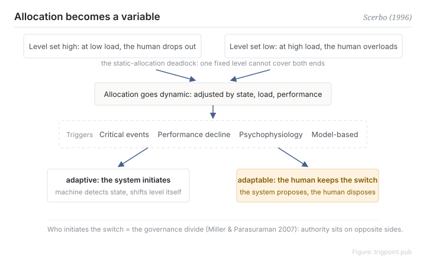

Canonical: https://trigpoint.pub/collections/hai/adaptive-automation  
Captured: 2026-10-05T03:32:07.518698+08:00

> Public theory reading mirror. Verification and Lab case sections remain on the website.

Fix the division of labour at design time, or let it shift while the system runs?

# Adaptive automation

adaptive automation · Scerbo (1996)

Bibliography checked ✓  
Lab case ✓  
Human-automation interaction · function allocation

## In three sentences

The division of labour does not have to be fixed at design time. It can move up and down during operation with load, state and performance. That is adaptive automation: the machine takes over when load peaks and hands back when it drops. The real governance question is who decides to shift, the system or the person.

<strong>Figure 1</strong> · Triggers and authority in adaptive automation. A static allocation cannot cover both risks at once; once allocation becomes a run-time variable, the real governance line is who initiates the switch. Adaptive is system-initiated, adaptable keeps the switch in human hands (Miller and Parasuraman 2007).

## 1. What happened

Static levels have a deadlock. Set the level high and the operator is out of the loop when load is low; set it low and the operator is overloaded when load is high. One setting cannot cover both ends. In 1996 Scerbo consolidated the theoretical form: let the allocation vary over time[\[1\]](#reference-note-1). Triggers commonly discussed in the literature include critical events, performance degradation, psychophysiological measures and model-based estimates.

Kaber and Endsley later showed empirically that the level itself remains the main driver of performance, while adaptive switching mainly affected subjective workload and secondary task performance, with little effect on primary task performance or situation awareness. The study switched on a predefined schedule, not on the operator's state in the moment[\[2\]](#reference-note-2). The two lines act on different things. Miller and Parasuraman then drew the critical line: adaptive means the system initiates the switch, adaptable means the person keeps that authority, and the two have opposite power structures[\[3\]](#reference-note-3).

<strong>Attribution where due:</strong>The concept of adaptive automation predates Scerbo, for instance in Rouse's adaptive aiding. Scerbo (1996) consolidated and formalised the theory rather than coining the phrase. Miller and Parasuraman (2007) is the most frequently cited source for using the adaptive against adaptable distinction in delegation design; the distinction appears in earlier literature (for example Oppermann 1994), and authors define adaptive differently, so say which sense you use.

## 2. Why this matters to you

"Let the system decide when to take over" sounds like the most intelligent option, and it also means handing over the switch. For a one-person studio that line is the core of governance: the automated surface can have schedules, triggers and recommendations, but who presses the switch decides where responsibility and awareness sit when something goes wrong. Wherever the judgement needs human input, the switch should not stay with the system.

Boundary: adaptive means the system initiates the switch and adaptable keeps that authority with the person, and the two are not interchangeable; moving does not automatically beat staying still, since in the evidence adaptive switching mainly shifted subjective workload rather than primary task performance or situation awareness; the canonical definitions are not quoted on this page.

## Corrections

- 2026-09-27 · The page said that Kaber and Endsley 2004 showed the effect of adaptive switching varying with the switching cycle, and that badly timed switching adds coordination cost. Against Table 3 and the conclusion of the full text: the switching cycle had no significant main effect on any of the three levels of situation awareness, and adaptive switching mainly affected subjective workload and secondary task performance, with little effect on primary task performance or situation awareness; nothing in the paper supports the coordination cost sentence. The result sentence was rewritten, the coordination cost sentence removed, and a note added that the study switched on a predefined schedule.

## References

<strong>How to read the source notes</strong> “Bibliographic details checked” means author, year, title and venue were confirmed. It does not mean the source's claims were checked. “Matched against the full text” means the claim was compared with the text of the source itself. “Follows secondary accounts” means the claim rests on sources that report it, not on the original document. Definitions as of 2026-09-20.

- \[1\] Scerbo, M. W. (1996). Theoretical Perspectives on Adaptive Automation. In R. Parasuraman & M. Mouloua (Eds.), Automation and Human Performance: Theory and Applications (pp. 37–63). Mahwah, NJ: Lawrence Erlbaum Associates. https://doi.org/10.1201/9781315137957
- \[2\] Kaber, D. B., & Endsley, M. R. (2004). The Effects of Level of Automation and Adaptive Automation on Human Performance, Situation Awareness and Workload in a Dynamic Control Task. Theoretical Issues in Ergonomics Science, 5(2), 113–153. https://doi.org/10.1080/1463922021000054335
- \[3\] Miller, C. A., & Parasuraman, R. (2007). Designing for Flexible Interaction Between Humans and Automation: Delegation Interfaces for Supervisory Control. Human Factors, 49(1), 57–75. https://doi.org/10.1518/001872007779598037

## Knowledge graph

- [<em>Compare ▸</em>Levels of automation](levels-of-automation.md)
- [<em>Applied in ▸</em>Out-of-the-loop performance problem](out-of-the-loop.md)

Cite as: Trigpoint, “Adaptive automation”, trigpoint.pub/collections/hai/adaptive-automation · © Strategitect Limited. · Content last revised 2026-09-28

## Source notes

**[1]** Scerbo, M. W. (1996). Theoretical Perspectives on Adaptive Automation. In Parasuraman & Mouloua (Eds.), Automation and Human Performance: Theory and Applications (pp. 37–63). Erlbaum. Bibliographic details cross-checked against multiple sources. The summary of the core claims follows secondary accounts that agree with one another.

**[2]** Kaber, D. B., & Endsley, M. R. (2004). The Effects of Level of Automation and Adaptive Automation on Human Performance, Situation Awareness and Workload in a Dynamic Control Task. Theoretical Issues in Ergonomics Science, 5(2), 113–153. Claims matched against the full text.

**[3]** Miller, C. A., & Parasuraman, R. (2007). Designing for Flexible Interaction Between Humans and Automation. Human Factors, 49(1), 57–75. Bibliographic details confirmed by two sources. The distinction between adaptive and adaptable automation follows secondary accounts that agree with one another.

---

[繁體中文](../../../zh-Hant/collections/hai/adaptive-automation.md) · [简体中文](../../../zh-Hans/collections/hai/adaptive-automation.md)

[Index](../../README.md) · [Original page](https://trigpoint.pub/collections/hai/adaptive-automation) · [Citation and versions](../../../READING.md)

[Original SVG](assets/adaptive-automation.svg) · Display copy adds a white background only.
