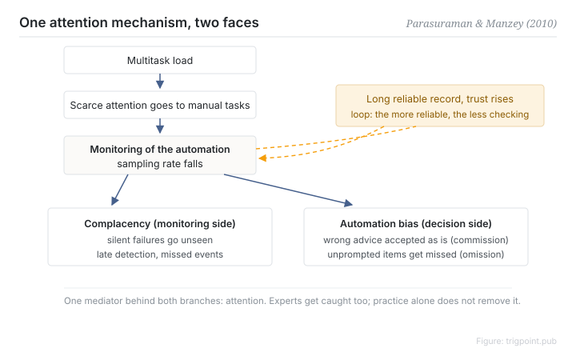

Canonical: https://trigpoint.pub/collections/hai/automation-complacency  
Captured: 2026-10-05T03:32:07.519699+08:00

> Public theory reading mirror. Verification and Lab case sections remain on the website.

Missing things while monitoring, deferring while deciding: two effects, one attention mechanism.

# Automation complacency and bias

automation complacency & bias · Parasuraman & Manzey (2010)

Abstracts checked ✓  
Lab case ✓  
Human-automation interaction · trust and reliance

## In three sentences

Complacency and bias are two faces of one attentional mechanism. Attention withdraws from the automation's output: on the monitoring side silent failures go unseen (complacency), on the decision side the system's recommendation is accepted without challenge (bias). It comes from how attention is allocated under multitask load, and long practice does not remove it.

<strong>Figure 1</strong> · The shared attentional mechanism behind complacency and bias. Multitask load makes attention scarce, the sampling rate for monitoring the automation falls, silent failures go unseen on the monitoring side (complacency) and prompts are followed uncritically on the decision side (bias). The more reliable the system, the higher the trust and the faster the sampling rate falls, which closes a self-reinforcing loop. The original paper also draws a negative feedback (experience of automation failure lowers complacency potential), which this figure leaves out. Redrawn from the integration model in Parasuraman and Manzey (2010).

## 1. What happened

One failure sits on the monitoring side and the other on the decision side, so they look unrelated. In 2010 Parasuraman and Manzey reviewed years of empirical work and integrated two phenomena that had been discussed separately into a single model[\[1\]](#reference-note-1).

The chain runs like this. Multitask load makes attention scarce, people allocate it to the task that needs their hands, and the sampling rate for monitoring the automation drops.

The complacency branch: silent failures go unseen and detection is delayed. The bias branch: the system's prompt becomes a heuristic that replaces the person's own information search, so wrong recommendations are accepted (commission) and missing ones are overlooked (omission).

The more reliable the system, the higher the trust and the harder the sampling rate falls, which closes a self-reinforcing loop. The paper infers a second loop running the other way: having experienced an automation failure, trust and complacency potential fall back. Novices and experts are both affected, and extended practice does not eliminate the effect; the paper suggests that variable-priority training, and first-hand experience of automation failure, may reduce it.

<strong>Attribution where due:</strong>The definition of "automation bias" used in the paper comes from Mosier and Skitka (1996); the contribution of Parasuraman and Manzey is the attentional integration model of 2010. The term complacency appears earlier, as a coding item in the NASA Aviation Safety Reporting System (Billings et al., 1976), and Wiener (1981) discussed its definition; Parasuraman and Riley (1997) is the reference for the frame of automation misuse. Keep the three coordinates apart and the citation comes out right.

## 2. Why this matters to you

The more consistently good the automation's output, the less often you check it, and that curve holds for you as well. The effective interventions sit mainly in the design layer: a mandatory verification step, a sampling mechanism, a varying check rhythm, or keeping the critical decision in human hands. Trying to beat an attentional structure by reminding yourself to stay alert is a fight with poor odds.

Boundary: bias refers specifically to commission and omission errors under imperfect decision aids and is not general over-trust; the mechanism here is checked mainly against the abstract, with four points checked against the full text, so a design that needs exact parameters cannot rest on this page.

## References

<strong>How to read the source notes</strong> “Bibliographic details checked” means author, year, title and venue were confirmed. It does not mean the source's claims were checked. “Consistent with the abstract” means the claim agrees with the paper's abstract. It does not include sentence-by-sentence checking against the full text. Definitions as of 2026-09-20.

- \[1\] Parasuraman, R., & Manzey, D. H. (2010). Complacency and Bias in Human Use of Automation: An Attentional Integration. Human Factors: The Journal of the Human Factors and Ergonomics Society, 52(3), 381–410. https://doi.org/10.1177/0018720810376055
- \[2\] Mosier, K. L., & Skitka, L. J. (1996). Human Decision Makers and Automated Decision Aids: Made for Each Other? In R. Parasuraman & M. Mouloua (Eds.), Automation and Human Performance: Theory and Applications (pp. 201–220). Mahwah, NJ: Lawrence Erlbaum Associates. https://doi.org/10.1201/9781315137957
- \[3\] Parasuraman, R., & Riley, V. (1997). Humans and Automation: Use, Misuse, Disuse, Abuse. Human Factors, 39(2), 230–253. https://doi.org/10.1518/001872097778543886
- \[4\] Billings, C. E., Lauber, J. K., Funkhouser, H., Lyman, G., & Huff, E. M. (1976). Aviation Safety Reporting System (Technical Report TM-X-3445). Moffett Field, CA: NASA Ames Research Center. https://ntrs.nasa.gov/citations/19760026757 (as cited in Parasuraman & Manzey, 2010)
- \[5\] Wiener, E. L. (1981). Complacency: Is the term useful for air safety? In Proceedings of the 26th Corporate Aviation Safety Seminar (pp. 116–125). (as cited in Parasuraman & Manzey, 2010)

## Knowledge graph

- [<em>Prerequisite ▸</em>Vigilance decrement](vigilance-decrement.md)

Cite as: Trigpoint, “Automation complacency and bias”, trigpoint.pub/collections/hai/automation-complacency · © Strategitect Limited. · Content last revised 2026-09-28

## Source notes

**[1]** Parasuraman, R., & Manzey, D. H. (2010). Complacency and Bias in Human Use of Automation: An Attentional Integration. Human Factors, 52(3), 381–410. Bibliographic details checked against the official record. Consistent with the abstract.

---

[繁體中文](../../../zh-Hant/collections/hai/automation-complacency.md) · [简体中文](../../../zh-Hans/collections/hai/automation-complacency.md)

[Index](../../README.md) · [Original page](https://trigpoint.pub/collections/hai/automation-complacency) · [Citation and versions](../../../READING.md)

[Original SVG](assets/automation-complacency.svg) · Display copy adds a white background only.
