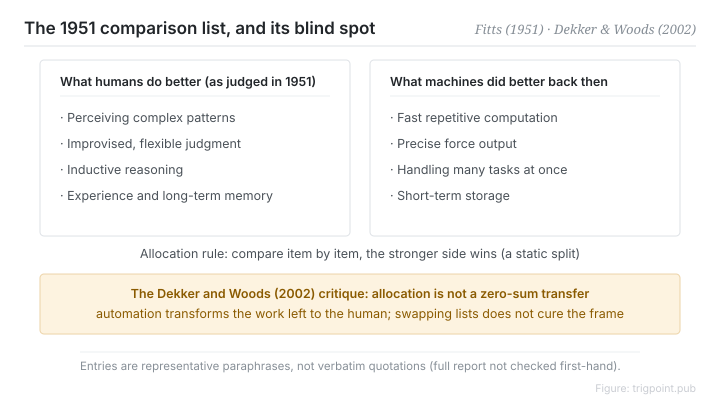

Canonical: https://trigpoint.pub/collections/hai/fitts-list  
Captured: 2026-10-05T03:32:07.519699+08:00

> Public theory reading mirror. Verification and Lab case sections remain on the website.

“Hand the task to the AI and that is one job off my plate”: not necessarily.

# Function allocation

Fitts list (MABA-MABA) · Fitts (1951)

Bibliography checked ✓  
Human-automation interaction · function allocation

## In three sentences

The 1951 Fitts list splits system functions into "humans are better at" and "machines are better at", which later readers took to mean assigning each function to whichever side is stronger. It is where the study of human-machine division of labour begins. Its fatal assumption is that humans and machines are interchangeable containers, so allocating work means moving it across a line. Half a century later that assumption was refuted directly. Automation changes the character of the work it leaves behind.

<strong>Figure 1</strong> · Structure of the 1951 comparison list. Entries are representative paraphrase; the primary full text was not checked, so the list is not reproduced item by item. Below it, the Dekker and Woods (2002) critique: allocation is not a zero-sum transfer, and automation changes the character of the work that remains.

## 1. What happened

On the face of it, dividing work means handing each task to whichever side does it better. In 1951 a National Research Council report edited by Fitts gave the designers of air navigation and traffic control systems a comparison list. Humans were better at perceiving patterns, improvising judgement, and adapting to the unexpected; the machines of that decade were better at high-speed repetition, precise force, and running several channels at once[\[1\]](#reference-note-1). Later readers took this as a direct design rule: compare item by item, and the stronger side takes the function. The 1951 report itself is more guarded and says it cannot foresee what machines will be built to do.

Half a century later Dekker and Woods identified the problem underneath. The framework assumes allocation is a zero-sum transfer, moving a task from the human column into the machine column and leaving the rest as it was[\[2\]](#reference-note-2). The real effect of automation is qualitative. It reshapes the work that remains and forces people to rebuild their skills and routines. An outdated list can be replaced. The defect in the frame cannot.

<strong>Attribution where due:</strong>Fitts (1951) is a prose list and uses no acronym. "MABA-MABA" (Men Are Better At) is a label attached by later writers, and "HABA-MABA" is a still later gender-neutral rewrite. Neither belongs to Fitts himself. The substitution-myth critique of the Fitts list belongs to Dekker and Woods (2002); the term itself is often traced to Sarter, Woods and Billings (1997); this page has not verified where it first appeared.

## 2. Why this matters to you

Every "these go to the AI, those stay with us" list repeats Fitts's assumption. Hand data cleanup to an agent and the remainder is a different job: checking data that something else cleaned. The question a delegation design has to answer is not "which of these does it do better than me". It is "once I hand this over, what has my own work become". The list only starts being useful after you can answer the second question.

Boundary: the entries age, but what actually fails is the interchangeable-container assumption; the eleven-statement structure has not been quote-verified, so do not build a method on its exact wording.

## References

<strong>How to read the source notes</strong> “Bibliographic details checked” means author, year, title and venue were confirmed. It does not mean the source's claims were checked. “Follows secondary accounts” means the claim rests on sources that report it, not on the original document. Definitions as of 2026-09-20.

- \[1\] Fitts, P. M. (Ed.) (1951). Human Engineering for an Effective Air-Navigation and Traffic-Control System. Washington, DC: National Research Council, Committee on Aviation Psychology.
- \[2\] Dekker, S. W. A., & Woods, D. D. (2002). MABA-MABA or Abracadabra? Progress on Human-Automation Co-ordination. Cognition, Technology & Work, 4(4), 240–244. https://doi.org/10.1007/s101110200022

## Knowledge graph

- [<em>Compare ▸</em>Levels of automation](levels-of-automation.md)

Cite as: Trigpoint, “Function allocation”, trigpoint.pub/collections/hai/fitts-list · © Strategitect Limited. · Content last revised 2026-09-28

## Source notes

**[1]** Fitts, P. M. (Ed.) (1951). Human Engineering for an Effective Air-Navigation and Traffic-Control System. Washington, DC: National Research Council. Bibliographic details cross-checked against multiple sources. The content of the list follows secondary accounts that agree with one another.

**[2]** Dekker, S. W. A., & Woods, D. D. (2002). MABA-MABA or Abracadabra? Progress on Human-Automation Co-ordination. Cognition, Technology & Work, 4(4), 240–244. Bibliographic details confirmed by two sources. The summary of the core claims follows secondary accounts that agree with one another.

---

[繁體中文](../../../zh-Hant/collections/hai/fitts-list.md) · [简体中文](../../../zh-Hans/collections/hai/fitts-list.md)

[Index](../../README.md) · [Original page](https://trigpoint.pub/collections/hai/fitts-list) · [Citation and versions](../../../READING.md)

[Original SVG](assets/fitts-list.svg) · Display copy adds a white background only.
