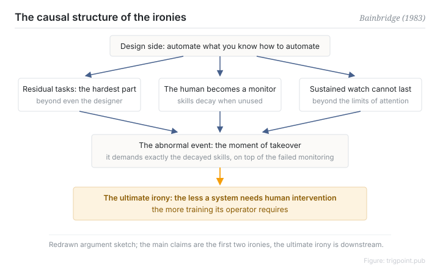

Canonical: https://trigpoint.pub/collections/hai/ironies-of-automation  
Captured: 2026-10-05T03:32:07.520702+08:00

> Public theory reading mirror. Verification and Lab case sections remain on the website.

Design the human out, and the hardest leftover work still lands on the human.

# Ironies of automation

ironies of automation · Bainbridge (1983)

Checked against the sources ✓  
Human-automation interaction · founding paradox

## In three sentences

Automation set out to replace an unreliable human and ended up handing the hardest, most critical residual work to a human whose skills are decaying. The more successful the automation, the harder the human's role becomes.

<strong>Figure 1</strong> · The causal structure of the ironies. Designers automate the part they can see how to automate; the residual problems, the decayed skills, and the monitoring that was never humanly possible all land on the moment of takeover. Redrawn from the structure of Bainbridge's argument (1983).

## 1. What happened

The obvious way to make a system more reliable is to take people out of it. In 1983 Bainbridge, a psychologist at UCL, used five pages to take apart the central assumption of automation design[\[1\]](#reference-note-1). Designers treat the operator as unreliable and try to design the human out, and she finds two ironies in that attitude. First, designer errors can themselves be a major source of operating problems. Second, a designer can only automate the parts they can see how to automate. What is left over is exactly the set of problems the designer could not solve, and all of it falls back on the operator.

At the same time the human is demoted to monitor. Hands-off for long stretches, manual skill decays. Sustained monitoring is itself beyond human attention, so even noticing that a takeover is needed becomes unreliable. When something finally goes wrong, the system needs the decayed skill and the failed monitoring at the same moment.

Discussing training, she adds one more irony, hedged as an inference: the most successful automated systems, needing manual intervention rarely, may be the ones that need the greatest investment in operator training.

<strong>Attribution where due:</strong>"Ironies of Automation" was named and argued through by one person, Bainbridge (1983), so attribution here is unusually clean. The claim that sustained monitoring fails after about half an hour cites Mackworth's 1950 research report; the vigilance-decrement node cites his 1948 experimental paper. The years differ because the two pages cite different publications. The main argument is the pair of ironies at the opening; "the most successful systems may need the most training" is a hedged inference from the discussion of training. Do not invert the two when citing.

## 2. Why this matters to you

Hand work to an AI agent and your role does not disappear. It changes shape: from doing the work to handling its exceptions. Handling exceptions is precisely what requires you to keep a feel for the work. So the question a delegation design has to answer is not "can this step be automated". It is "after it is automated, can a human still do what is left".

Keeping a channel where you periodically do the work by hand is not inefficiency. It is the cost of retaining the ability to take over. The more smoothly the automation runs, the more that channel is worth.

Boundary: this is a causal argument with no answer to which level to pick; the half-hour figure is an order of magnitude to reason with.

## References

<strong>How to read the source notes</strong> “Bibliographic details checked” means author, year, title and venue were confirmed. It does not mean the source's claims were checked. “Matched against the full text” means the claim was compared with the text of the source itself. “Cited as reported in” means the original was not read here; the citation is taken from the source named. Definitions as of 2026-09-20.

- \[1\] Bainbridge, L. (1983). Ironies of Automation. Automatica, 19(6), 775–779. https://doi.org/10.1016/0005-1098(83)90046-8
- \[2\] Mackworth, N. H. (1950). Researches on the Measurement of Human Performance. Cited as reported in Bainbridge (1983).

Cite as: Trigpoint, “Ironies of automation”, trigpoint.pub/collections/hai/ironies-of-automation · © Strategitect Limited. · Content last revised 2026-09-28

## Source notes

**[1]** Bainbridge, L. (1983). Ironies of Automation. Automatica, 19(6), 775–779. Bibliographic details cross-checked against multiple sources. Claims matched against the full text.

---

[繁體中文](../../../zh-Hant/collections/hai/ironies-of-automation.md) · [简体中文](../../../zh-Hans/collections/hai/ironies-of-automation.md)

[Index](../../README.md) · [Original page](https://trigpoint.pub/collections/hai/ironies-of-automation) · [Citation and versions](../../../READING.md)

[Original SVG](assets/ironies-of-automation.svg) · Display copy adds a white background only.
