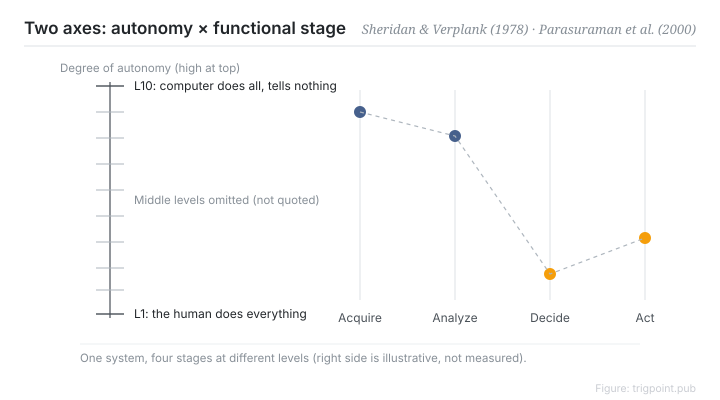

Canonical: https://trigpoint.pub/collections/hai/levels-of-automation  
Captured: 2026-10-05T03:32:08.397187+08:00

> Public theory reading mirror. Verification and Lab case sections remain on the website.

“Automation is either on or off”: it is not that simple.

# Levels of automation

levels of automation · Sheridan & Verplank (1978) · Parasuraman, Sheridan & Wickens (2000)

Bibliography checked ✓  
Lab case ✓  
Human-automation interaction · function allocation

## In three sentences

Level of automation is a continuous scale, running from the human doing everything to the computer doing everything and not telling the human. The scale is also set stage by stage: information acquisition, information analysis, decision selection, and action execution can each sit at a different point. The idea that automation is a single switch is where most automation design errors begin.

<strong>Figure 1</strong> · The two-axis model, redrawn: a ten-point scale (Sheridan and Verplank 1978) crossed with four stages (Parasuraman, Sheridan and Wickens 2000). Intermediate level labels are omitted; the location of the table in the 1978 report was never verified against the primary source, so the levels are not reproduced verbatim. The settings on the right are illustrative, not measured.

## 1. What happened

Treating automation as a switch misses one thing: different stages of the same system can sit at different levels. In 1978 Sheridan and Verplank proposed a ten-point scale of autonomy in a research report on undersea teleoperation, running from level one, where the human does everything, to level ten, where the computer acts and does not inform the human[\[1\]](#reference-note-1).

In 2000 Parasuraman, Sheridan and Wickens added a second axis: automation acts on four classes of information processing (acquisition, analysis, decision, action), and each class can be set independently[\[2\]](#reference-note-2).

There is evidence on the cost side too. Endsley and Kaber (1999) had 30 participants work a dynamic control task at different levels of automation. Performance gains came mainly from automating the implementation stage, and only under normal operation. Once the human was removed from implementation, recovery after an automation failure suffered. When human and computer generated options together, performance fell below either one alone. Automating the decision stage, meaning the choice among options, brought lower workload and higher situation awareness, with only a slight gain in performance[\[3\]](#reference-note-3). So "how automated should this be" is a stage-by-stage trade-off, not a case of higher being better.

<strong>Attribution where due:</strong>The ten-point scale comes from the 1978 report by Sheridan and Verplank and is sometimes cited as Sheridan 1992. Get the year right. The four-stage skeleton descends from the human information processing tradition, with Wickens as its representative figure and a co-author of the 2000 paper, so it was not invented there. What Parasuraman, Sheridan and Wickens contributed is the integration of the two axes.

## 2. Why this matters to you

The most useful move when granting authority to an AI agent is to split the work into the four stages and ask about each one. Can gathering be fully automated? Can analysis? What about the decision? What about execution? For most situations the answers differ: gathering and analysis can sit high on the scale, while decisions and irreversible actions stay low. A blanket "trust the AI" or "do not trust the AI" gives you nothing to act on inside this framework.

Boundary: moving up the scale is a trade. In the same experiment, implementation-stage automation raised performance under normal operation but left recovery from failure worse, and joint option generation lowered performance. The ten-point scale was written for 1978 undersea teleoperation, so confirm your setting is comparable before reusing it.

## References

<strong>How to read the source notes</strong> “Bibliographic details checked” means author, year, title and venue were confirmed. It does not mean the source's claims were checked. Definitions as of 2026-09-20.

- \[1\] Sheridan, T. B., & Verplank, W. L. (1978). Human and Computer Control of Undersea Teleoperators. Cambridge, MA: MIT Man-Machine Systems Laboratory. https://doi.org/10.21236/ADA057655
- \[2\] Parasuraman, R., Sheridan, T. B., & Wickens, C. D. (2000). A Model for Types and Levels of Human Interaction with Automation. IEEE Transactions on Systems, Man, and Cybernetics, Part A, 30(3), 286–297. https://doi.org/10.1109/3468.844354
- \[3\] Endsley, M. R., & Kaber, D. B. (1999). Level of automation effects on performance, situation awareness and workload in a dynamic control task. Ergonomics, 42(3), 462–492. https://doi.org/10.1080/001401399185595

## Knowledge graph

- [<em>Compare ▸</em>Function allocation](fitts-list.md)
- [<em>Compare ▸</em>Adaptive automation](adaptive-automation.md)
- [<em>Downstream ▸</em>Out-of-the-loop performance problem](out-of-the-loop.md)
- [<em>Applied by ▸</em>Mental workload (NASA-TLX)](mental-workload-nasa-tlx.md)

Cite as: Trigpoint, “Levels of automation”, trigpoint.pub/collections/hai/levels-of-automation · © Strategitect Limited. · Content last revised 2026-09-28

## Source notes

**[1]** Sheridan, T. B., & Verplank, W. L. (1978). Human and Computer Control of Undersea Teleoperators. MIT Man-Machine Systems Laboratory. Bibliographic details checked against the official record. Provenance double-checked across models. This page does not quote the original wording level by level.

**[2]** Parasuraman, R., Sheridan, T. B., & Wickens, C. D. (2000). A Model for Types and Levels of Human Interaction with Automation. IEEE Transactions on Systems, Man, and Cybernetics, Part A, 30(3), 286–297. Bibliographic details checked against the official record. Provenance double-checked across models.

**[3]** Endsley, M. R., & Kaber, D. B. (1999). Level of automation effects on performance, situation awareness and workload in a dynamic control task. Ergonomics, 42(3), 462–492. Bibliographic details checked against the official record. Provenance double-checked across models. The sentences reporting experimental results follow the paper's abstract.

---

[繁體中文](../../../zh-Hant/collections/hai/levels-of-automation.md) · [简体中文](../../../zh-Hans/collections/hai/levels-of-automation.md)

[Index](../../README.md) · [Original page](https://trigpoint.pub/collections/hai/levels-of-automation) · [Citation and versions](../../../READING.md)

[Original SVG](assets/levels-of-automation.svg) · Display copy adds a white background only.
