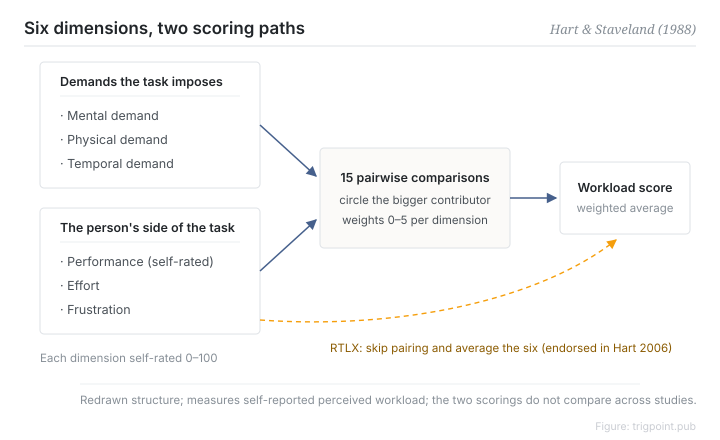

Canonical: https://trigpoint.pub/collections/hai/mental-workload-nasa-tlx  
Captured: 2026-10-05T03:32:08.402201+08:00

> Public theory reading mirror. Verification and Lab case sections remain on the website.

Workload cannot be seen, so people rate their own, yet one overall score hides where the load comes from.

# Mental workload (NASA-TLX)

mental workload (NASA-TLX) · Hart & Staveland (1988)

Bibliography checked ✓  
Lab case ✓  
Human-automation interaction · workload measurement

## In three sentences

NASA-TLX takes mental workload, which cannot be measured directly, and breaks it into six ratable dimensions: mental demand, physical demand, temporal demand, own performance, effort, and frustration. Respondents then set the weights themselves through pairwise comparison, and the scores are combined into a weighted mean. What it measures is perceived workload. It is a self-report instrument and not an objective reading, and using it well starts with admitting that.

<strong>Figure 1</strong> · Structure of the NASA-TLX. Six dimensions in two groups: the demands the task imposes (mental, physical, temporal) and the interaction between the person and the task (own performance, effort, frustration). The original design fixes weights through fifteen pairwise comparisons and then takes a weighted mean; later practice commonly simplifies this to a plain average (RTLX). The six names were checked verbatim against the official NASA manual.

## 1. What happened

To measure something no one can see, you have to ask the person living through it. In 1988 Hart and Staveland at NASA Ames gathered three years of research, more than forty experiments according to the official NASA manual, into a single scale[\[1\]](#reference-note-1). The starting point was that a single overall score is too coarse: it hides where the load comes from, and it varies widely between people.

Their answer was to rate six dimensions from 0 to 100 each, then have the respondent set the weights through fifteen pairwise comparisons, choosing in each pair which dimension contributed more to the load for that particular task. Take the weighted mean and you have a workload score. Twenty years later Hart reviewed five hundred and fifty studies that had used or reviewed it. The most common modification was to drop the pairing and simply average the six, the Raw TLX; among the comparison studies he reviewed, the sensitivity results were mixed, and his view was that you can take your pick[\[2\]](#reference-note-2).

<strong>Attribution where due:</strong>Hart and Staveland (1988) originated the instrument: the six-dimension structure and the pairwise weighting procedure both come from that chapter. The construct of mental workload is older and does not belong to them. RTLX is a later simplification from practice, which Hart (2006) acknowledged in his review. Say which version you used.

## 2. Why this matters to you

Managing your own load or a team's starts with the structural lesson in TLX: workload is multidimensional and a single total will mislead you. Time pressure at the ceiling and frustration at the ceiling are entirely different problems, and folding them into one "tired" score leaves you nothing to treat. The second lesson is about honesty. Any self-reported workload is a subjective measurement and can come apart from objective output, so you need to watch both. Reporting a score without stating how it was computed, weighted or plain average, is a gap in the method.

Boundary: the score is a retrospective self-report, not an objective load measurement, and it says nothing about situation awareness; the weighted and plain-average versions are not directly comparable across studies; the 1988 chapter itself was not checked.

## References

<strong>How to read the source notes</strong> “Bibliographic details checked” means author, year, title and venue were confirmed. It does not mean the source's claims were checked. “Matched against the full text” means the claim was compared with the text of the source itself. Definitions as of 2026-09-20.

- \[1\] Hart, S. G., & Staveland, L. E. (1988). Development of NASA-TLX (Task Load Index): Results of Empirical and Theoretical Research. In P. A. Hancock & N. Meshkati (Eds.), Human Mental Workload (pp. 139–183). Amsterdam: North-Holland. https://doi.org/10.1016/S0166-4115(08)62386-9
- \[2\] Hart, S. G. (2006). NASA-Task Load Index (NASA-TLX); 20 Years Later. Proceedings of the Human Factors and Ergonomics Society Annual Meeting, 50(9), 904–908. https://doi.org/10.1177/154193120605000909

## Knowledge graph

- [<em>Applied in ▸</em>Levels of automation](levels-of-automation.md)
- [<em>Compare ▸</em>Situation awareness](situation-awareness.md)

Cite as: Trigpoint, “Mental workload (NASA-TLX)”, trigpoint.pub/collections/hai/mental-workload-nasa-tlx · © Strategitect Limited. · Content last revised 2026-09-28

## Source notes

**[1]** Hart, S. G., & Staveland, L. E. (1988). Development of NASA-TLX (Task Load Index): Results of Empirical and Theoretical Research. In Hancock & Meshkati (Eds.), Human Mental Workload (pp. 139–183). North-Holland. Bibliographic details cross-checked against multiple sources. Checked against the official manual.

**[2]** Hart, S. G. (2006). NASA-Task Load Index (NASA-TLX); 20 Years Later. Proceedings of the Human Factors and Ergonomics Society Annual Meeting, 50(9), 904–908. Bibliographic details cross-checked against multiple sources.

---

[繁體中文](../../../zh-Hant/collections/hai/mental-workload-nasa-tlx.md) · [简体中文](../../../zh-Hans/collections/hai/mental-workload-nasa-tlx.md)

[Index](../../README.md) · [Original page](https://trigpoint.pub/collections/hai/mental-workload-nasa-tlx) · [Citation and versions](../../../READING.md)

[Original SVG](assets/mental-workload-nasa-tlx.svg) · Display copy adds a white background only.
