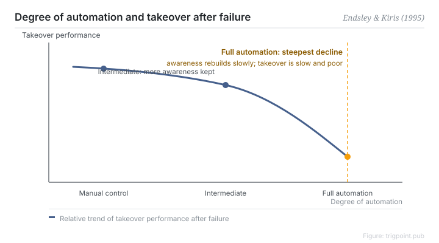

Canonical: https://trigpoint.pub/collections/hai/out-of-the-loop  
Captured: 2026-10-05T03:32:08.418654+08:00

> Public theory reading mirror. Verification and Lab case sections remain on the website.

When the automation failed during the navigation task, the fully automated group took over worst.

# Out-of-the-loop performance problem

out-of-the-loop performance problem · Endsley & Kiris (1995)

Abstracts checked ✓  
Human-automation interaction · situation awareness

## In three sentences

Automation turns the operator into a bystander, and situation awareness and hands-on feel drain away together. While everything is running normally the loss is invisible and costs nothing. Then the system fails and someone has to take over: comprehension has dropped and decisions after the failure come slower. That is the out-of-the-loop performance problem.

<strong>Figure 1</strong> · Relative takeover performance after a failure, against level of automation. In the Endsley and Kiris experiment the fully automated group degraded most, while intermediate levels retained more awareness and more ability to take over. The trend is redrawn; the primary data were not checked, so only relative shape is shown, without values.

## 1. What happened

While automation runs normally, the person beside it only has to watch; when it fails, they have to take over at once. In 1995 Endsley and Kiris pinned the problem down with a controlled experiment. One navigation decision task, level of control manipulated across five settings, then the automation was failed and takeover performance measured[\[1\]](#reference-note-1). The fully automated group degraded most on takeover, while the intermediate levels retained more awareness and more ability to resume control.

The mechanism matters more than the result. According to Endsley's 1996 book chapter on the experiment, the display information did not change between groups, and vigilance and monitoring effects were not enough to explain the drop in awareness. The authors take the most likely cause to be the shift from active processing to passive reception itself. Turning a doer into an observer lowers awareness on its own.

<strong>Attribution where due:</strong>That detection of failures slows once a person leaves the control loop belongs to the concept's definition and prehistory. Endsley's 1996 chapter lists Young (1969), Wickens and Kessel (1979), Ephrath and Young (1981), and Kessel and Wickens (1982) as earlier related studies. None was checked individually here, and the direction of their results varies with task complexity. What Endsley and Kiris (1995) contributed is the naming and formalisation, together with a controlled experiment using level of control as the variable. What that experiment measured was a drop in comprehension and slower decisions after failure; slower detection was not one of its measures.

## 2. Why this matters to you

"I can step in if anything goes wrong" is the most common piece of self-reassurance in an automated workflow. Stepping in presupposes that you still understand the situation, and understanding is exactly what full automation takes away. So a heavily automated line has two honest options: deliberately keep a human step in the decision loop, or accept that takeover will be slow and poor and budget for it. Doing neither bets the reliability of the system on someone who has already left the room.

Boundary: the conclusion is not "less automation is better" but whether the person stays in the active decision loop; this page reaches the 1995 article only at conclusion grade, so anyone needing the original wording or page numbers must obtain the full text.

## References

<strong>How to read the source notes</strong> “Bibliographic details checked” means author, year, title and venue were confirmed. It does not mean the source's claims were checked. “Consistent with the abstract” means the claim agrees with the paper's abstract. It does not include sentence-by-sentence checking against the full text. Definitions as of 2026-09-20.

- \[1\] Endsley, M. R., & Kiris, E. O. (1995). The Out-of-the-Loop Performance Problem and Level of Control in Automation. Human Factors: The Journal of the Human Factors and Ergonomics Society, 37(2), 381–394. https://doi.org/10.1518/001872095779064555
- \[2\] Endsley, M. R. (1996). Automation and Situation Awareness. In R. Parasuraman & M. Mouloua (Eds.), Automation and Human Performance: Theory and Applications (pp. 163–181). Mahwah, NJ: Lawrence Erlbaum Associates. https://doi.org/10.1201/9781315137957

## Knowledge graph

- [<em>Prerequisite ▸</em>Situation awareness](situation-awareness.md)
- [<em>Prerequisite ▸</em>Levels of automation](levels-of-automation.md)
- [<em>Applied by ▸</em>Adaptive automation](adaptive-automation.md)

Cite as: Trigpoint, “Out-of-the-loop performance problem”, trigpoint.pub/collections/hai/out-of-the-loop · © Strategitect Limited. · Content last revised 2026-09-28

## Source notes

**[1]** Endsley, M. R., & Kiris, E. O. (1995). The Out-of-the-Loop Performance Problem and Level of Control in Automation. Human Factors, 37(2), 381–394. Bibliographic details cross-checked against multiple sources. Consistent with the abstract. The core conclusion is corroborated against the full text of the same author's 1996 book chapter.

---

[繁體中文](../../../zh-Hant/collections/hai/out-of-the-loop.md) · [简体中文](../../../zh-Hans/collections/hai/out-of-the-loop.md)

[Index](../../README.md) · [Original page](https://trigpoint.pub/collections/hai/out-of-the-loop) · [Citation and versions](../../../READING.md)

[Original SVG](assets/out-of-the-loop.svg) · Display copy adds a white background only.
