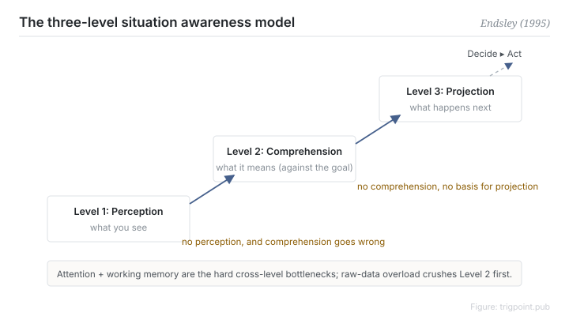

Canonical: https://trigpoint.pub/collections/hai/situation-awareness  
Captured: 2026-10-05T03:32:08.419654+08:00

> Public theory reading mirror. Verification and Lab case sections remain on the website.

Seeing the situation and deciding what to do are two abilities; the first is only the input to the second.

# Situation awareness

situation awareness · Endsley (1995)

Bibliography checked ✓  
Lab case ✓  
Human-automation interaction · situation awareness

## In three sentences

Situation awareness has three levels: perception (what is happening), comprehension (so what), and projection (what happens next). The levels ascend, and they are not strictly linear stages. It is the input to a decision, so when the picture is unclear, good judgement has nothing to work on.

<strong>Figure 1</strong> · The Endsley three-level model, redrawn. Perception, comprehension and projection are ascending levels of awareness, not strictly linear stages. Attention and working memory are the most visible bottleneck across all three for novices, and experts relieve it with mental models and pattern matching. Situation awareness is an input to decision making and is separate from the decision itself.

## 1. What happened

Knowing the situation is not the same as knowing what to do. Endsley took "knowing what is going on", which had been scattered through aviation human factors research, and formalised it into a workable three-level model. The definition of the three levels is usually traced to her 1988 work (by her own later account; this page has not read the 1988 original), and the 1995 paper extended it into a full theory covering attention, working memory, mental models and goal-driven processing[\[1\]](#reference-note-1). Level one, perception: detecting the state of the relevant elements in the environment. Level two, comprehension: integrating those elements into meaning relative to a goal. Level three, projection: predicting the near future on the basis of that understanding. The levels ascend, and higher means more complete awareness, but they are not strictly linear stages: a gap in perception makes errors in comprehension likely, yet goal-driven processing and mental models can still produce levels two and three when level one is incomplete. The whole structure is bounded by attention and working memory, most visibly for novices, while experts relieve the limit with mental models and pattern matching. That is why pouring in more raw information tends to crush level two rather than help it.

<strong>Attribution where due:</strong>The phrase "situation awareness" predates Endsley and had been used for decades in military aviation. What Endsley contributed is the formalisation of the three-level model (the 1995 paper is her full theory), turning a colloquial phrase into a construct that can be measured and designed for. Cite "the Endsley three-level model" rather than "Endsley proposed the concept".

## 2. Why this matters to you

When you are running several AI workstreams in parallel, the bottleneck is rarely a shortage of information. It is almost always that the picture will not assemble. A dashboard supplies the raw material for level one, but comprehension and projection have to be designed in: state shown against the goal, staleness marked explicitly, next step readable directly. Dumping every agent output in front of yourself uses the volume of level one to smother level two.

Boundary: awareness is the input to a decision, so it cannot be inferred from whether the decision turned out right; the three levels ascend, so a level-one detection rate does not establish awareness; the account here stops at textbook-level agreement and has not been checked against the primary source.

## References

<strong>How to read the source notes</strong> “Bibliographic details checked” means author, year, title and venue were confirmed. It does not mean the source's claims were checked. Definitions as of 2026-09-20.

- \[1\] Endsley, M. R. (1995). Toward a Theory of Situation Awareness in Dynamic Systems. Human Factors: The Journal of the Human Factors and Ergonomics Society, 37(1), 32–64. https://doi.org/10.1518/001872095779049543

## Knowledge graph

- [<em>Compare ▸</em>Mental workload (NASA-TLX)](mental-workload-nasa-tlx.md)
- [<em>Downstream ▸</em>Out-of-the-loop performance problem](out-of-the-loop.md)

Cite as: Trigpoint, “Situation awareness”, trigpoint.pub/collections/hai/situation-awareness · © Strategitect Limited. · Content last revised 2026-09-28

## Source notes

**[1]** Endsley, M. R. (1995). Toward a Theory of Situation Awareness in Dynamic Systems. Human Factors, 37(1), 32–64. Bibliographic details cross-checked against multiple sources.

---

[繁體中文](../../../zh-Hant/collections/hai/situation-awareness.md) · [简体中文](../../../zh-Hans/collections/hai/situation-awareness.md)

[Index](../../README.md) · [Original page](https://trigpoint.pub/collections/hai/situation-awareness) · [Citation and versions](../../../READING.md)

[Original SVG](assets/situation-awareness.svg) · Display copy adds a white background only.
