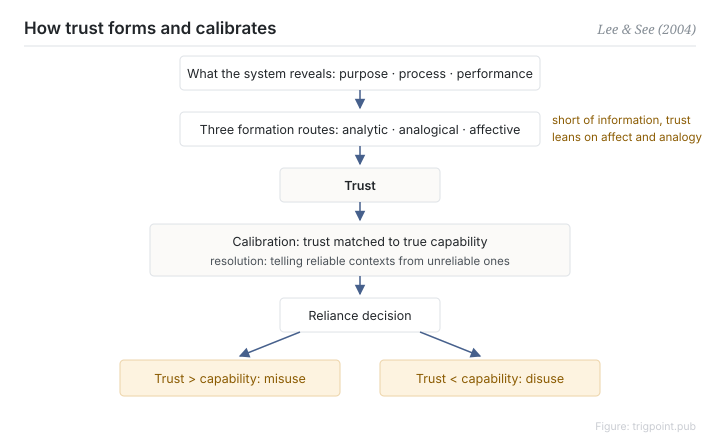

Canonical: https://trigpoint.pub/collections/hai/trust-in-automation  
Captured: 2026-10-05T03:32:09.406358+08:00

> Public theory reading mirror. Verification and Lab case sections remain on the website.

“The more they trust it, the better”: wrong.

# Trust in automation

trust in automation · Lee & See (2004)

Bibliography checked ✓  
Human-automation interaction · trust and reliance

## In three sentences

People decide whether to use automation on the basis of trust, and trust can be mismatched. Too much and they keep relying on a system that has stopped working; too little and a usable tool sits idle. The design goal was never to push trust higher. It is to calibrate trust against what the system can actually do.

<strong>Figure 1</strong> · How trust forms and how it is calibrated. Information the system exposes feeds three psychological routes that form trust; trust is then calibrated and resolved against actual capability, which determines reliance. Two mismatches sit at the extremes: too much trust is misuse, too little is disuse. Redrawn from the framework in Lee and See (2004).

## 1. What happened

When designing a human-machine system, it feels natural to want users to trust it a little more. In 2004 Lee and See pulled scattered work on trust together into the unifying framework for the field[\[1\]](#reference-note-1). Two of its central concepts for judging whether trust is appropriate are calibration, where the level of trust matches actual capability, and resolution, where trust can distinguish the situations in which the system is reliable from those in which it is not. Trust is fed by three kinds of information about the system, its purpose, its process, and its performance, and it forms through three psychological routes, analytic, analogical, and affective. What the interface exposes determines where trust goes. This page infers that when the information is unavailable, people are more likely to fall back on the affective and analogical shortcuts, and the risk of miscalibration rises with it.

<strong>Attribution where due:</strong>Lee and See (2004) act as synthesisers. Work on trust was scattered before this paper, and secondary sources credit the three information dimensions to earlier work, most often Lee and Moray (1992), with the exact origin unchecked. What the two of them contributed is the unified framework: calibration plus resolution, three information dimensions plus three psychological routes. Attribute the framework to them; the word "trust" needs no attribution.

## 2. Why this matters to you

"How do we make users trust the AI more" points in the wrong direction. The accidents caused by too much trust and the capacity wasted by too little are equally real. The question you can act on is this: in which situations is this system reliable, in which is it not, and can the user tell the difference? If they cannot, expose the process and the performance in the interface. Trust is something you calibrate. Trust you have talked up is just credulity.

Boundary: the goal is calibration and not elevation, and calibration has to resolve where the system is reliable and where it is not; trust is a dynamic state, not a trait; the framework here is confirmed at secondary-source grade only.

## References

<strong>How to read the source notes</strong> “Bibliographic details checked” means author, year, title and venue were confirmed. It does not mean the source's claims were checked. “Follows secondary accounts” means the claim rests on sources that report it, not on the original document. Definitions as of 2026-09-20.

- \[1\] Lee, J. D., & See, K. A. (2004). Trust in Automation: Designing for Appropriate Reliance. Human Factors: The Journal of the Human Factors and Ergonomics Society, 46(1), 50–80. https://doi.org/10.1518/hfes.46.1.50_30392

## Knowledge graph

- [<em>Compare ▸</em>Vigilance decrement](vigilance-decrement.md)

Cite as: Trigpoint, “Trust in automation”, trigpoint.pub/collections/hai/trust-in-automation · © Strategitect Limited. · Content last revised 2026-09-28

## Source notes

**[1]** Lee, J. D., & See, K. A. (2004). Trust in Automation: Designing for Appropriate Reliance. Human Factors, 46(1), 50–80. Bibliographic details cross-checked against multiple sources. The summary of the framework's core claims follows secondary accounts that agree with one another.

---

[繁體中文](../../../zh-Hant/collections/hai/trust-in-automation.md) · [简体中文](../../../zh-Hans/collections/hai/trust-in-automation.md)

[Index](../../README.md) · [Original page](https://trigpoint.pub/collections/hai/trust-in-automation) · [Citation and versions](../../../READING.md)

[Original SVG](assets/trust-in-automation.svg) · Display copy adds a white background only.
