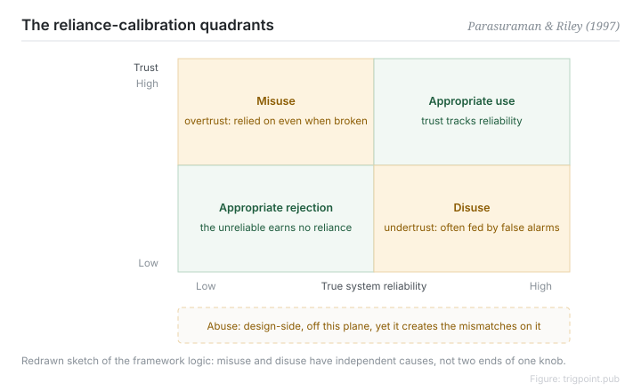

Canonical: https://trigpoint.pub/collections/hai/use-misuse-disuse-abuse  
Captured: 2026-10-05T03:32:09.409359+08:00

> Public theory reading mirror. Verification and Lab case sections remain on the website.

Over-reliance and refusal to use have independent causes.

# Use, misuse, disuse, abuse

use, misuse, disuse, abuse · Parasuraman & Riley (1997)

Bibliography checked ✓  
Lab case ✓  
Human-automation interaction · trust and reliance

## In three sentences

The relationship between people and automation splits into four categories: appropriate use, and three ways it goes wrong: misuse (over-reliance), disuse (distrusted and left idle), and abuse (pushed through on the design side with no regard for human factors). Each of the three failure modes has its own causes and they feed each other. The most common managerial illusion is treating misuse and disuse as two ends of one dial.

<strong>Figure 1</strong> · The reliance calibration quadrants: trust against actual reliability, with two directions of mismatch. Misuse (too much trust) and disuse (too little) have independent causes and are not two ends of one dial. Abuse is a design-side dimension that does not sit on this plane but produces the mismatches on it. Redrawn from the framework in Parasuraman and Riley (1997).

## 1. What happened

Some people lean on automation too hard and others will not use it at all; the two are often treated as two directions of one problem. In 1997 Parasuraman and Riley rewrote "automation failure" from an argument about whether humans or machines are more reliable into a question of whether reliance is appropriate, and set out the four terms[\[1\]](#reference-note-1). Misuse comes from trust above actual reliability: monitoring slackens and output is followed uncritically. Disuse comes from trust below actual reliability, most often driven by an alarm with too high a false alarm rate, which in turn usually traces back to a design that never worked out the base rate of the event being detected.

Abuse turns the camera back on the design and management side: pushing automation through without regard for its human consequences is the upstream source of the first two. The least intuitive point: driving the false alarm rate down to cure disuse can push misuse up. The two problems have independent causes and do not share a dial.

<strong>Attribution where due:</strong>The concept and the naming of the four-term taxonomy come from the same place, Parasuraman and Riley (1997). This page found no earlier coiner to separate out.

## 2. Why this matters to you

When an automated alert in a workflow starts getting skipped, the first instinct is to blame the person. The quadrant reading runs the other way. Check the alarm's false alarm rate and the base rate first, which is a design question. Then check whether reliance is calibrated to actual reliability, which is a relationship question. The person's discipline comes last. And there is a question that usually gets skipped entirely: should this have been automated at all? Ask the four separately and the fixes stop fighting each other.

Boundary: the four terms are a taxonomy of mismatch, not a maturity scale; misuse and disuse have independent causes and can coexist; the verbatim definitions have not been checked against the primary source.

## References

<strong>How to read the source notes</strong> “Bibliographic details checked” means author, year, title and venue were confirmed. It does not mean the source's claims were checked. “Follows secondary accounts” means the claim rests on sources that report it, not on the original document. Definitions as of 2026-09-20.

- \[1\] Parasuraman, R., & Riley, V. (1997). Humans and Automation: Use, Misuse, Disuse, Abuse. Human Factors: The Journal of the Human Factors and Ergonomics Society, 39(2), 230–253. https://doi.org/10.1518/001872097778543886

Cite as: Trigpoint, “Use, misuse, disuse, abuse”, trigpoint.pub/collections/hai/use-misuse-disuse-abuse · © Strategitect Limited. · Content last revised 2026-09-28

## Source notes

**[1]** Parasuraman, R., & Riley, V. (1997). Humans and Automation: Use, Misuse, Disuse, Abuse. Human Factors, 39(2), 230–253. Bibliographic details checked against the official record. The summary of the definitions of the four terms follows secondary accounts that agree with one another.

---

[繁體中文](../../../zh-Hant/collections/hai/use-misuse-disuse-abuse.md) · [简体中文](../../../zh-Hans/collections/hai/use-misuse-disuse-abuse.md)

[Index](../../README.md) · [Original page](https://trigpoint.pub/collections/hai/use-misuse-disuse-abuse) · [Citation and versions](../../../READING.md)

[Original SVG](assets/use-misuse-disuse-abuse.svg) · Display copy adds a white background only.
