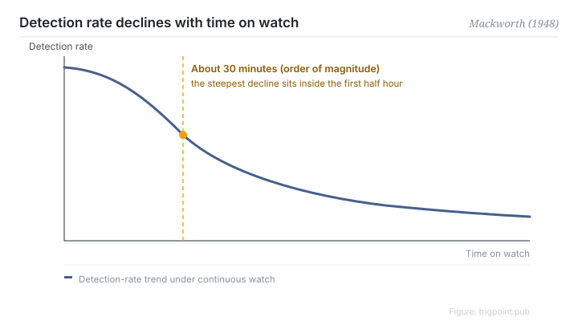

Canonical: https://trigpoint.pub/collections/hai/vigilance-decrement  
Captured: 2026-10-05T03:32:09.569012+08:00

> Public theory reading mirror. Verification and Lab case sections remain on the website.

Subjects watching a clock hand for the occasional double jump soon began to miss it.

# Vigilance decrement

vigilance decrement · Mackworth (1948)

Bibliography checked ✓  
Lab case ✓  
Human-automation interaction · monitoring

## In three sentences

When a person watches a signal source that rarely changes, detection rate falls measurably within about thirty minutes. Any design whose only safeguard is having someone watch the automation therefore fails by construction. This is not a discipline problem. It is a limit of human attention, and the fix belongs in the design, not in trying harder.

<strong>Figure 1</strong> · Decay of detection rate during sustained monitoring. In Mackworth's radar-clock experiment, detection rate falls sharply within the first thirty minutes and then continues to decline slowly. The trend is redrawn; the primary data were not checked, so the shape is shown without a numeric scale.

## 1. What happened

During the Second World War, airborne radar operators of the British RAF Coastal Command were missing submarine signals in the back half of a watch. Mackworth reproduced the effect with a clock face whose hand jumped in steps: the subject watched the pointer and reported the occasional double jump.

The result was disturbingly stable: detection rate dropped measurably within about thirty minutes of watching (an order of magnitude, reported secondhand)[\[1\]](#reference-note-1).

<strong>Attribution where due:</strong>"Vigilance" as a neurological concept appears earlier, in Henry Head (1923). What Mackworth contributed in 1948 is the first systematic experiment and the quantified curve. Predecessors are predecessors; the experiment is the experiment.

## 2. Why this matters to you

Handing an AI agent's output to "someone will keep an eye on it" bets the reliability of the system on a curve that starts leaking after half an hour. Your attention depletes. So a human-oversight design that amounts to asking someone to watch is not a safety mechanism. It is safety theatre.

The question is not who watches. It is how the monitoring surface should be built so that it still catches things once the human has inevitably slackened: rotation, sampling, and pushing anomalies to the person rather than waiting for the person to find them.

Boundary: "about thirty minutes" is an order of magnitude and not a constant, reaches us through secondary reporting, and must be calibrated against your own data before it goes into a shift specification; this page does not supply the numeric shape of the curve.

## References

<strong>How to read the source notes</strong> “Bibliographic details checked” means author, year, title and venue were confirmed. It does not mean the source's claims were checked. Definitions as of 2026-09-20.

- \[1\] Mackworth, N. H. (1948). The breakdown of vigilance during prolonged visual search. Quarterly Journal of Experimental Psychology, 1(1), 6–21. https://doi.org/10.1080/17470214808416738
- \[2\] Head, H. (1923). The conception of nervous and mental energy (II): 'Vigilance'; a physiological state of the nervous system. British Journal of Psychology, 14, 126–147. https://doi.org/10.1111/j.2044-8295.1923.tb00122.x
- \[3\] Parasuraman, R., & Manzey, D. H. (2010). Complacency and bias in human use of automation. Human Factors, 52(3), 381–410. https://doi.org/10.1177/0018720810376055

## Knowledge graph

- [<em>Compare ▸</em>Trust in automation](trust-in-automation.md)
- [<em>Downstream ▸</em>Automation complacency and bias](automation-complacency.md)

Cite as: Trigpoint, “Vigilance decrement”, trigpoint.pub/collections/hai/vigilance-decrement · © Strategitect Limited. · Content last revised 2026-09-28

## Source notes

**[1]** Mackworth, N. H. (1948). The breakdown of vigilance during prolonged visual search. Quarterly Journal of Experimental Psychology, 1(1), 6–21. Bibliographic details cross-checked against multiple sources.

---

[繁體中文](../../../zh-Hant/collections/hai/vigilance-decrement.md) · [简体中文](../../../zh-Hans/collections/hai/vigilance-decrement.md)

[Index](../../README.md) · [Original page](https://trigpoint.pub/collections/hai/vigilance-decrement) · [Citation and versions](../../../READING.md)

[Original SVG](assets/vigilance-decrement.svg) · Display copy adds a white background only.
