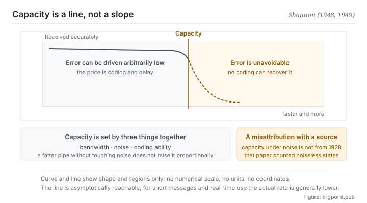

Canonical: https://trigpoint.pub/collections/information-theory/channel-and-capacity  
Captured: 2026-11-02T21:27:18.925465+08:00

> Public theory reading mirror. Verification and Lab case sections remain on the website.

What fits into a channel and what can be reliably reconstructed under noise are two different quantities.

# Channel and capacity

Channel and Capacity · Shannon (1948, 1949)

Bibliography checked ✓  
Lab case ✓  
Information theory · transmission limits  
Read first: Signal and noise  
Read first: Entropy

## In three sentences

A channel is anything that lets information flow, not wires and radio only but also language, attention and memory. Capacity is not how much you can push in. It is the most the other end can reliably reconstruct while noise is present. The gap between the two never reports an error. It quietly turns into misunderstanding.

<strong>Figure 1</strong> · The trade between rate and reliability. To the right on the horizontal axis is faster and more; upward on the vertical axis is received more accurately. Capacity is a line: to the left of it, coding can drive error arbitrarily low, and past it error becomes unavoidable. This figure deliberately carries no numerical scale and no units.

## 1. What happened

How much can be pushed into a channel and how much the other end can reliably reconstruct under noise are often taken as one number; the second has a hard ceiling. The 1948 paper proved something counterintuitive: on a noisy channel, the error rate is not something you can only grind down by raising power. So long as the transmission rate stays below a certain threshold, a coding scheme exists that drives the error rate arbitrarily close to zero. Once past that threshold, error is unavoidable[\[1\]](#reference-note-1). That threshold is capacity. The paper of the following year proved the result again by geometric means[\[2\]](#reference-note-2).

The shape of that result is worth pausing on. It is not a continuous trade of the faster, the more error-prone kind. It is a line. To the left of the line, reliability is a problem of coding design. To the right of it, reliability is impossible. It took engineering decades more before coding methods came close to that line in practice, but the line itself was fixed in 1948.

Capacity is settled by three things together: the bandwidth the channel can carry, the strength of the noise, and your coding ability. None substitutes for another. Widen the pipe without addressing the noise and capacity does not rise in proportion; equally, no amount of ingenious coding breaks through a ceiling set by bandwidth and noise.

Two attributions need stating clearly. First, capacity under noise does not belong to the 1928 paper. That paper deals only with the number of distinguishable choices and says nothing about signal or noise, and attributing capacity under noise to it is a citation error whose source can be traced[\[3\]](#reference-note-3)[\[5\]](#reference-note-5). Second, several researchers derived similar formulas independently in the same period, and the 1948 paper names three of them. Tuller's contribution among these has long been little mentioned; but his derivation is a rough estimate from the number of distinguishable amplitude levels[\[4\]](#reference-note-4); the 2014 study proves that such a formula is the capacity of a channel with uniform noise and limited amplitude, which is a different setting from the Gaussian-noise, limited-power channel of the 1948 theorem[\[5\]](#reference-note-5).

<strong>Attribution where due:</strong>Measuring information by the logarithm of the number of distinguishable choices belongs to Hartley (1928)[\[3\]](#reference-note-3). Capacity under noise belongs to Shannon, sourced to theorem 17 of the 1948 paper and to the geometric proof of the 1949 paper[\[1\]](#reference-note-1)[\[2\]](#reference-note-2). In the same period Tuller independently derived a similar formula by rough estimate, published in 1949 and named in the 1948 paper[\[4\]](#reference-note-4); a 2014 study argues for naming the two together while tracing the source of the citation error above[\[5\]](#reference-note-5). Sign the three separately. Compressing capacity under noise into Hartley's formula gets the scope and the author wrong in one move, and it is one of the corrections this site states explicitly.

## 2. Why this matters to you

Widen the word channel from wires to your own workflow and this page starts paying.

The stretch of context between you and a model is a channel. It has bandwidth (how much fits in at once), noise (irrelevant content, expired specifications, mutually contradictory instructions), and coding ability (how you organise that content). Most people adjust the first only: push in more, write longer, attach everything that might be relevant. Under this page's frame that is a nameable error. What you raise is the volume of input, what you lower is the signal-to-noise ratio, and capacity governs the second.

The same thing is more visible with people. A handover document, a meeting, a letter: their capacity is fixed not by how much you wrote but by how much the other end can reliably reconstruct.

And here is the cruel part: transmission past capacity does not report an error. Nobody tells you that they overflowed. They give you a response that looks reasonable, built on truncated input. That failure is silent, so it can only be guarded against by design in advance, never by detection afterwards.

In practice this page gives you three questions you can ask directly. What is the noise on this channel, meaning which content does not change any judgement. Am I adjusting the volume of input or the signal-to-noise ratio. And if the other end can reconstruct half, which half do I want it to be. The third question takes you straight into segment three of this shelf.

## Common misreadings

Page verification: Bibliography checked ✓ · Content last revised 2026-10-27

- A common account says the capacity formula under noise comes from Hartley in 1928. Wrong. The 1928 paper deals only with the number of distinguishable choices, first assumes external interference away, and never sets signal against noise in a formula. Capacity under noise comes from theorem 17 of the 1948 paper, and the 1949 paper gives a geometric proof. According to a 2014 study, the oldest source that attributes the related formula to Hartley appears to be a widely used textbook of 1965.
- A common account says capacity is bandwidth. Bandwidth is only one of the factors that set capacity; the other two are noise and coding ability. Swap in a wider pipe without addressing the noise and capacity does not rise in proportion.

## Corrections

- Several researchers derived similar formulas independently in the same period. Tuller was one of them, and the 1948 paper names him. His contribution has long been little mentioned; but his derivation is a rough estimate from the number of distinguishable amplitude levels; according to the 2014 study, such a formula is the capacity of a channel with uniform noise and limited amplitude, which is a different setting from the Gaussian-noise, limited-power channel of the 1948 theorem. Both things need saying: neither erase him nor inflate him.

## References

<strong>How to read the source notes</strong> “Bibliographic details checked” means author, year, title and venue were confirmed. It does not mean the source's claims were checked. “Matched against the full text” means the claim was compared with the text of the source itself. Definitions as of 2026-09-20.

- \[1\] Shannon, C. E. (1948). A Mathematical Theory of Communication. Bell System Technical Journal, 27(3), 379–423; 27(4), 623–656.
- \[2\] Shannon, C. E. (1949). Communication in the Presence of Noise. Proceedings of the IRE, 37(1), 10–21.
- \[3\] Hartley, R. V. L. (1928). Transmission of Information. Bell System Technical Journal, 7(3), 535–563.
- \[4\] Tuller, W. G. (1949). Theoretical Limitations on the Rate of Transmission of Information. Proceedings of the IRE, 37(5), 468–478.
- \[5\] Rioul, O., & Magossi, J. C. (2014). On Shannon's Formula and Hartley's Rule: Beyond the Mathematical Coincidence. Entropy, 16(9), 4892–4910.

Cite as: Trigpoint, “Channel and capacity”, trigpoint.pub/collections/information-theory/channel-and-capacity · © Strategitect Limited. · Content last revised 2026-10-27

## Source notes

**[1]** Shannon, C. E. (1948). A Mathematical Theory of Communication. Bell System Technical Journal, 27(3), 379–423; 27(4), 623–656. Bibliographic details checked against the official record. Claims matched against the full text. Provenance double-checked across models. Theorem 17 gives the capacity of a band-limited channel perturbed by white thermal noise when the average transmitter power is limited. Right after that theorem, the paper names Wiener, Tuller and Sullivan as having developed similar formulas on their own.

**[2]** Shannon, C. E. (1949). Communication in the Presence of Noise. Proceedings of the IRE, 37(1), 10–21. DOI 10.1109/JRPROC.1949.232969. Bibliographic details checked against the official record. Provenance double-checked across models. Proves the capacity formula under noise again, by geometric means.

**[3]** Hartley, R. V. L. (1928). Transmission of Information. Bell System Technical Journal, 7(3), 535–563. Bibliographic details checked against the official record. Provenance double-checked across models. Measures information by the logarithm of the number of distinguishable choices and says nothing about signal or noise. Attributing capacity under noise to this paper is a citation error.

**[4]** Tuller, W. G. (1949). Theoretical Limitations on the Rate of Transmission of Information. Proceedings of the IRE, 37(5), 468–478. DOI 10.1109/JRPROC.1949.232323. Bibliographic details checked against the official record. Provenance double-checked across models. Journal version of the author's 1948 MIT doctoral (Sc.D.) thesis. The derivation estimates roughly from the number of distinguishable amplitude levels and arrives at a formula close to capacity under noise. According to the 2014 study (section 5, theorem 1), such a formula is the capacity of a channel with uniform noise and limited amplitude when the ratio of the amplitude limit to the noise bound is a whole number, which is a different setting from the Gaussian-noise, average-power-limited channel treated by theorem 17 of the 1948 paper.

**[5]** Rioul, O., & Magossi, J. C. (2014). On Shannon's Formula and Hartley's Rule: Beyond the Mathematical Coincidence. Entropy, 16(9), 4892–4910. DOI 10.3390/e16094892. Bibliographic details checked against the official record. Claims matched against the full text. Traces the attribution of Hartley's rule: the 1928 paper never sets signal against noise in a formula, and the oldest source that attributes the formula to Hartley appears to be a widely used textbook of 1965 (Wozencraft and Jacobs). The paper also proves that the formula is exactly the capacity of a channel with uniform noise and limited amplitude, and argues for the name Tuller-Shannon.

---

[繁體中文](../../../zh-Hant/collections/information-theory/channel-and-capacity.md) · [简体中文](../../../zh-Hans/collections/information-theory/channel-and-capacity.md)

[Index](../../README.md) · [Original page](https://trigpoint.pub/collections/information-theory/channel-and-capacity) · [Citation and versions](../../../READING.md)

[Original SVG](assets/channel-and-capacity.svg) · Display copy adds a white background only.
