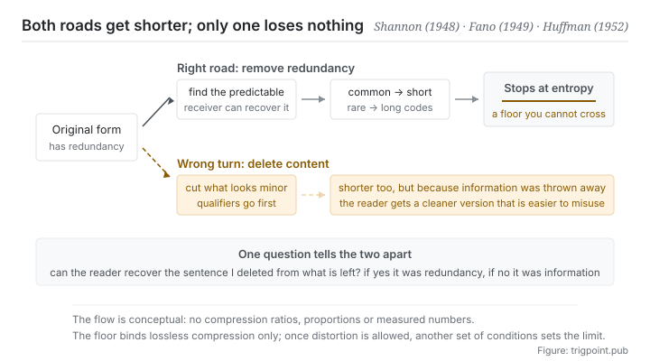

Canonical: https://trigpoint.pub/collections/information-theory/coding-and-compression  
Captured: 2026-11-02T21:27:19.296465+08:00

> Public theory reading mirror. Verification and Lab case sections remain on the website.

“Compression means deleting some of it”: wrong.

# Coding and compression

Coding and Compression · Shannon (1948) / Fano (1949) / Huffman (1952)

Abstracts checked ✓  
Lab case ✓  
Information theory · representation and compression  
Read first: Entropy  
Read first: Self-information

## In three sentences

Compression is not deleting content. It is representing the same content in a shorter way. The compressible part is called redundancy: the part the receiving end could already have worked out. Removing it loses nothing. And there is a floor to this. The average length of lossless compression can never fall below the entropy.

<strong>Figure 1</strong> · The right road and the wrong turn. The right road recognises regularity and carries the same content in a shorter representation, with the entropy floor as its end point. The wrong turn deletes content outright: it does get shorter, but it gets shorter because information was thrown away rather than because redundancy was removed.

## 1. What happened

Two words that get used interchangeably should be separated first. Coding turns content into some system of symbols and need not make it shorter. Compression is one optimisation goal for coding: exploit the regularity in the content to represent its predictable parts more briefly. The key word is predictable. Writing at length what the receiving end could already guess is pure waste, and that waste is what redundancy means.

From this follows an allocation principle: short codes for what occurs often, long codes for what is rare. Two classic implementations of that principle arrived in 1949 and 1952. The first is a top-down heuristic; the second proved that a bottom-up construction guarantees the minimum average code length[\[2\]](#reference-note-2)[\[3\]](#reference-note-3). The difference between them is not efficiency alone but guarantee: one is usually good, the other is provably optimal.

Whatever method is used, there is one line that cannot be crossed. Theorem 9 of the 1948 paper fixes the lower bound on average code length for lossless compression, and that bound is the entropy[\[1\]](#reference-note-1).

The line has two practical implications, both worth keeping. First, the ceiling on how far you can compress is set by the probability structure of the data and not by your technique. Second, as you approach the line, each further step stops removing redundancy and starts discarding information.

Lossless and lossy part company here. Lossless requires complete reconstruction and is bound by the entropy floor. Lossy permits distortion in exchange for shorter length, and it has an entirely different theoretical limit, which is the subject of the next page on this shelf.

<strong>Attribution where due:</strong>The lower bound on lossless compression belongs to Shannon (1948), sourced to theorem 9 in section 9 of that paper[\[1\]](#reference-note-1). The top-down heuristic coding method is conventionally named for Shannon and Fano together, and its formal place of publication is Fano's technical report of 1949[\[2\]](#reference-note-2). The construction that guarantees minimum average code length belongs to Huffman (1952)[\[3\]](#reference-note-3). The standing of the two results differs: one is a heuristic, the other is provably optimal, and neither name should be used for the other.

## 2. Why this matters to you

Most people, when they summarise, are cutting rather than compressing. One question separates the two: can the reader reconstruct the sentence I deleted from what remains? If yes, it was redundancy and the cut was right. If no, it was information, and all you did was make the document shorter.

That test changes how you write handovers and explanations at once. What should usually go is not the detail but the groundwork the reader's existing knowledge already covers: background introductions, restatements of general principles, repetitions of premises.

And what should least go often looks exactly like what could go, namely the sentences carrying conditions. Unless, depends on, only if, must: these words carry causation and boundaries, they cannot be reconstructed from the other sentences, and cutting them leaves the reader with a version that looks cleaner and is easier to misuse. The next page puts this more precisely.

The second corollary concerns the decoding end. Compression presupposes that both sides share the same regularities. If the receiving end does not hold them, your short code is a cipher to them. So the same content needs different compression ratios for different audiences, which is not a courtesy but a direct consequence of the theory. A briefing for an old hand and an explanation for a newcomer cannot be one document, and not because the newcomer needs more information. They are missing the codebook that made your compression work.

The third corollary is the most counterintuitive: sometimes not being able to compress further is good news. It means there is little redundancy left in the material and what remains cannot be derived. What to do then is to accept the length, not keep shaving.

## Common misreadings

Page verification: Abstracts checked ✓ · Content last revised 2026-10-25

- A common account says compression means deleting the unimportant parts. Lossless compression deletes no content at all: it only switches to a shorter representation, and the original can be reconstructed in full. What deletes things is lossy compression, which is a different theory with its own page on this site. Mixing the two up leads people to think every compression has to pay a price in distortion.
- A common account says the compression ratio depends on how good the algorithm is. The algorithm decides how far you are from the limit, but the limit itself is set by the probability structure of the data. Most of the difference in compression ratio when one algorithm runs on different data comes from the data, not the algorithm.

## References

<strong>How to read the source notes</strong> “Bibliographic details checked” means author, year, title and venue were confirmed. It does not mean the source's claims were checked. “Consistent with the abstract” means the claim agrees with the paper's abstract. It does not include sentence-by-sentence checking against the full text. “Matched against the full text” means the claim was compared with the text of the source itself. Definitions as of 2026-09-20.

- \[1\] Shannon, C. E. (1948). A Mathematical Theory of Communication. Bell System Technical Journal, 27(3), 379–423; 27(4), 623–656.
- \[2\] Fano, R. M. (1949). The Transmission of Information. MIT RLE Technical Report No. 65.
- \[3\] Huffman, D. A. (1952). A Method for the Construction of Minimum-Redundancy Codes. Proceedings of the IRE, 40(9), 1098–1101.

Cite as: Trigpoint, “Coding and compression”, trigpoint.pub/collections/information-theory/coding-and-compression · © Strategitect Limited. · Content last revised 2026-10-25

## Source notes

**[1]** Shannon, C. E. (1948). A Mathematical Theory of Communication. Bell System Technical Journal, 27(3), 379–423; 27(4), 623–656. Bibliographic details checked against the official record. Claims matched against the full text. Provenance double-checked across models. Theorem 9 in section 9, the fundamental theorem for a noiseless channel: the entropy of a source sets the lowest average rate needed to send it over a noiseless channel, which can be approached arbitrarily closely and never beaten. That is the lower bound on average code length in lossless compression.

**[2]** Fano, R. M. (1949). The Transmission of Information (Technical Report No. 65). Research Laboratory of Electronics, Massachusetts Institute of Technology. Bibliographic details checked against the publisher's record. Claims matched against the full text. Where the Shannon-Fano coding method was published: messages are ordered by probability and then split again and again into two groups of as nearly equal probability as possible.

**[3]** Huffman, D. A. (1952). A Method for the Construction of Minimum-Redundancy Codes. Proceedings of the IRE, 40(9), 1098–1101. DOI 10.1109/JRPROC.1952.273898. Bibliographic details checked against the official record. Consistent with the abstract. The bottom-up construction of an optimal prefix code, which guarantees the minimum average code length.

---

[繁體中文](../../../zh-Hant/collections/information-theory/coding-and-compression.md) · [简体中文](../../../zh-Hans/collections/information-theory/coding-and-compression.md)

[Index](../../README.md) · [Original page](https://trigpoint.pub/collections/information-theory/coding-and-compression) · [Citation and versions](../../../READING.md)

[Original SVG](assets/coding-and-compression.svg) · Display copy adds a white background only.
