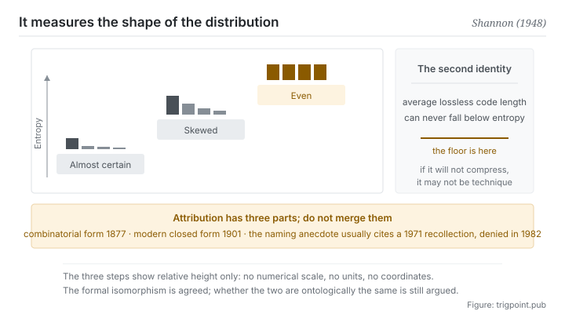

Canonical: https://trigpoint.pub/collections/information-theory/entropy  
Captured: 2026-11-02T21:27:19.603651+08:00

> Public theory reading mirror. Verification and Lab case sections remain on the website.

“Entropy is disorder”: that is a misreading.

# Entropy

Entropy · Shannon (1948)

Bibliography checked ✓  
Information theory · core measures  
Read first: Self-information

## In three sentences

Entropy is not disorder. It is the quantification of unpredictability. It is the number you get when the information of each possible outcome is averaged, each weighted by its own probability. The more even the distribution, the harder to guess and the higher the entropy. And the same number carries a second identity: it is the floor of lossless compression.

<strong>Figure 1</strong> · A ladder showing how entropy moves with the shape of the distribution. The more concentrated the distribution, the easier it is to guess and the lower the entropy; the more even it is, the harder to guess and the higher the entropy. The panel on the right marks the second identity of the same ruler: the average code length of lossless compression can never fall below it. This figure deliberately carries no numerical scale and no units.

## 1. What happened

The previous page dealt with the information of a single event: the less likely the event, the more it carries when it happens. But the quantity for a single event cannot describe a system, because the system has not resolved yet. The quantity the 1948 paper gives amounts to one simple and decisive move: weight the information of each possible outcome by its own probability, and average[\[1\]](#reference-note-1). The number that comes out is entropy, and it answers how much uncertainty I face on average before the resolution.

The construction has one property you can feel at once. The more concentrated the distribution, the lower the entropy, because you can nearly guess it. The more even, the higher, because every outcome is equally possible. At the extreme, a certain event has entropy zero.

Note that what is measured is the shape of the distribution, not how messy the outcome itself looks. That is exactly where the intuition entropy equals disorder goes wrong: it drops the probability structure out of the account.

The same paper gave entropy a second identity, and this one turns it from a descriptive quantity into a hard boundary: the average code length of lossless compression can never fall below the entropy[\[1\]](#reference-note-1). How small you can compress a body of data depends not on how clever your algorithm is but on the probability structure of the data. That lower bound is the premise of the whole of segment three on this shelf.

The formal kinship was pointed out in the same paper. In section 6 Shannon wrote, word for word, that this H is the H in Boltzmann's famous H theorem[\[2\]](#reference-note-2). That sentence opened an argument still running today, which the verification layer below handles.

One thing commonly got wrong should be corrected first. The famous thermodynamic formula with the constant in it does not come from the 1877 paper, which contains the combinatorial form only. The modern form and that constant are generally credited to Planck, written down in 1900 to 1901, and by secondary accounts Planck himself said in his 1920 Nobel lecture that Boltzmann never introduced the constant[\[3\]](#reference-note-3)[\[4\]](#reference-note-4).

<strong>Attribution where due:</strong>Entropy as the expectation of information, and its identity as the lower bound of lossless compression, belong to Shannon (1948)[\[1\]](#reference-note-1). The combinatorial quantity in statistical mechanics belongs to Boltzmann (1877), while the modern closed form with the constant is generally credited to Planck (1900 to 1901). The two cannot be compressed into one[\[3\]](#reference-note-3)[\[4\]](#reference-note-4). Establishing maximum entropy as a principle of inference, and treating statistical mechanics as a form of statistical inference, belongs to Jaynes (1957)[\[5\]](#reference-note-5); for a contemporary argument that the measure of information and thermodynamic entropy cannot simply be equated, see Ben-Naim (2017)[\[6\]](#reference-note-6). As for the anecdote about von Neumann suggesting the name, its most often cited source is a personal recollection from 1971[\[7\]](#reference-note-7) (another account places an earlier telling), and one of the parties to it denied it in a recorded interview in 1982[\[8\]](#reference-note-8). This site does not list it as historical fact.

## 2. Why this matters to you

The first thing entropy gives you is a diagnostic for this will not compress any further.

You trim a piece of material over and over, and past a certain point every change feels like a loss. The usual reaction is to blame your own writing. This page says there is another possibility: you have hit the floor. The probability structure of that material fixes its shortest average length, and every cut past that point stops removing redundancy and starts removing information.

The difference can be asked out loud: can the reader reconstruct the sentence I deleted from what remains? If yes, it was redundancy. If no, it was information.

The second thing is more counterintuitive. Since entropy depends on the distribution, the same content is compressible to different degrees for different readers. For someone who already holds the context, most of your groundwork is high-probability, predictable material and can go. For someone unfamiliar, that same material carries the real reduction in uncertainty, and cutting it breaks the chain.

So how long should this document be has no general answer, only an answer for a given reader. It also explains why the context you give a model and the explanation you give a person cannot be one and the same document.

The third thing concerns the word itself. Fighting entropy, in everyday usage, is mostly rhetorical: leave a system alone and it gets worse. The entropy on this page does not mean that. It is a quantity about a distribution. The two are not the same thing, and they are not unrelated either, and how substantial that relation actually is happens to be the question the last page of this shelf takes up. Until then, treat them as two words.

## Common misreadings

Page verification: Bibliography checked ✓ · Content last revised 2026-10-25

- A common account says that Boltzmann wrote S = k log W in 1877. His 1877 paper contains only a combinatorial measure of probability and does not write the closed form with the constant k. The modern form and the constant are generally credited to Planck, written down in 1900 to 1901. The tombstone at the Vienna Central Cemetery that carries the formula was unveiled in 1933 (per secondary accounts), long after Boltzmann's death, and the form is Planck's.
- A common account says that von Neumann suggested Shannon call the quantity entropy, on the grounds that nobody really knows what entropy is. The most often cited source is a personal recollection in a 1971 popular-science article, about ten years after the conversation, and von Neumann had died in 1957; another account says the same person had already told it in a 1964 memorial volume. More decisively, Shannon himself denied it in a 1982 oral-history interview. The anecdote circulates very widely; this site lists it as unconfirmed.
- A common account says that information entropy and thermodynamic entropy are the same thing. That the mathematical forms are isomorphic is agreed; in what sense the two are the same thing is still argued. This page sets out the layers side by side and does not crown one side.

## References

<strong>How to read the source notes</strong> “Bibliographic details checked” means author, year, title and venue were confirmed. It does not mean the source's claims were checked. “Consistent with the abstract” means the claim agrees with the paper's abstract. It does not include sentence-by-sentence checking against the full text. “Matched against the full text” means the claim was compared with the text of the source itself. “Follows secondary accounts” means the claim rests on sources that report it, not on the original document. Definitions as of 2026-09-20.

- \[1\] Shannon, C. E. (1948). A Mathematical Theory of Communication. Bell System Technical Journal, 27(3), 379–423; 27(4), 623–656.
- \[2\] Shannon, C. E. (1948). A Mathematical Theory of Communication. Bell System Technical Journal, 27(3), 379–423; 27(4), 623–656.
- \[3\] Boltzmann, L. (1877). Wiener Berichte, 76, 373–435.
- \[4\] Planck, M. (1901). Ueber das Gesetz der Energieverteilung im Normalspectrum. Annalen der Physik, 309(3), 553–563.
- \[5\] Jaynes, E. T. (1957). Information Theory and Statistical Mechanics. Physical Review, 106(4), 620–630; 108(2), 171–190.
- \[6\] Ben-Naim, A. (2017). Entropy, Shannon's Measure of Information and Boltzmann's H-Theorem. Entropy, 19(2), 48.
- \[7\] Tribus, M. & McIrvine, E. C. (1971). Energy and Information. Scientific American, 225(3), 179–188.
- \[8\] Price, R. (1982/1984). Claude E. Shannon oral history. IEEE History Center Interview 423; IEEE Communications Magazine, 22(5), 123–126.
- \[9\] Shannon, C. E. (1956). The Bandwagon. IRE Transactions on Information Theory, IT-2(1), 3.

Cite as: Trigpoint, “Entropy”, trigpoint.pub/collections/information-theory/entropy · © Strategitect Limited. · Content last revised 2026-10-25

## Source notes

**[1]** Shannon, C. E. (1948). A Mathematical Theory of Communication. Bell System Technical Journal, 27(3), 379–423; 27(4), 623–656. DOI 10.1002/j.1538-7305.1948.tb01338.x. Bibliographic details checked against the official record. Claims matched against the full text. Defines H = −Σ p log p, that is, the probability-weighted average of log(1/p) over the outcomes, and in section 9 (the fundamental theorem for a noiseless channel, theorem 9) sets the limit of lossless coding.

**[2]** Shannon 1948, section 6, in the original: “H is then, for example, the H in Boltzmann's famous H theorem”.

**[3]** Boltzmann, L. (1877). Wiener Berichte, 76, 373–435. Bibliographic details confirmed by two sources. That this paper lacks the closed form with k follows secondary accounts that agree with one another. Builds the probabilistic basis of entropy on the number of permutations, a combinatorial measure of probability. The closed form with the constant k does not appear in this paper and is generally credited to Planck.

**[4]** Planck, M. (1901). Ueber das Gesetz der Energieverteilung im Normalspectrum. Annalen der Physik, 309(3), 553–563. DOI 10.1002/andp.19013090310. Bibliographic details checked against the official record. Planck's remark in his 1920 lecture follows secondary accounts that agree with one another. The modern closed form with the constant k, and the introduction of the constant, are generally credited to this paper. By secondary accounts, Planck said in his 1920 Nobel lecture that the constant is often called Boltzmann's constant, but that to his knowledge Boltzmann himself never introduced it.

**[5]** Jaynes, E. T. (1957). Information Theory and Statistical Mechanics. Physical Review, 106(4), 620–630; Information Theory and Statistical Mechanics. II. Physical Review, 108(2), 171–190. Bibliographic details checked against the official record. Consistent with the abstract. Treats statistical mechanics as a form of statistical inference: probability distributions are set up by the principle of maximum entropy, committing to nothing beyond the information available, so the usual rules of statistical mechanics need no further physical assumption. The author calls the result subjective statistical mechanics.

**[6]** Ben-Naim, A. (2017). Entropy, Shannon's Measure of Information and Boltzmann's H-Theorem. Entropy, 19(2), 48. DOI 10.3390/e19020048. Bibliographic details checked against the official record. Consistent with the abstract. Argues that Shannon's measure of information applies to any probability distribution, while thermodynamic entropy is defined only on one special class of distributions, so the two cannot simply be equated; on that basis, Boltzmann's H-function is a measure of information and not entropy.

**[7]** Tribus, M. & McIrvine, E. C. (1971). Energy and Information. Scientific American, 225(3), 179–188. DOI 10.1038/scientificamerican0971-179. Bibliographic details checked against the official record. The account of the anecdote and its date follows secondary accounts that agree with one another. The most often cited source for the von Neumann naming anecdote: a personal recollection set down about ten years later.

**[8]** Price, R. (1982). Claude E. Shannon, an oral history conducted by Robert Price, 28 July 1982. IEEE History Center, Interview #423. Published as: A Conversation with Claude Shannon, IEEE Communications Magazine, 22(5), 123–126 (1984). Bibliographic details confirmed by two sources. Claims matched against the full text. Shannon denies the story in the interview: “I'm quite sure that it didn't happen between von Neumann and me”. The commonly repeated 1984 interview should be read as interviewed in 1982, published in 1984.

---

[繁體中文](../../../zh-Hant/collections/information-theory/entropy.md) · [简体中文](../../../zh-Hans/collections/information-theory/entropy.md)

[Index](../../README.md) · [Original page](https://trigpoint.pub/collections/information-theory/entropy) · [Citation and versions](../../../READING.md)

[Original SVG](assets/entropy.svg) · Display copy adds a white background only.
