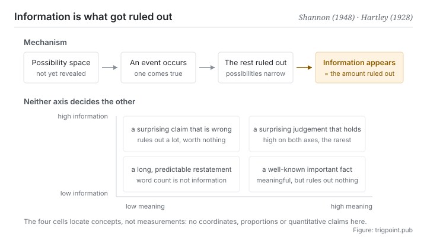

Canonical: https://trigpoint.pub/collections/information-theory/information-and-uncertainty  
Captured: 2026-11-02T21:27:19.872851+08:00

> Public theory reading mirror. Verification and Lab case sections remain on the website.

“Information is content”: they are two different things.

# Information and uncertainty

Information and Uncertainty · Shannon (1948) / Hartley (1928)

Checked against the sources ✓  
Information theory · basic definitions

## In three sentences

Information is not content. It is the amount by which uncertainty is reduced. How much information something carries depends on how many of the previously possible situations it rules out, not on how long, how deep or how important it is. So quantity of information and whether something means anything are two different rulers, and what each measures does not determine the other.

<strong>Figure 1</strong> · How information arises. A space of possibilities exists first; an event occurs and rules part of it out, and the amount ruled out is the information. The two axes below show that one and the same sentence can sit in completely different places on quantity of information and on meaning, and that neither axis determines the other.

## 1. What happened

The founding paper of 1948 opened by doing something that still reads as counterintuitive: it took meaning out of the problem[\[1\]](#reference-note-1). The original is blunt about it. The semantic aspects of communication are irrelevant to the engineering problem.

That is not evasion, it is a boundary. To make information a quantity that can be computed, transmitted and compared, you first have to give up asking what it says. The book of the following year carried Weaver's introduction, which split communication into technical, semantic and effectiveness levels and granted that the theory is on its face applicable only to the first; he argued at the same time that it is helpful and suggestive for the other two[\[3\]](#reference-note-3).

With meaning taken out, what is left to measure? The ruling out of possibilities. Picture a situation not yet resolved, with a set of possible outcomes. When one of them comes true the rest are ruled out, and the amount ruled out is the information the event carries.

That definition has an immediately testable consequence: the same sentence carries different amounts of information in different situations. To someone who already knows it will rain tomorrow, it will rain tomorrow carries almost none. To someone whose forecasts all said clear skies, the same sentence carries a great deal. What changed is not the sentence. It is what the sentence rules out.

One more step separates two levels. How much a single event rules out is the information of that event. How hard the whole situation is to guess on average is the entropy of that system. The two get run together often, and they answer different questions: one asks how much this resolution told me, the other asks how uncertain I was before it. The next two pages take them one at a time.

The logarithmic structure is older. The 1928 paper connected quantity of message to the number of distinguishable states and laid the ground for the later formalisation[\[2\]](#reference-note-2). Note that it handles the noiseless case; attributing capacity under noise to it is a citation error that arose later.

<strong>Attribution where due:</strong>The prototype of the logarithmic structure belongs to Hartley (1928), though what he handles is the noiseless count of distinguishable states and not capacity under noise[\[2\]](#reference-note-2). Defining information as the reduction of uncertainty, and explicitly excluding semantics from the engineering problem, belongs to Shannon (1948)[\[1\]](#reference-note-1). The split into technical, semantic and effectiveness levels comes from Weaver's introduction to the 1949 book, not from Shannon's own text; nor did Weaver confine the theory to the first level, since he argued it helps with the other two as well[\[3\]](#reference-note-3). Sign the three separately. Compressing them into Shannon proposed information theory and distinguished three levels gets the origin of the prototype and the author of the three-level split both wrong.

## 2. Why this matters to you

You use the word information every day, in its everyday sense: more information means said more, said in more detail, said more professionally. This theory says that is a different thing, and the difference changes how you judge what is in front of you.

A three-thousand-word set of meeting minutes whose entire content you could have predicted in advance carries information close to zero, whatever its word count. A model output can read as well organised and fully furnished with terminology and still rule out almost nothing, because all it did was rearrange your own question.

So the question is not whether this content is rich enough. It is what did it rule out that I previously took to be possible. The first question has no answer. The second one does.

The boundary has a harder corollary: a high quantity of information does not mean correct. The more unexpected an assertion, the more possibilities it rules out and the higher its information, while whether it is true belongs entirely to another ruler.

When a model gives a bold and specific judgement, that really is a high-information output under this theory, and that fact by itself is no reason to believe it. Keeping the two rulers apart is the first price of using this language, and the first thing it gives you.

## Common misreadings

Page verification: Checked against the sources ✓ · Content last revised 2026-10-25

- A common account says that high information means valuable content. The two are independent axes. A completely wrong sentence can carry a great deal of information, and a deeply meaningful one can carry almost none. The theory measures the first and says nothing about the second.
- A common account says that Hartley proposed the capacity formula for information. What Hartley gave in 1928 is a count of distinguishable states in the noiseless case, not capacity under noise power. The latter belongs to the 1948 paper. The error does circulate, and this site handles it on a separate page.

## References

<strong>How to read the source notes</strong> “Bibliographic details checked” means author, year, title and venue were confirmed. It does not mean the source's claims were checked. “Matched against the full text” means the claim was compared with the text of the source itself. Definitions as of 2026-09-20.

- \[1\] Shannon, C. E. (1948). A Mathematical Theory of Communication. Bell System Technical Journal, 27(3), 379–423; 27(4), 623–656.
- \[2\] Hartley, R. V. L. (1928). Transmission of Information. Bell System Technical Journal, 7(3), 535–563.
- \[3\] Shannon, C. E. & Weaver, W. (1949). The Mathematical Theory of Communication. University of Illinois Press.

Cite as: Trigpoint, “Information and uncertainty”, trigpoint.pub/collections/information-theory/information-and-uncertainty · © Strategitect Limited. · Content last revised 2026-10-25

## Source notes

**[1]** Shannon, C. E. (1948). A Mathematical Theory of Communication. Bell System Technical Journal, 27(3), 379–423; 27(4), 623–656. DOI 10.1002/j.1538-7305.1948.tb01338.x. Bibliographic details checked against the official record. Claims matched against the full text. Provenance double-checked across models. The introduction sets the question of meaning explicitly outside the engineering problem: the semantic aspects of communication are irrelevant to it.

**[2]** Hartley, R. V. L. (1928). Transmission of Information. Bell System Technical Journal, 7(3), 535–563. DOI 10.1002/j.1538-7305.1928.tb01236.x. Bibliographic details checked against the official record. Claims matched against the full text. Builds the prototype of the logarithmic structure of information from a count of distinguishable states. The paper states that it first assumes there is no external interference, and it contains no capacity in terms of noise power; attributing the latter to Hartley is a citation error (see this site's page on channel and capacity).

**[3]** Shannon, C. E. & Weaver, W. (1949). The Mathematical Theory of Communication. Urbana: University of Illinois Press. Bibliographic details checked against the publisher's record. Claims matched against the full text. Provenance double-checked across models. Weaver's introduction divides the problems of communication into technical, semantic and effectiveness levels. He grants that the mathematical theory is on its face applicable only to the first, and argues at the same time that it is helpful and suggestive for the other two.

---

[繁體中文](../../../zh-Hant/collections/information-theory/information-and-uncertainty.md) · [简体中文](../../../zh-Hans/collections/information-theory/information-and-uncertainty.md)

[Index](../../README.md) · [Original page](https://trigpoint.pub/collections/information-theory/information-and-uncertainty) · [Citation and versions](../../../READING.md)

[Original SVG](assets/information-and-uncertainty.svg) · Display copy adds a white background only.
