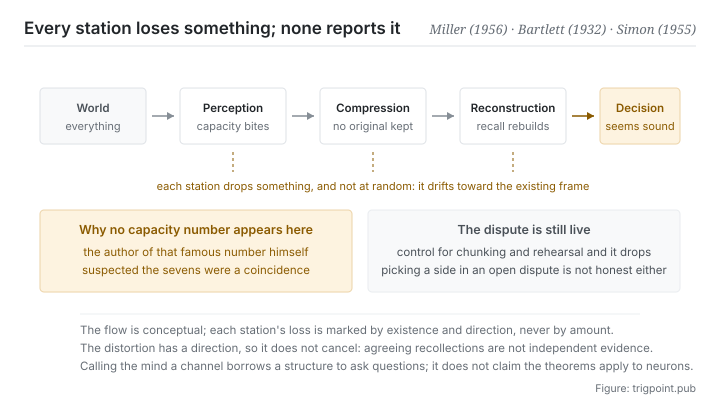

Canonical: https://trigpoint.pub/collections/information-theory/information-theory-and-cognition  
Captured: 2026-11-02T21:27:20.146878+08:00

> Public theory reading mirror. Verification and Lab case sections remain on the website.

Retelling a story from an unfamiliar culture, subjects turned the details they did not understand into plausible ones.

# Information theory and cognitive science

Information Theory and Cognitive Science · Miller (1956) / Bartlett (1932) / Simon (1955)

Bibliography checked ✓  
Information theory · cross-domain interface  
Read first: Channel and capacity  
Read first: Coding and compression

## In three sentences

The mind is an information-processing system working under capacity limits and noise. It does not store raw data, it compresses; and recall is not retrieval but reconstruction from compressed cues. So understanding loses something and memory drifts. That is the normal output of the mechanism.

<strong>Figure 1</strong> · The route a message travels from the outside world to a decision. Every station has a capacity limit and noise, so every station loses something. The figure deliberately marks no capacity number at all; the reason is in the verification layer of this page, where that famous number turns out to be under dispute.

## 1. What happened

When subjects retold a story from an unfamiliar culture, the unfamiliar details came back as versions that made sense to them. Carry the concepts of the previous pages over to people and a fairly consistent picture appears. Attention, working memory and processing speed all have ceilings, so input has to be filtered. What is kept is not stored as it came but compressed into some structure. When it is needed later, that structure is used to reconstruct rather than to retrieve the original. Every station has noise, and every station loses something.

That memory is reconstruction and not recording had experimental support as early as the 1932 book[\[4\]](#reference-note-4): retelling a story from an unfamiliar culture, subjects changed the details that were unfamiliar to them or that they did not understand into versions that seemed plausible to them. That is the characteristic consequence of compression plus reconstruction: the loss happens at the encoding end, the error shows up at the decoding end, and no step in between reports anything.

Bounded rationality is the same picture in the setting of decisions[\[5\]](#reference-note-5): people are not optimising machines, because the computation and the information that optimising needs exceed the available capacity, so real decisions look for a good enough solution under limited capacity. That is often misread as people being irrational, while the original sense is the opposite: it describes reasonable behaviour under given constraints.

As for how large the capacity actually is, this page has to stop and be clear, because that number is both the most famous and the most misused thing on it. The number that entered common circulation from the 1956 paper does exist and has been influential, but its own author already withheld judgment at the end of the paper and suspected that the recurring sevens were only a coincidence[\[1\]](#reference-note-1). The 2001 paper reads the number as a rough estimate and a rhetorical device rather than a real ceiling on capacity.

That paper also reports that work controlling for chunking and rehearsal measured a distinctly lower figure[\[2\]](#reference-note-2). That argument is still live today. A separate line of research redefines the chunk as a maximally compressed unit, which connects the question of capacity to segment three of this shelf[\[3\]](#reference-note-3).

<strong>Attribution where due:</strong>Memory as reconstruction rather than recording belongs to Bartlett (1932)[\[4\]](#reference-note-4). An early statement of bounded rationality belongs to Simon (1955)[\[5\]](#reference-note-5). The widely circulated number for working-memory capacity belongs to Miller (1956), while its character is a historical and rhetorical anchor and not an established limit: its author already suspected the sevens were a coincidence, and rhetorical device is the reading of later work[\[1\]](#reference-note-1)[\[2\]](#reference-note-2). The corrective work controlling for chunking and rehearsal belongs to Cowan (2001)[\[2\]](#reference-note-2), and the restatement of the chunk in terms of compression belongs to Mathy and Feldman (2012)[\[3\]](#reference-note-3). A contemporary line brings perception and action together under the minimisation of prediction error[\[6\]](#reference-note-6); this site has not checked the disputes attached to it, so it is not used as the basis for any claim on this page. The signing discipline on this page is stricter than on the others: when citing that number, the dispute has to be cited with it, or a statement its own author hedged is being passed off as a conclusion.

## 2. Why this matters to you

The first corollary is the most usable: whether what you hand over can be used depends on the other end's capacity, not on your completeness.

Writers naturally optimise for completeness, because completeness can be self-checked while the other end's capacity is invisible. The result is a document with no errors, comprehensive coverage, and no chance of being read through. Segment two of this shelf said that transmission past capacity reports no error. This page supplies the other half: the receiving end does not know it overflowed either, and will give you a reasonable response built on truncated input. Neither side finds out.

The second corollary: compression is not a courtesy but a precondition. Since the receiving end will compress regardless, the only question is who does it. If you do not, they will, and they will do it with their frames and their priors, and you have no control over which part gets dropped. Compress first and at least you decide where the distortion falls, which is the reason behind the rule in segment three of this shelf.

The third corollary concerns the reliability of memory, and it bears directly on collaboration: the version a participant remembers differing from what happened is the normal case, not a sign that anyone is dishonest. Since recall is reconstruction, any process that depends on later recall is using a source with a systematic bias. The workable countermeasure is not to ask everyone to remember more clearly. It is to leave a record at the time, so that later reconstruction has something to calibrate against.

The fourth point is about this page itself. Calling the mind a channel is an illuminating analogy. It gets you to the right questions, and it authorises no numerical transfer at all. This page deliberately gives no capacity number; the reason is in the next section.

## Common misreadings

Page verification: Bibliography checked ✓ · Content last revised 2026-10-25

- A common account says working-memory capacity is seven plus or minus two and that this is settled psychology. The paper is a classic and genuinely exists, but at its end the author already withheld judgment on the recurring sevens and suspected they were only a coincidence; later research reads the number as a rough estimate and a rhetorical device, and, controlling for chunking and rehearsal, measured a distinctly lower figure. The argument is still live today. Citing it as settled treats a claim its own author held back as a conclusion.
- A common account says memory distorts because people do not concentrate enough. Memory is not a recording in the first place; it is reconstruction after compression. Distortion is the normal product of that mechanism, not a symptom of insufficient attention.

## References

<strong>How to read the source notes</strong> “Bibliographic details checked” means author, year, title and venue were confirmed. It does not mean the source's claims were checked. “Consistent with the abstract” means the claim agrees with the paper's abstract. It does not include sentence-by-sentence checking against the full text. “Matched against the full text” means the claim was compared with the text of the source itself. “Follows secondary accounts” means the claim rests on sources that report it, not on the original document. Definitions as of 2026-09-20.

- \[1\] Miller, G. A. (1956). The Magical Number Seven, Plus or Minus Two: Some Limits on Our Capacity for Processing Information. Psychological Review, 63(2), 81–97.
- \[2\] Cowan, N. (2001). The Magical Number 4 in Short-Term Memory: A Reconsideration of Mental Storage Capacity. Behavioral and Brain Sciences, 24(1), 87–114.
- \[3\] Mathy, F. & Feldman, J. (2012). What's Magic about Magic Numbers? Chunking and Data Compression in Short-Term Memory. Cognition, 122(3), 346–362.
- \[4\] Bartlett, F. C. (1932). Remembering: A Study in Experimental and Social Psychology. Cambridge: Cambridge University Press.
- \[5\] Simon, H. A. (1955). A Behavioral Model of Rational Choice. Quarterly Journal of Economics, 69(1), 99–118.
- \[6\] Friston, K. (2010). The Free-Energy Principle: A Unified Brain Theory? Nature Reviews Neuroscience, 11(2), 127–138. Bibliographic details checked against the official record. Consistent with the abstract. Mentioned as context only. This site has not checked the disputes attached to it, and deliberately uses it as the basis for none of this page's claims.

Cite as: Trigpoint, “Information theory and cognitive science”, trigpoint.pub/collections/information-theory/information-theory-and-cognition · © Strategitect Limited. · Content last revised 2026-10-25

## Source notes

**[1]** Miller, G. A. (1956). The Magical Number Seven, Plus or Minus Two: Some Limits on Our Capacity for Processing Information. Psychological Review, 63(2), 81–97. DOI 10.1037/h0043158. Bibliographic details checked against the official record. Claims matched against the full text. The source of the circulating number. At the end of the paper the author withholds judgment on the recurring sevens and says he suspects they are only a coincidence.

**[2]** Cowan, N. (2001). The Magical Number 4 in Short-Term Memory: A Reconsideration of Mental Storage Capacity. Behavioral and Brain Sciences, 24(1), 87–114. DOI 10.1017/S0140525X01003922. Bibliographic details checked against the official record. Claims matched against the full text. Under conditions that block rehearsal and stop items being regrouped into larger chunks, a wide range of data points to a capacity limit distinctly below the circulating number. The paper reads the 1956 number as a rough estimate and a rhetorical device rather than a real capacity limit; that is this paper's reading, not the original author's words.

**[3]** Mathy, F. & Feldman, J. (2012). What's Magic about Magic Numbers? Chunking and Data Compression in Short-Term Memory. Cognition, 122(3), 346–362. DOI 10.1016/j.cognition.2011.11.003. Bibliographic details checked against the official record. Consistent with the abstract. Restates the chunk in terms of compression: a chunk is a unit in a maximally compressed code.

**[4]** Bartlett, F. C. (1932). Remembering: A Study in Experimental and Social Psychology. Cambridge: Cambridge University Press. Bibliographic details checked against the publisher's record. Consistent with the abstract. The classic source for memory as reconstruction rather than recording: retelling a ghost story from an unfamiliar culture, subjects changed the details they did not understand.

**[5]** Simon, H. A. (1955). A Behavioral Model of Rational Choice. Quarterly Journal of Economics, 69(1), 99–118. DOI 10.2307/1884852. Bibliographic details checked against the official record. This paper's place in the history of the concept of bounded rationality follows secondary accounts that agree with one another. Often regarded as an early statement of the concept of bounded rationality: it replaces the assumption of all-knowing optimisation with the information and computational capacity that organisms actually possess.

**[6]** Friston, K. (2010). The Free-Energy Principle: A Unified Brain Theory? Nature Reviews Neuroscience, 11(2), 127–138. DOI 10.1038/nrn2787. Bibliographic details checked against the official record. Consistent with the abstract. The free-energy principle: it brings perception, action and learning together under the minimisation of surprise (prediction error). This site has not separately checked the disputes attached to it, and lists it as context only.

---

[繁體中文](../../../zh-Hant/collections/information-theory/information-theory-and-cognition.md) · [简体中文](../../../zh-Hans/collections/information-theory/information-theory-and-cognition.md)

[Index](../../README.md) · [Original page](https://trigpoint.pub/collections/information-theory/information-theory-and-cognition) · [Citation and versions](../../../READING.md)

[Original SVG](assets/information-theory-and-cognition.svg) · Display copy adds a white background only.
