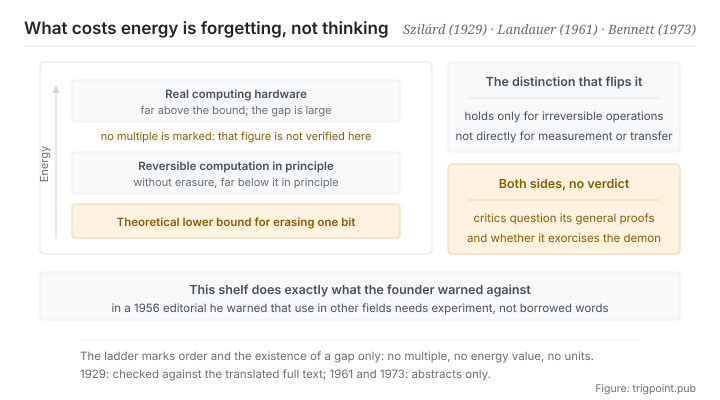

Canonical: https://trigpoint.pub/collections/information-theory/information-theory-and-thermodynamics  
Captured: 2026-11-02T21:27:20.441933+08:00

> Public theory reading mirror. Verification and Lab case sections remain on the website.

Computing and erasing data are separate entries in the thermodynamic account; the lower bound falls on erasing.

# Information theory and thermodynamics

Information Theory and Thermodynamics · Szilárd (1929) / Landauer (1961) / Bennett (1973)

Abstracts checked ✓  
Information theory · cross-domain interface  
Read first: Entropy

## In three sentences

Information is not purely abstract. Erase a bit and heat must be paid physically. That is the hard boundary thermodynamics draws around computation. So keeping order takes a continuous supply of energy is not a metaphor on this page. It has a lower bound, and the bound can be quantified.

<strong>Figure 1</strong> · The ladder of energy cost in computation. At the bottom is the theoretical lower bound, the heat that erasing information has to pay; real hardware sits far above it. The figure deliberately marks no multiple and no energy value, only the order of the rungs and the fact that the gap exists.

## 1. What happened

Computation itself and wiping data out cannot share one energy account: the lower bound this page deals with falls only on erasure. This line does not start with computers. It starts with a thought experiment. In the nineteenth century someone imagined a gatekeeper able to tell fast molecules from slow ones and so create a temperature difference without doing work, which looks like a direct violation of the second law. The 1929 paper supplied the decisive step: to tell them apart the gatekeeper has to acquire information, and acquiring information itself enters the entropy account[\[1\]](#reference-note-1). From then on, the way out of the paradox lay with the observer rather than with the physical system.

The 1961 paper settled the account more precisely, and more counterintuitively: what must pay heat is not computing but erasing[\[2\]](#reference-note-2). The reason is that a logically irreversible operation collapses several possible input states into one output state, and that collapse has to be repaid to the environment as heat. The 1973 line pushed one step further, showing that computation can be made logically reversible at every step, and pointing out on that basis that computation without erasure could in principle bring the dissipation of each step far below the order of that bound[\[3\]](#reference-note-3). Taken together, the three steps give a clean conclusion: what consumes energy is not thinking but forgetting.

Note that this line is not without opposition. A body of criticism in philosophy and physics holds that the general proofs of the principle do not succeed: one criticism, for example, is that those proofs illicitly treat memory devices holding different data as a single statistical ensemble, and that the existing arguments are not enough to exorcise the gatekeeper in general[\[4\]](#reference-note-4). That argument is live today, and this site sets both sides out without ruling.

Finally, the shared formal ancestry belongs in its proper place. That information entropy and the entropy of statistical mechanics share a mathematical form is not disputed. Whether their units, interpretations and ontological standing are the same is still argued and remains unsettled, and this site already handled that in layers on the entropy page.

<strong>Attribution where due:</strong>The early key step that formally connected an observer's acquisition of information to a change in entropy belongs to Szilárd (1929)[\[1\]](#reference-note-1). The lower bound by which erasure must dissipate heat belongs to Landauer (1961)[\[2\]](#reference-note-2); that computation can be logically reversible at every step, and in principle far below that bound, belongs to Bennett (1973)[\[3\]](#reference-note-3). The philosophical criticism of that principle has an independent tradition of its own, set out here without a ruling[\[4\]](#reference-note-4). And the public warning about this whole cross-domain extrapolation comes from the founder of the theory himself (1956)[\[5\]](#reference-note-5). Sign the parts separately, above all the second and the third: running computation costs energy together with erasure costs energy reverses the conclusion of the entire line.

## 2. Why this matters to you

The first eleven pages of this shelf were about limits and trades. This page is about why those limits are not a personal failing.

Keeping an ordered system takes continuous input, and that input has a physical lower bound. In everyday use that sentence has the tone of a motivational poster. On this page it is a quantifiable statement: clearing old states, overwriting expired records, gathering scattered things back into structure, at the most abstract level all of these are erasure, and erasure has a price.

Your knowledge base, your projects and your workflow do not hold themselves in order, and not because you lack discipline. Keeping order is a continuous expenditure by nature. Stop spending and order starts to come apart.

The second thing follows from the counterintuitive result that forgetting costs more than remembering. It has a human counterpart: deciding what to throw away is much harder than deciding what to keep. Keeping needs no judgement; throwing away does. So in any system that accumulates, the real bottleneck was never collection but deletion, and deletion gets postponed not out of laziness but because its unit cost genuinely is higher. Knowing that, the right move is to give deletion a fixed budget rather than expecting it to happen when there is time.

The third thing connects this line to the shelf as a whole. Segment one defined information, segment two said it does not get through, segment three said how to compress it, segment four said how to measure relation and error, segment five said who bears these limits. This page supplies the last bearer: the physical world itself. None of the earlier limits is a convention. They all land on energy in the end.

## Common misreadings

Page verification: Abstracts checked ✓ · Content last revised 2026-10-25

- A common account says information entropy and thermodynamic entropy are the same thing. Their mathematical forms share an ancestry, but whether they are ontologically equivalent is still argued and remains unsettled. This site sets the question out in layers on the entropy page and on this page, without taking a side.
- A common account says computation itself costs energy. According to the principle above, the cost comes from logically irreversible operations, erasure above all; computation that is reversible in principle is not subject to the same bound. That distinction is the key to the whole line, and erasing it gives the opposite conclusion.
- A common account says that information therefore has mass, or that information is physical. What this page supports is a narrower proposition: erasing information has a lower bound in energy. Jumping from there to a stronger metaphysical conclusion needs an argument this page does not provide.

## References

<strong>How to read the source notes</strong> “Bibliographic details checked” means author, year, title and venue were confirmed. It does not mean the source's claims were checked. “Consistent with the abstract” means the claim agrees with the paper's abstract. It does not include sentence-by-sentence checking against the full text. “Matched against the full text” means the claim was compared with the text of the source itself. Definitions as of 2026-09-20.

- \[1\] Szilárd, L. (1929). Über die Entropieverminderung in einem thermodynamischen System bei Eingriffen intelligenter Wesen. Zeitschrift für Physik, 53(11–12), 840–856. English translation: Behavioral Science, 9(4), 301–310 (1964).
- \[2\] Landauer, R. (1961). Irreversibility and Heat Generation in the Computing Process. IBM Journal of Research and Development, 5(3), 183–191.
- \[3\] Bennett, C. H. (1973). Logical Reversibility of Computation. IBM Journal of Research and Development, 17(6), 525–532.
- \[4\] Norton, J. D. (2005). Eaters of the lotus: Landauer's principle and the return of Maxwell's demon. Studies in History and Philosophy of Modern Physics, 36(2), 375–411. Bibliographic details checked against the official record. Consistent with the abstract. Listed as a representative paper of the criticism of the principle.
- \[5\] Shannon, C. E. (1956). The Bandwagon. IRE Transactions on Information Theory, IT-2(1), 3.

Cite as: Trigpoint, “Information theory and thermodynamics”, trigpoint.pub/collections/information-theory/information-theory-and-thermodynamics · © Strategitect Limited. · Content last revised 2026-10-25

## Source notes

**[1]** Szilárd, L. (1929). Über die Entropieverminderung in einem thermodynamischen System bei Eingriffen intelligenter Wesen. Zeitschrift für Physik, 53(11–12), 840–856. DOI 10.1007/BF01341281. English translation: On the decrease of entropy in a thermodynamic system by the intervention of intelligent beings. Behavioral Science, 9(4), 301–310 (1964). Bibliographic details checked against the official record. Claims matched against the full text. The paper argues that the kind of memory faculty on which measurement relies could cause a permanent decrease of entropy, were it not that measurement is necessarily accompanied by a production of entropy; the entropy produced turns out to be exactly enough for full compensation. The editors' note to the English translation calls it one of the earliest, if not the earliest, papers of its kind.

**[2]** Landauer, R. (1961). Irreversibility and Heat Generation in the Computing Process. IBM Journal of Research and Development, 5(3), 183–191. DOI 10.1147/rd.53.0183. Bibliographic details checked against the official record. Consistent with the abstract. Logical operations without a single-valued inverse (logically irreversible operations, such as erasure) necessarily involve a minimal generation of heat.

**[3]** Bennett, C. H. (1973). Logical Reversibility of Computation. IBM Journal of Research and Development, 17(6), 525–532. DOI 10.1147/rd.176.0525. Bibliographic details checked against the official record. Consistent with the abstract. Shows that a general-purpose computer can be made logically reversible at every step; on that basis the author holds that thermodynamically reversible computers dissipating far less than the order of that bound per step are plausible.

**[4]** Norton, J. D. (2005). Eaters of the lotus: Landauer's principle and the return of Maxwell's demon. Studies in History and Philosophy of Modern Physics, 36(2), 375–411. DOI 10.1016/j.shpsb.2004.12.002. Bibliographic details checked against the official record. Consistent with the abstract. One criticism of the principle: the author holds that it is valid only for a particular class of erasure processes, that its general proofs depend on illicitly treating memory devices holding random data as a single statistical ensemble, and that the existing theory is not enough to exorcise the gatekeeper in general. Earman, Norton, Shenker and others have made related criticisms. It is a live philosophical argument, and this site sets both sides out without ruling.

**[5]** Shannon, C. E. (1956). The Bandwagon. IRE Transactions on Information Theory, IT-2(1), 3. DOI 10.1109/TIT.1956.1056774. Bibliographic details checked against the official record. Claims matched against the full text. An editorial. It lists the fields to which the theory was then being applied (biology, psychology, linguistics, fundamental physics, economics and others) and warns that the basic results of the subject point in a very specific direction; applying them elsewhere is not a matter of carrying the words across, but the slow process of hypothesis and experimental verification.

---

[繁體中文](../../../zh-Hant/collections/information-theory/information-theory-and-thermodynamics.md) · [简体中文](../../../zh-Hans/collections/information-theory/information-theory-and-thermodynamics.md)

[Index](../../README.md) · [Original page](https://trigpoint.pub/collections/information-theory/information-theory-and-thermodynamics) · [Citation and versions](../../../READING.md)

[Original SVG](assets/information-theory-and-thermodynamics.svg) · Display copy adds a white background only.
