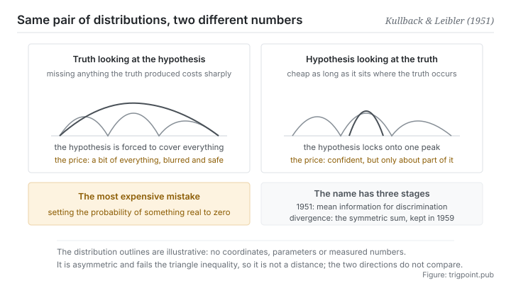

Canonical: https://trigpoint.pub/collections/information-theory/kl-divergence  
Captured: 2026-11-02T21:27:20.714110+08:00

> Public theory reading mirror. Verification and Lab case sections remain on the website.

Should the model cover every situation that occurs, or lock onto one peak?

# Kullback-Leibler divergence

Kullback-Leibler Divergence · Kullback & Leibler (1951)

Bibliography checked ✓  
Information theory · between distributions  
Read first: Entropy  
Read first: Mutual information

## In three sentences

This quantity answers a practical question: if you encode real data with the wrong model, how much extra do you pay per item on average. It is never below zero, and it equals zero only when your model is exactly right. But it is no distance: from you looking at the truth and from the truth looking at you are two different numbers.

<strong>Figure 1</strong> · The two behaviours that follow from the choice of direction. Looking from the true distribution at the hypothesis forces the hypothesis to cover every situation the truth has produced, at the cost of blur. Looking from the hypothesis at the truth forces the hypothesis to lock onto one peak, at the cost of missing the others. For the same pair of distributions, the two directions give different numbers and different optima.

## 1. What happened

Fitting a model to real data involves a trade-off that is often made without noticing: cover every situation that really occurs, or lock onto one peak. Earlier pages established that the most economical coding is fixed by the true probability structure of the data: short codes for the frequent, long codes for the rare. Now suppose you have that structure wrong, and you believe certain situations are common when in fact they are rare. You can still encode, but the code lengths are allocated wrongly, so on average every item costs a little more than the most economical scheme would. What this page measures is that extra.

Seen that way, its properties all become natural. It is always non-negative, because you cannot do better than the most economical scheme. It equals zero only when your assumption is exactly right. What it measures is not how alike two distributions look but the price of substituting one for the other.

That framing of price explains its most famous property directly: asymmetry. Encoding my data with your distribution, and encoding your data with mine, have no reason to cost the same. It also fails the triangle inequality, so mathematically it is no distance, however often it is called one.

Asymmetry is not a technical detail. It produces two entirely different behaviours. One direction pushes your model to cover every situation the truth has produced, because missing any situation that really occurs makes the price rise steeply; the result is a model that turns conservative and blurred, covering a bit of everything. The other direction pushes your model to lock onto one peak and abandon the rest; the result is a model that is confident and right about part of the picture. Both behaviours are visible in practice, and which direction was chosen is often not a conscious decision.

One boundary is easy to step on. If a situation that really occurs has been assigned zero probability under your assumption, the price is infinite. That is intuitively reasonable: your model declared the thing impossible, and it happened. In practice it means that any assertion of never possible is extremely expensive.

As for the name, it goes down in two parts. The 1951 paper called it the mean information for discrimination[\[1\]](#reference-note-1). The word divergence at that time referred to the symmetrised version, the sum of the two directions, and the 1959 book kept that usage[\[2\]](#reference-note-2).

<strong>Attribution where due:</strong>The quantity belongs to Kullback and Leibler (1951), where the original text calls it the mean information for discrimination[\[1\]](#reference-note-1). The word divergence first meant the symmetrised version, the sum of the two directions, and Kullback (1959) kept that usage[\[2\]](#reference-note-2); the one-directional quantity came to be called by the two names only later. Non-negativity follows from Gibbs's inequality, a standard textbook-level result whose sources this site has not separately checked, so it is not listed in the references[\[3\]](#reference-note-3). Booking the name and the quantity separately is a discipline this page shares with several others on this shelf.

## 2. Why this matters to you

This page turns my judgement was wrong from a sentence into a structured quantity, and the structure is the useful part.

The first thing: the cost of an error depends on its direction. When you and reality disagree, what matters is not only how far apart you are but which way you are wrong. A model that overconfidently ruled some possibilities out, and a model that too conservatively covered too many, are two different errors with different cost structures calling for different corrections. Most people reviewing a bad call ask only how far off they were. This page says also ask which way.

The second thing is the most usable: any assertion of never possible is the most expensive kind of error. Let your model set a probability to zero anywhere, and if that thing does happen, the cost blows up. That yields a directly applicable discipline: keep a non-zero possibility for things you believe will not happen, especially while information is thin. The cost of that discipline is low and the loss it guards against has no upper bound.

The third thing concerns the behaviour of models. You will see two tendencies in use: one says a bit of everything and rules nothing out, which reads as safe and is useless; the other gives a confident specific answer while missing other equally possible situations. The frame this page offers: those two tendencies correspond to different optimisation directions rather than to the difference between a good model and a bad one. Knowing that, you will ask a different question instead: on this particular matter, which error is more expensive for me. The answer decides which way you should push.

## Common misreadings

Page verification: Bibliography checked ✓ · Content last revised 2026-10-25

- A common account says this is the distance between two distributions. It is not symmetric and fails the triangle inequality, so it is not a distance in the mathematical sense. For a genuine distance, use another measure. The misnomer is fairly widespread.
- A common account says the concept is called the KL divergence and comes from the 1951 paper. The 1951 paper calls it the mean information for discrimination, and the word divergence at that time referred to the symmetrised version, the sum of the two directions. Keep the history of the name and the history of the quantity apart.
- A common account says a larger value means the two distributions differ more. The value changes with direction, so before comparing you must state which direction is meant. For the same pair of distributions, reversing the direction can reverse which is larger.

## References

<strong>How to read the source notes</strong> “Bibliographic details checked” means author, year, title and venue were confirmed. It does not mean the source's claims were checked. “Follows secondary accounts” means the claim rests on sources that report it, not on the original document. Definitions as of 2026-09-20.

- \[1\] Kullback, S. & Leibler, R. A. (1951). On Information and Sufficiency. Annals of Mathematical Statistics, 22(1), 79–86.
- \[2\] Kullback, S. (1959). Information Theory and Statistics. New York: Wiley; London: Chapman & Hall.
- \[3\] Editorial note, no external source; see note \[3\] in the text.

Cite as: Trigpoint, “Kullback-Leibler divergence”, trigpoint.pub/collections/information-theory/kl-divergence · © Strategitect Limited. · Content last revised 2026-10-25

## Source notes

**[1]** Kullback, S. & Leibler, R. A. (1951). On Information and Sufficiency. Annals of Mathematical Statistics, 22(1), 79–86. DOI 10.1214/aoms/1177729694. Bibliographic details checked against the official record. The wording of the original follows secondary accounts that agree with one another. The original calls the one-directional quantity the mean information for discrimination. The word divergence in the same paper refers to the symmetrised version, the sum of the two directions, not to the one-directional quantity now called the KL divergence.

**[2]** Kullback, S. (1959). Information Theory and Statistics. New York: Wiley; London: Chapman & Hall. Bibliographic details cross-checked against multiple sources. The naming in the book and afterwards follows secondary accounts that agree with one another. The book keeps divergence for the symmetrised version and calls each one-directional quantity a directed divergence. The one-directional quantity came to be called by the two names only later.

**[3]** Non-negativity follows from Gibbs' inequality, with equality if and only if the two distributions are identical. It is a standard textbook result, and this site has not separately checked its sources.

---

[繁體中文](../../../zh-Hant/collections/information-theory/kl-divergence.md) · [简体中文](../../../zh-Hans/collections/information-theory/kl-divergence.md)

[Index](../../README.md) · [Original page](https://trigpoint.pub/collections/information-theory/kl-divergence) · [Citation and versions](../../../READING.md)

[Original SVG](assets/kl-divergence.svg) · Display copy adds a white background only.
