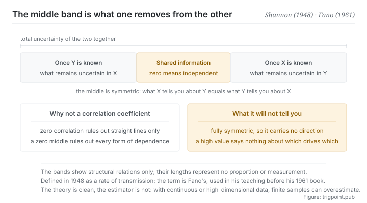

Canonical: https://trigpoint.pub/collections/information-theory/mutual-information  
Captured: 2026-11-02T21:27:20.975513+08:00

> Public theory reading mirror. Verification and Lab case sections remain on the website.

“Zero correlation means no relationship”: wrong.

# Mutual information

Mutual Information · Shannon (1948) / Fano (1961)

Bibliography checked ✓  
Information theory · between distributions  
Read first: Entropy

## In three sentences

Mutual information measures how much of the uncertainty in one thing goes away once you know the other. It is zero only when the two are genuinely independent, and it catches the nonlinear dependence that a correlation coefficient cannot see. The price is that it is perfectly symmetric. It tells you that there is a relation, and never which one affects which.

<strong>Figure 1</strong> · Decomposing the uncertainty of two variables. The whole band is the total uncertainty of the two taken together; the middle section is the part of one that goes away once the other is known, which is the shared information. The two sides are what remains of each once the other is known. Band lengths show structural relations only and represent no proportion.

## 1. What happened

The previous pages all measured the uncertainty of a single object. This page begins measuring between two. The method is direct: look at how uncertain one of them was, then at how much uncertainty remains once the other is known, and the difference is the information they share.

The construction has several clean properties. It is always non-negative, meaning that knowing one thing never leaves you more uncertain about another, at least on average. It is perfectly symmetric: how much X tells you about Y equals how much Y tells you about X. And the most useful property: it is zero if and only if the two are statistically independent.

That last property is where it parts company with a correlation coefficient. Correlation captures linear relationships only, so a correlation of zero does not rule out strong dependence, only dependence in the shape of a straight line. Mutual information has no such blind spot: statistical dependence of any form drives it above zero.

The price is computational. For continuous variables and in high dimensions, estimating it from finite samples is difficult, and practice relies on various proxy methods, each carrying biases of its own.

The quantity is also the core of channel capacity: capacity is precisely the value that maximises this shared information over all possible input distributions[\[1\]](#reference-note-1). Which is to say that the hard boundary in segment two of this shelf measures exactly what this page is about.

One standard corollary is worth keeping, and it concerns which way information travels through a process: after any processing step, what a piece of information shares with its original source can only decrease or stay level, never increase. Processing can make information more usable and more readable. It cannot create it from nothing. That corollary sits at the textbook level, and this site has not separately checked its sources, so it carries no citation mark here and stands as a directional pointer only.

As for the name, it goes down in two parts: the quantity belongs to the 1948 paper, which calls it a rate of transmission[\[1\]](#reference-note-1), while the term mutual information belongs to Fano and not to Shannon[\[2\]](#reference-note-2).

<strong>Attribution where due:</strong>The definition of the quantity belongs to Shannon (1948), who called it a rate of transmission, and it was used in the same paper to establish channel capacity[\[1\]](#reference-note-1). The term mutual information belongs to Fano: the commonly cited source is his 1961 book, but historical accounts state that he was using the word in his teaching earlier[\[2\]](#reference-note-2). Book the quantity and the word separately. Attributing both to the 1948 paper is a common way of writing it, and it erases a real piece of terminological history. As for the equivalence between this quantity and a measure of divergence between distributions, see the related page on this site; treating the two as one concept is another form of over-compression.

## 2. Why this matters to you

Segment two of this shelf said signal is input that reliably lowers uncertainty, and gave no quantity for it. This page gives one: the shared information is that quantity.

In practice you will not actually compute it, but the way it asks a question is directly usable: if this item were removed, would my conclusion differ? That question is the everyday form of shared information, because it asks exactly whether knowing this changed my uncertainty about the conclusion. Run it over a body of context assembled for a model and most passages drop out on the spot, not because they are wrong but because they change nothing.

The second use is to expose a very common misjudgement. Somebody cites a correlation coefficient to say two things are unrelated, and stops investigating. This page says that conclusion is too strong: a correlation of zero rules out a straight line only, and real dependence often has turns, thresholds and segments in it. Asserting independence needs stronger evidence than a correlation coefficient.

The third use comes with a warning. The quantity is perfectly symmetric, so it will never tell you direction. Two things sharing a lot of information may mean the first affects the second, the second affects the first, or a third thing affects both. Inferring causation from a high shared value uses a symmetric quantity as though it were directed. Handling direction needs another family of variants that carry time order, which this shelf does not include.

## Common misreadings

Page verification: Bibliography checked ✓ · Content last revised 2026-10-25

- A common account says a correlation of zero means the two are unrelated. It means only that there is no linear relationship. The quantity on this page is zero exactly when the two are statistically independent, and it catches nonlinear and non-monotonic dependence. Using a correlation coefficient as a test of independence uses a weaker condition as if it were a stronger one.
- A common account says the term comes from Shannon in 1948. He defined the quantity, calling it a rate of transmission, and did not use the term mutual information; the term belongs to Fano. Book the quantity and the word separately.
- A common account says higher mutual information means a stronger causal relationship. It is perfectly symmetric and carries no direction, so it cannot be used to judge what causes what. Handling direction needs another family of variants that carry time order, which this shelf does not include.

## References

<strong>How to read the source notes</strong> “Bibliographic details checked” means author, year, title and venue were confirmed. It does not mean the source's claims were checked. “Matched against the full text” means the claim was compared with the text of the source itself. “Follows secondary accounts” means the claim rests on sources that report it, not on the original document. Definitions as of 2026-09-20.

- \[1\] Shannon, C. E. (1948). A Mathematical Theory of Communication. Bell System Technical Journal, 27(3), 379–423; 27(4), 623–656.
- \[2\] Fano, R. M. (1961). Transmission of Information: A Statistical Theory of Communications. Cambridge, MA: MIT Press.

Cite as: Trigpoint, “Mutual information”, trigpoint.pub/collections/information-theory/mutual-information · © Strategitect Limited. · Content last revised 2026-10-25

## Source notes

**[1]** Shannon, C. E. (1948). A Mathematical Theory of Communication. Bell System Technical Journal, 27(3), 379–423; 27(4), 623–656. Bibliographic details checked against the official record. Claims matched against the full text. The original defines this quantity under the name rate of transmission (the entropy of the source less the conditional entropy that remains once the signal is received), and defines channel capacity as its maximum over all input sources. The term mutual information does not appear anywhere in the text.

**[2]** Fano, R. M. (1961). Transmission of Information: A Statistical Theory of Communications. Cambridge, MA: MIT Press. Bibliographic details cross-checked against multiple sources. That the term was in use before this book follows secondary accounts that agree with one another. The term mutual information belongs to Fano. Historical accounts state that he was already using it in his course at MIT (citing his class notes of 1952), before this book; this page therefore treats the book as the commonly cited source, not as the first appearance of the term.

---

[繁體中文](../../../zh-Hant/collections/information-theory/mutual-information.md) · [简体中文](../../../zh-Hans/collections/information-theory/mutual-information.md)

[Index](../../README.md) · [Original page](https://trigpoint.pub/collections/information-theory/mutual-information) · [Citation and versions](../../../READING.md)

[Original SVG](assets/mutual-information.svg) · Display copy adds a white background only.
