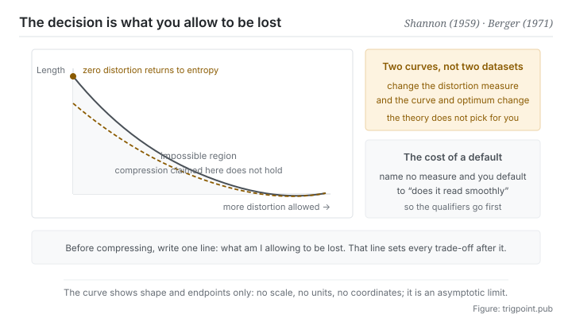

Canonical: https://trigpoint.pub/collections/information-theory/rate-distortion-theory  
Captured: 2026-11-02T21:27:21.236069+08:00

> Public theory reading mirror. Verification and Lab case sections remain on the website.

To compress an image, measure distortion by numerical difference, or by what the eye cares about?

# Rate-distortion theory

Rate-Distortion Theory · Shannon (1959) / Berger (1971)

Bibliography checked ✓  
Information theory · representation and compression  
Read first: Entropy  
Read first: Coding and compression

## In three sentences

Allow distortion and you can compress below the entropy, but how far below is fixed by a curve that cannot be crossed. The real design decision is not how much to compress. It is to specify in advance which kind of loss is acceptable. Get that standard wrong and you will optimise the wrong thing very efficiently.

<strong>Figure 1</strong> · The trade curve between rate and distortion. The more distortion allowed, the lower the bound on required length; when the allowed distortion is zero, the bound returns to the entropy. Below the curve is the impossible region, and any compression claimed to land there does not hold. This figure deliberately carries no numerical scale and no units.

## 1. What happened

Once distortion is allowed, the first design decision is which kind of difference counts as loss; how short the result can get comes after that. The floor of lossless compression is the entropy. But much of the time complete reconstruction is not needed: for a photograph, a recording or a summary, losing some detail in exchange for a large reduction is worth it. The question is worth it down to where.

The answer was sketched for continuous sources at the end of the 1948 paper[\[4\]](#reference-note-4), and the 1959 paper gave it its full shape[\[1\]](#reference-note-1). It uses a distortion measure, which states what kind of difference counts as loss and how much, and then, under the constraint that average distortion stays within D, finds the minimum length required. What comes out is a curve decreasing in D: the more distortion allowed, the less length needed.

Two end points of that curve are worth keeping. When the allowed distortion is zero, it returns to the entropy. When the allowed distortion reaches its limit, it falls to zero, which is to say nothing is transmitted at all. The 1971 textbook systematised the field and became its canon thereafter[\[2\]](#reference-note-2).

The most important property of the curve is not its shape but that the region below it is impossible. Any method claiming to compress below the curve at a given distortion level has either miscalculated or quietly changed the definition of distortion. That gives you a hard checking tool.

The real weight of the theory sits in a place that is often skipped: the distortion measure is yours to choose. The theory does not tell you what counts as loss. It tells you where the limit is once you have given it a standard. So for the same data, a different distortion measure yields a completely different curve and a completely different optimal method. One famous consequence in image compression is that methods built around numerical difference produce artefacts of a particular kind to the human eye, because what the eye cares about is not numerical difference.

One practical correction goes with this: the curve is reachable asymptotically and needs very long code blocks. For short messages, and wherever immediacy is required, the rate actually achievable is generally above the curve[\[3\]](#reference-note-3).

<strong>Attribution where due:</strong>The theoretical limit of lossy compression belongs to Shannon: the idea was set out for continuous sources at the end of the 1948 paper[\[4\]](#reference-note-4), and the convention-record paper of 1959 gives the full statement for discrete sources[\[1\]](#reference-note-1). Systematisation of the field, and its canonical standing, belong to Berger's textbook of 1971[\[2\]](#reference-note-2). The two roles differ and neither name should be used for the other. The correction for lossy compression at finite blocklength can be found in Kostina and Verdú (2012)[\[3\]](#reference-note-3). As for the later variants that carried this framework into representation theory in machine learning, this site has not admitted them to the shelf because unresolved disputes attach to their downstream claims. Their existence is noted here and no more.

## 2. Why this matters to you

Every summary, handover and briefing you make is lossy compression. The difference is that most people do not notice they are making a choice: which kind of loss is acceptable.

Leave that unspecified and you have defaulted to a standard, and the default is usually whether it reads smoothly. Compression then becomes cutting whatever makes sentences longer or more awkward, and those parts are frequently the ones carrying conditions and exceptions: unless, depends on, only if, must.

Cut them and fluency rises. Fluency was the distortion measure you defaulted to, so the optimisation process thinks it is doing well. What was lost is the boundaries a judgement needs, and that loss produces no error message.

Change the measure and the whole practice changes. Set the distortion measure to whether the reader would make a different decision, and the first things to protect are every condition that changes a decision, while background, motivation and process narrative can go wholesale. Same material, same halving of length, two completely different versions, each optimal under its own standard.

So what this page gives you is one sentence of practice: before compressing, write down what you allow yourself to lose. Written out it usually takes under ten words, and it settles the direction of every trade that follows. Our own knowledge base puts it as a hard rule: words carrying causation and conditions can never be cut when compressing, everything else can. That rule is a distortion measure stated in the open.

The third thing is to acknowledge the limit. When you find that any further compression loses something you cannot accept, that does not mean your technique is short. It means the length that corresponds to the distortion level you want is simply that length. The right move then is to accept the length, or to change the reader, rather than to keep compressing.

## Common misreadings

Page verification: Bibliography checked ✓ · Content last revised 2026-10-25

- A common account says lossy compression is just compression of poorer quality. It is not a matter of better or worse quality but of where the trade sits. The design core of lossy compression is not how much to compress but which kind of loss is specified in advance as acceptable and which is not. Lossy compression with no distortion measure specified has no target.
- A common account says the values on the curve can be reached. They are an asymptotic limit and need very long code blocks. For short messages and real-time use the actual rate is generally above the curve; the size of that correction for lossy compression at finite blocklength was characterised systematically in a 2012 paper.

## References

<strong>How to read the source notes</strong> “Bibliographic details checked” means author, year, title and venue were confirmed. It does not mean the source's claims were checked. “Consistent with the abstract” means the claim agrees with the paper's abstract. It does not include sentence-by-sentence checking against the full text. “Matched against the full text” means the claim was compared with the text of the source itself. Definitions as of 2026-09-20.

- \[1\] Shannon, C. E. (1959). Coding Theorems for a Discrete Source with a Fidelity Criterion. IRE National Convention Record, 7, Part 4, 142–163.
- \[2\] Berger, T. (1971). Rate Distortion Theory: A Mathematical Basis for Data Compression. Englewood Cliffs, NJ: Prentice-Hall.
- \[3\] Kostina, V., & Verdú, S. (2012). Fixed-Length Lossy Compression in the Finite Blocklength Regime. IEEE Transactions on Information Theory, 58(6), 3309–3338.
- \[4\] Shannon, C. E. (1948). A Mathematical Theory of Communication. Bell System Technical Journal, 27(3), 379–423; 27(4), 623–656.

Cite as: Trigpoint, “Rate-distortion theory”, trigpoint.pub/collections/information-theory/rate-distortion-theory · © Strategitect Limited. · Content last revised 2026-10-25

## Source notes

**[1]** Shannon, C. E. (1959). Coding Theorems for a Discrete Source with a Fidelity Criterion. IRE National Convention Record, 7, Part 4, 142–163. Bibliographic details confirmed by two sources. Claims matched against the full text. Defines the rate distortion function R(d) from a distortion measure and a ceiling on average distortion, and proves the coding theorem for discrete sources; R(d) decreases monotonically in d and falls to zero once distortion passes a certain ceiling.

**[2]** Berger, T. (1971). Rate Distortion Theory: A Mathematical Basis for Data Compression. Englewood Cliffs, NJ: Prentice-Hall. Bibliographic details cross-checked against multiple sources. The textbook that set out rate-distortion theory systematically.

**[3]** Kostina, V., & Verdú, S. (2012). Fixed-Length Lossy Compression in the Finite Blocklength Regime. IEEE Transactions on Information Theory, 58(6), 3309–3338. DOI 10.1109/TIT.2012.2186786. Bibliographic details checked against the official record. Consistent with the abstract. An analysis of lossy compression at finite blocklength: for a given blocklength and probability that distortion exceeds its level, the minimum achievable rate is close to R(d) plus a correction that shrinks with the square root of the blocklength, so for short codes the actual rate is generally above the curve.

**[4]** Shannon, C. E. (1948). A Mathematical Theory of Communication. Bell System Technical Journal, 27(3), 379–423; 27(4), 623–656. Bibliographic details checked against the official record. Claims matched against the full text. Sections 26 and 27 of the original printing (27 and 28 in later reprints) measure the fidelity of reconstruction by a distance function, define the rate of a source relative to that fidelity, and give the matching coding theorem (theorem 21); they deal with continuous sources.

---

[繁體中文](../../../zh-Hant/collections/information-theory/rate-distortion-theory.md) · [简体中文](../../../zh-Hans/collections/information-theory/rate-distortion-theory.md)

[Index](../../README.md) · [Original page](https://trigpoint.pub/collections/information-theory/rate-distortion-theory) · [Citation and versions](../../../READING.md)

[Original SVG](assets/rate-distortion-theory.svg) · Display copy adds a white background only.
