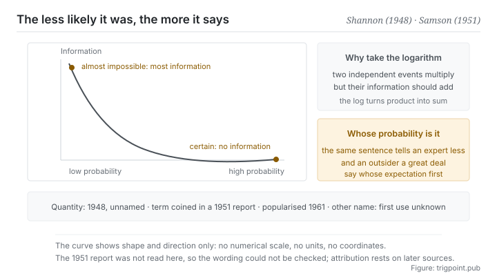

Canonical: https://trigpoint.pub/collections/information-theory/self-information  
Captured: 2026-11-02T21:27:21.531561+08:00

> Public theory reading mirror. Verification and Lab case sections remain on the website.

Should the information in an event be counted with the insider's probabilities or the outsider's?

# Self-information

Self-Information · Shannon (1948) / Samson (1951)

Bibliography checked ✓  
Information theory · core measures  
Read first: Information and uncertainty

## In three sentences

How much information something carries depends on how unlikely it was in the first place. Something certain happens and it has told you nothing. Something all but impossible happens and it carries the most information there is. So what information measures is how much of your prior expectation was overturned.

<strong>Figure 1</strong> · How information relates to probability. The lower the probability, the more information the event carries when it occurs; when something is all but certain, its occurrence tells you almost nothing. The panel on the right shows why the logarithm is taken: it is what makes the information of two independent events add up. This figure deliberately carries no numerical scale and no units.

## 1. What happened

Before the information in an event can be counted, a choice has to be made: the probabilities of someone with inside knowledge, or those of an outsider. Once information is defined as the reduction of uncertainty, the next step is to fix a number for a single event. The answer is already contained in the 1948 paper: entropy is the probability-weighted average of log(1/p) over the outcomes, and the paper uses the same quantity to bound the code length a single message needs[\[1\]](#reference-note-1). Taken on its own, it gives a result simple to the point of being counterintuitive: the information of an event is determined by its probability alone, and the lower the probability the higher the information. For something certain, the information is zero.

Why take a logarithm rather than the reciprocal of the probability directly? Because information has to add up. When two unrelated events both occur, what they carry together should intuitively be the sum of what each carries, and the probability of two independent events both occurring is the product of the two probabilities. To turn multiplication into addition, the logarithm is the only natural choice.

That apparently technical decision is what makes information a quantity you can accumulate, compare and use as a unit, and the whole practical value of the theory rests on it.

One detail slips by easily: whose probability. For the same event, someone with inside knowledge assigns a high probability and gets low information, while an outsider assigns a low probability and gets high information. The theory does not prescribe where the probabilities come from. It only requires you to say whose expectation is in play. That is why how much information is in this sentence has no absolute answer, only an answer for a given person.

As for the name, two things are booked separately. The quantity comes out of the framework of the 1948 paper, which gave it no name[\[1\]](#reference-note-1). Priority for coining the word surprisal is assigned by the later literature to a 1951 air force research report, with the 1961 book putting it into circulation rather than originating it[\[2\]](#reference-note-2)[\[3\]](#reference-note-3). The term self-information does not appear in the 1948 paper, and this site has found no reliable source for its first use, so it is credited to nobody[\[4\]](#reference-note-4).

<strong>Attribution where due:</strong>The quantity comes out of the framework of Shannon (1948), though the paper neither defines it separately nor names it[\[1\]](#reference-note-1). Priority for coining surprisal is assigned by the later literature to Samson (1951)[\[2\]](#reference-note-2), with Tribus (1961) as populariser and not originator[\[3\]](#reference-note-3). Self-information does not appear in the 1948 paper, and this site has found no reliable source for its first use[\[4\]](#reference-note-4). Book the quantity and the word separately. Attributing both to Shannon is a common simplification, and it erases an author with a real priority claim along with a real piece of terminological history.

## 2. Why this matters to you

What this page gives you is a reading action you can apply directly: for any passage, ask first which of your expectations it overturned.

The action tells apart two things that read very much alike. One retells something you already believe, more completely and in better order. The other tells you that something you took to be so is not. The first is comfortable to read and carries information close to zero. The second is uncomfortable and carries a lot.

Comfort and quantity of information are negatively correlated here, which makes a sharp criterion for choosing what to read.

On model output it applies more directly still. A response that falls entirely inside your expected distribution reduces none of your uncertainty, however long and however complete it is. Useful output usually shares one feature: at least one item in it is something you would have bet against beforehand.

So rather than asking whether this answer is good, ask whether anything in it surprised you. If nothing did, the yield of that call is close to zero, whatever the word count.

The reverse holds too, and it makes a practical self-check: when everything you write has everyone nodding, you may have said nothing. Consensus statements have high probability and low information. That does not make them worthless, since laying groundwork and aligning have their functions, but be clear that that part is not you transmitting information. It is you aligning probability distributions. Book the two separately.

## Common misreadings

Page verification: Bibliography checked ✓ · Content last revised 2026-10-25

- A common account says that Shannon proposed both the concept and the name surprisal. The 1948 paper uses the quantity but coins no word for it. Priority for the word is assigned by the later literature to a 1951 air force research report, and a 1961 book put it into circulation. As for the other common term, self-information, it does not appear in the 1948 paper, and this site has found no reliable source for its first use.
- A common account says that information depends on whether an event is important. It does not depend on importance, only on how improbable the event was. That is hard to accept intuitively, but it is exactly the premise that lets the whole theory quantify.

## References

<strong>How to read the source notes</strong> “Bibliographic details checked” means author, year, title and venue were confirmed. It does not mean the source's claims were checked. “Matched against the full text” means the claim was compared with the text of the source itself. “Follows secondary accounts” means the claim rests on sources that report it, not on the original document. Definitions as of 2026-09-20.

- \[1\] Shannon, C. E. (1948). A Mathematical Theory of Communication. Bell System Technical Journal, 27(3), 379–423; 27(4), 623–656.
- \[2\] Samson, E. W. (1951). Fundamental Natural Concepts of Information Theory. AFCRC Report E5079.
- \[3\] Tribus, M. (1961). Thermostatics and Thermodynamics. Van Nostrand.
- \[4\] Editorial note with no external source; the full text is in note \[4\] in the body.

Cite as: Trigpoint, “Self-information”, trigpoint.pub/collections/information-theory/self-information · © Strategitect Limited. · Content last revised 2026-10-25

## Source notes

**[1]** Shannon, C. E. (1948). A Mathematical Theory of Communication. Bell System Technical Journal, 27(3), 379–423; 27(4), 623–656. DOI 10.1002/j.1538-7305.1948.tb01338.x. Bibliographic details checked against the official record. Claims matched against the full text. The paper uses the quantity: entropy is the probability-weighted average of log(1/p) over the outcomes, and the bound on the code length a single message needs is also stated in terms of log(1/p). But the paper does not define it separately as the information of a single event, and gives it no name; the words self-information, surprisal and mutual information appear nowhere in it.

**[2]** Samson, E. W. (1951). Fundamental Natural Concepts of Information Theory. AFCRC Report E5079. Bibliographic details confirmed by two sources. The attribution of the coinage of surprisal follows secondary accounts that agree with one another. The later literature assigns priority for coining the word surprisal to this report. This site has not read the report itself, so whether the word appears in it could not be checked word for word.

**[3]** Tribus, M. (1961). Thermostatics and Thermodynamics. Van Nostrand. Bibliographic details confirmed by two sources. The account of this book as populariser of the word follows secondary accounts that agree with one another. Put the word surprisal into circulation: popularisation rather than origination.

**[4]** The term self-information does not appear in the 1948 paper; this site has found no reliable source for its first use and so credits it to nobody.

---

[繁體中文](../../../zh-Hant/collections/information-theory/self-information.md) · [简体中文](../../../zh-Hans/collections/information-theory/self-information.md)

[Index](../../README.md) · [Original page](https://trigpoint.pub/collections/information-theory/self-information) · [Citation and versions](../../../READING.md)

[Original SVG](assets/self-information.svg) · Display copy adds a white background only.
