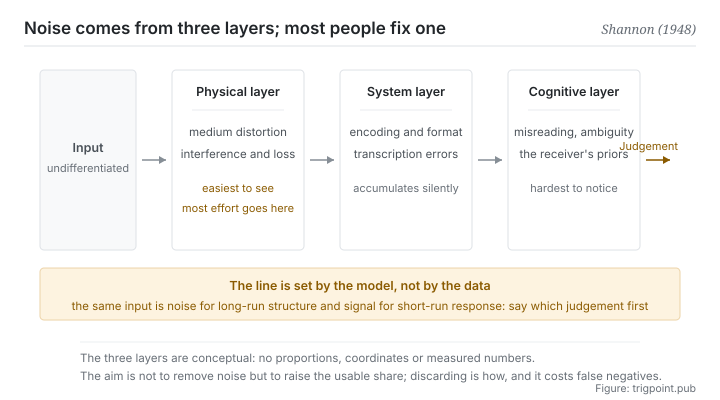

Canonical: https://trigpoint.pub/collections/information-theory/signal-and-noise  
Captured: 2026-11-02T21:27:21.794519+08:00

> Public theory reading mirror. Verification and Lab case sections remain on the website.

Long-run structure or short-run response? Signal and noise swap sides depending on the answer.

# Signal and noise

Signal and Noise · Shannon (1948)

Bibliography checked ✓  
Lab case ✓  
Information theory · transmission limits  
Read first: Self-information  
Read first: Entropy

## In three sentences

Signal is the part of the input that reliably lowers uncertainty. The rest is noise. The line between them is not in the data but in the model you read it with: change the model and the same input can change sides. So the work goes into raising the proportion that is usable.

<strong>Figure 1</strong> · The three source layers of noise. Before it reaches a judgement, the same input passes in turn through physical, system and cognitive interference. The note underneath points at a property that is often missed: the line between signal and noise is set by the model you are using at the time, and under a different model the same input can change sides.

## 1. What happened

Whether a stretch of input counts as signal or noise depends on a prior choice of which judgement it is meant to serve: long-run structure, or short-run response. One decisive move in the 1948 paper was to write noise formally into the communication model[\[1\]](#reference-note-1). From then on noise was part of the model, and how much can still be transmitted reliably while interference is present turned into a question that can be analysed and pushed to a limit.

The importance of that turn is in the concession: it admits that noise will not go away, and then asks what can be done given that it is there.

Seen that way, the definition of signal becomes narrow: only input that reliably changes your probability distribution is signal. Changes, meaning it reduced uncertainty. Reliably, meaning it is not a random disturbance that moves things one way this time and back the next. Anything failing those two conditions is noise, however much it looks like data.

Noise comes from at least three layers, and they usually act at once. The physical layer is distortion in the transmission medium. The system layer is error introduced in encoding, formatting and transcription. The cognitive layer is misunderstanding, ambiguous terminology, and the receiving end's own prior convictions. Most people handle the first only, because it is the easiest to see.

One property is often missed, and it is the most useful sentence on this page: signal and noise are relative to a model. The same input is noise when you care about long-run structure and signal when you care about short-run response. That is not equivocation. This pair of concepts carries a frame of reference inside its definition. So any discussion of whether this is signal that has not first said which judgement it is signal for will reach no conclusion.

<strong>Attribution where due:</strong>Writing noise formally into the communication model, and so making reliable transmission under interference an analysable problem, belongs to Shannon (1948), and the capacity formula under white noise already appears in the same paper[\[1\]](#reference-note-1); the 1949 paper treats the same problem geometrically[\[2\]](#reference-note-2). By 1948 signal-to-noise ratio was already a working quantity in communications engineering: the paper's opening sentence mentions modulation methods of the time, such as PCM and PPM, that exchange bandwidth for signal-to-noise ratio[\[1\]](#reference-note-1). Its earlier history and attribution have not been separately checked here, so no specific name is signed. The attributions of other figures from engineering history are unchecked as well, and are therefore not listed in this section.

## 2. Why this matters to you

Most people handle information overload by adding gates: subscribe to more sources, produce more summaries, build more categories. This page says most of that effort goes into the wrong variable.

The quantity to watch is the proportion, not the total. If what reaches you grows while the share of it that can change a judgement does not, your position has not improved. You are busier.

Worse, an increase in total usually drives the proportion down, because newly added sources are generally more marginal than the ones you already had. Volume of input and signal-to-noise ratio are two quantities that can move in opposite directions, and only the second affects how accurately you judge.

That is particularly costly when working with a model, because the context you feed in has a quiet failure mode. You attach everything that might be relevant, the model does not tell you that eight parts in ten are noise, it takes the lot and produces a response that looks reasonable. You think you are supplying fuller background. You are diluting.

The test is simple: if this passage were removed, would my conclusion differ? If it would not, it is noise, and attaching it does not cost nothing.

The third thing is about time scale. Reading short-run fluctuation as a trend is the standard form of mistaking noise for signal, and it has a feature that is hard to shake: fluctuation is always the most recent, the most vivid, and the easiest to read as things are changing. There is no clever guard against this. You can only fix in advance which scale you are looking at and how long counts, then not change it midway.

## Common misreadings

Page verification: Bibliography checked ✓ · Content last revised 2026-10-25

- A common account says: remove the noise first, then analyse. In most cases noise cannot be removed, and what can be adjusted is the ratio of signal to noise. Setting the goal as eliminating noise usually leads to over-filtering, which strips out signal along with it.
- A common account says that signal and noise are intrinsic properties of the data. They are not. The same input can fall on either side under different models and time scales. Before judging, say which model and which scale.

## References

<strong>How to read the source notes</strong> “Bibliographic details checked” means author, year, title and venue were confirmed. It does not mean the source's claims were checked. “Matched against the full text” means the claim was compared with the text of the source itself. Definitions as of 2026-09-20.

- \[1\] Shannon, C. E. (1948). A Mathematical Theory of Communication. Bell System Technical Journal, 27(3), 379–423; 27(4), 623–656.
- \[2\] Shannon, C. E. (1949). Communication in the Presence of Noise. Proceedings of the IRE, 37(1), 10–21.

Cite as: Trigpoint, “Signal and noise”, trigpoint.pub/collections/information-theory/signal-and-noise · © Strategitect Limited. · Content last revised 2026-10-25

## Source notes

**[1]** Shannon, C. E. (1948). A Mathematical Theory of Communication. Bell System Technical Journal, 27(3), 379–423; 27(4), 623–656. DOI 10.1002/j.1538-7305.1948.tb01338.x. Bibliographic details checked against the official record. Claims matched against the full text. Writes noise formally into the communication model (part II, the discrete channel with noise), making reliable transmission under interference an analysable problem; the capacity formula for a channel under white noise is in section 24, theorem 17. The opening sentence mentions modulation methods of the time, such as PCM and PPM, that exchange bandwidth for signal-to-noise ratio.

**[2]** Shannon, C. E. (1949). Communication in the Presence of Noise. Proceedings of the IRE, 37(1), 10–21. DOI 10.1109/JRPROC.1949.232969. Bibliographic details checked against the official record. Treats transmission under noise geometrically; the 1948 paper announces it as forthcoming and cites it for the geometric discussion of white noise. This site has a separate page on capacity under noise.

---

[繁體中文](../../../zh-Hant/collections/information-theory/signal-and-noise.md) · [简体中文](../../../zh-Hans/collections/information-theory/signal-and-noise.md)

[Index](../../README.md) · [Original page](https://trigpoint.pub/collections/information-theory/signal-and-noise) · [Citation and versions](../../../READING.md)

[Original SVG](assets/signal-and-noise.svg) · Display copy adds a white background only.
