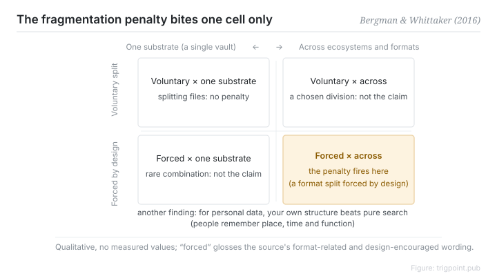

Canonical: https://trigpoint.pub/collections/pkm/bergman-whittaker-2016-pim  
Captured: 2026-10-05T03:32:09.590602+08:00

> Public theory reading mirror. Verification and Lab case sections remain on the website.

“Fewer tools is always better”: the fault is structural.

# Personal information management

Personal Information Management · Bergman & Whittaker (2016)

Abstracts checked ✓  
Personal knowledge management · empirical science

## In three sentences

Personal information management is an empirical science, not productivity folklore. Two central findings: search dominates for public information, but used for personal information it works less well, and the authors argue their user-subjective approach does not replace folders; and fragmentation has clear scope conditions, covering only splits across tools that system design forces. "Fewer tools is always better" is precisely what happens when those conditions are read past.

<strong>Figure 1</strong> · The scope conditions on the fragmentation penalty, shown qualitatively. Two axes: whether the split is forced by system design, and whether it crosses ecosystems and formats. The penalty fires only in the cell where both hold. Voluntary splitting across files within one substrate is not in that cell. Forced is our gloss on the source's format-related and design-encouraged wording. Redrawn; not the book's own diagram.

## 1. What happened

The 2016 monograph from Bergman and Whittaker synthesises research on personal information management[\[1\]](#reference-note-1).

Folders take a standard criticism: information hides inside nested folders, you have to remember the exact location, and information scientists therefore argue that search is more flexible. The authors see it differently: search and tags work best for public information and less well for personal information, and the user-subjective approach they argue for does not replace folders.

The fragmentation claim gets narrowed by evidence in the same way. A classic definition, from a 2006 CHI paper, is that material for one project is stored in separate format-related collections, documents in one place, mail in another, bookmarks in a third; a 20-user study found that whether people fragment depends on what the interface design encourages[\[2\]](#reference-note-2). The problem lies in a split the system design forces, not in having many files.

<strong>Attribution where due:</strong>"Forced" is a reasonable gloss on the source's format-related and design-encouraged wording rather than the book's own term, and the folder criticism is a near-paraphrase of the publisher's blurb. A classic definition of the fragmentation problem comes from the 2006 conference paper by Bergman, Beyth-Marom and Nachmias[\[2\]](#reference-note-2), while the 2016 monograph is the milestone of empirical synthesis. Cite the two layers separately.

## 2. Why this matters to you

Two design consequences. First, organising your own knowledge base is not wasted time: you are building an index for your own memory, which is exactly the part search cannot replace.

Second, run the scope test before deciding whether to merge tools. This particular definition covers splits that cross ecosystems and are forced by format. Splitting across several files inside one substrate, several files for different purposes within one vault, is not covered by the definition.

Treating a design claim as universal makes you reorganise a system to avoid a cost that is not there. Reading the boundary correctly turns "how many tools is too many" from a matter of taste into a decidable question.

One honest addition: that definition covers only the cross-tool kind. It does not mean that any internal arrangement is free.

## References

<strong>How to read the source notes</strong> “Bibliographic details checked” means author, year, title and venue were confirmed. It does not mean the source's claims were checked. “Consistent with the abstract” means the claim agrees with the paper's abstract. It does not include sentence-by-sentence checking against the full text. Definitions as of 2026-09-20.

- \[1\] Bergman, O., & Whittaker, S. (2016). The Science of Managing Our Digital Stuff. Cambridge, MA: MIT Press. https://doi.org/10.7551/mitpress/9780262035170.001.0001
- \[2\] Bergman, O., Beyth-Marom, R., & Nachmias, R. (2006). The project fragmentation problem in personal information management. CHI 2006, 271–274. https://doi.org/10.1145/1124772.1124813

Cite as: Trigpoint, “Personal information management”, trigpoint.pub/collections/pkm/bergman-whittaker-2016-pim · © Strategitect Limited. · Content last revised 2026-10-01

## Source notes

**[1]** Bergman, O., & Whittaker, S. (2016). The Science of Managing Our Digital Stuff. Cambridge, MA: MIT Press. ISBN 9780262035170. Bibliographic details cross-checked against multiple sources. Consistent with the abstract. The criticism of folders is a near-paraphrase of the publisher's blurb, not a page-anchored quotation.

**[2]** Bergman, O., Beyth-Marom, R., & Nachmias, R. (2006). The project fragmentation problem in personal information management. CHI 2006, 271–274. DOI 10.1145/1124772.1124813. Bibliographic details cross-checked against multiple sources. Consistent with the abstract. This paper gives a classic definition of the fragmentation problem: the material for one project is stored separately in collections divided by format (a study of 20 people).

---

[繁體中文](../../../zh-Hant/collections/pkm/bergman-whittaker-2016-pim.md) · [简体中文](../../../zh-Hans/collections/pkm/bergman-whittaker-2016-pim.md)

[Index](../../README.md) · [Original page](https://trigpoint.pub/collections/pkm/bergman-whittaker-2016-pim) · [Citation and versions](../../../READING.md)

[Original SVG](assets/bergman-whittaker-2016-pim.svg) · Display copy adds a white background only.
