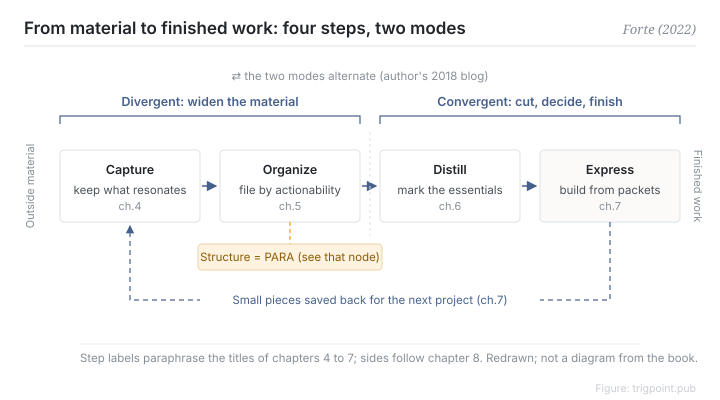

Canonical: https://trigpoint.pub/collections/pkm/code-tiago-forte-2022  
Captured: 2026-10-05T03:32:10.398685+08:00

> Public theory reading mirror. Verification and Lab case sections remain on the website.

“One pass through the four steps and you ship”: it is not that simple.

# The CODE method

CODE Method · Forte (2022)

Bibliography checked ✓  
Personal knowledge management · workflow  
Read first: The PARA method

## In three sentences

Material you collect goes through four steps before it becomes finished work: Capture keeps only what resonates, Organize files it by actionability, Distill marks the essentials layer by layer, and Express assembles output from intermediate packets. Chapter 8 of the book then splits the four steps into two modes. Capture and Organize are divergent; Distill and Express are convergent. Collecting is only the first half. Finished work comes from narrowing and deciding in the last two steps.

<strong>Figure 1</strong> · The four steps turn outside material into finished work, left to right. Capture and Organize are divergent; Distill and Express are convergent. Small pieces made while expressing are saved back for the next project. The structure used in the Organize step is PARA. Step labels paraphrase the titles of chapters 4 to 7; the back-and-forth between the two modes comes from the author's 2018 blog. Redrawn; not a reproduction of a diagram in the book.

## 1. What happened

Treating the four steps as a single pass that ends in delivery misses two structures in the book. Tiago Forte's Building a Second Brain, published in 2022, sets out its method as four steps, one per chapter across chapters 4 to 7[\[1\]](#reference-note-1).

Capture keeps only material that strikes you. Organize files it by actionability rather than by topic, using the book's own PARA structure. Distill applies progressive summarisation, marking what matters in layers so it can be picked up at a glance later. Express produces work in intermediate packets: a finished piece is assembled from existing small pieces, which are saved back and can be reused in the next project[\[1\]](#reference-note-1).

Chapter 8, The Art of Creative Execution, then splits the four steps into two working modes. Capture and Organize are divergent and widen the material available. Distill and Express are convergent: they cut, decide and produce the finished piece[\[1\]](#reference-note-1). In a 2018 blog post the author describes the two modes as alternating, and says the model comes from Design Thinking[\[2\]](#reference-note-2).

<strong>Attribution where due:</strong>CODE comes from Tiago Forte's Building a Second Brain (2022), and a citation to 2022 refers to the book. The earliest use of the name we found is a post by the author in January 2019, and the course that began in 2017 used different unit names, so the three years are kept apart. Divergence and convergence have their own sources: the technical terms appear in Guilford (1956), and the design-process shape in the Design Council's Double Diamond (one account traces it to Jones in 1970, not checked here). The book's contribution is assigning the four CODE steps to the two sides. The author's statement that the model comes from Design Thinking comes from the author's blog.

## 2. Why this matters to you

A note system usually stalls after collecting. Material keeps piling up and finished work does not appear. CODE separates storing from delivering into four steps with distinct jobs, and each can be checked on its own: has this material been distilled yet? Have the distilled points gone into a piece of finished work?

The chapter 8 split adds one more test. While you are still widening the range of options, you are diverging. Once you start cutting and deciding, you are converging.

One boundary to keep. CODE covers how material becomes finished work. Where things are kept in the Organize step is answered by PARA, which this page does not restate; see the PARA node.

## References

<strong>How to read the source notes</strong> “Bibliographic details checked” means author, year, title and venue were confirmed. It does not mean the source's claims were checked. “Checked against the primary site” means the claim was compared with the project's own website. “Follows secondary accounts” means the claim rests on sources that report it, not on the original document. Definitions as of 2026-09-20.

- \[1\] Forte, T. (2022). Building a Second Brain: A Proven Method to Organize Your Digital Life and Unlock Your Creative Potential. New York: Atria Books / Simon & Schuster. https://www.simonandschuster.com/books/Building-a-Second-Brain/Tiago-Forte/9781982167387 Bibliographic details cross-checked against multiple sources. The two-sided mapping in the chapter 8 passage on divergence and convergence (approx. p.178–180) follows secondary accounts that agree with one another.
- \[2\] Forte Labs blog. Divergence and Convergence: The Two Fundamental Stages of the Creative Process (2022-05-16); Just-In-Time PM #8: Divergence and Convergence (2018-05-23). https://fortelabs.com/blog/ Bibliographic details checked against the official record. The two blog statements and the timing of the acronym checked against the primary site.
- \[3\] Guilford, J. P. (1956). The structure of intellect. Psychological Bulletin, 53(4), 267–293. https://doi.org/10.1037/h0040755 Bibliographic details checked against the publisher's record. The claim that 1956 is the earliest published technical use follows secondary accounts that agree with one another.
- \[4\] Design Council (UK). History of the Double Diamond. https://www.designcouncil.org.uk/ Bibliographic details checked against the official record. The 2003 and 2004 dates and the use of the two terms checked against the primary site.

Cite as: Trigpoint, “The CODE method”, trigpoint.pub/collections/pkm/code-tiago-forte-2022 · © Strategitect Limited. · Content last revised 2026-10-01

## Source notes

**[1]** Forte, T. (2022). Building a Second Brain. Atria Books / Simon & Schuster. ISBN 9781982167387. Bibliographic details cross-checked against multiple sources. The two-sided mapping in the chapter 8 passage on divergence and convergence (approx. p.178–180) follows secondary accounts that agree with one another.

**[2]** Forte Labs. Bibliographic details checked against the official record. The two blog statements and the timing of the acronym checked against the primary site. The author's blog (fortelabs.com) and @fortelabs posts. The statements that the two modes alternate and that the model comes from Design Thinking are both from the blog, not from the book.

---

[繁體中文](../../../zh-Hant/collections/pkm/code-tiago-forte-2022.md) · [简体中文](../../../zh-Hans/collections/pkm/code-tiago-forte-2022.md)

[Index](../../README.md) · [Original page](https://trigpoint.pub/collections/pkm/code-tiago-forte-2022) · [Citation and versions](../../../READING.md)

[Original SVG](assets/code-tiago-forte-2022.svg) · Display copy adds a white background only.
