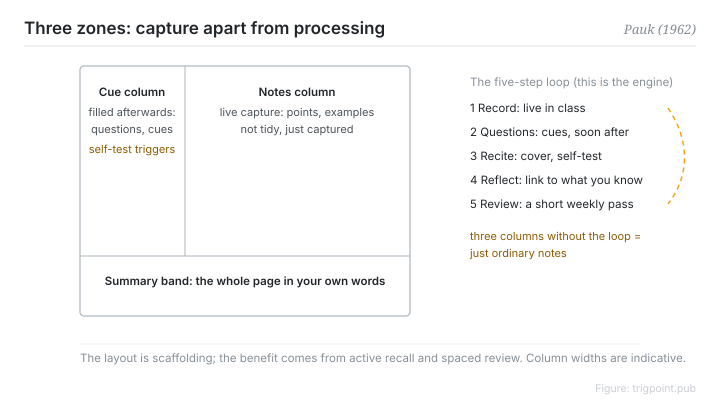

Canonical: https://trigpoint.pub/collections/pkm/cornell-note-taking-pauk-1962  
Captured: 2026-10-05T03:32:10.400686+08:00

> Public theory reading mirror. Verification and Lab case sections remain on the website.

“Neat notes mean you will remember it”: the fault is structural.

# Cornell note-taking system

Cornell Note-Taking System · Pauk (1962)

Bibliography checked ✓  
Personal knowledge management · note-taking

## In three sentences

The Cornell system divides a page into three zones: the right column for live capture, the left for questions drawn out afterwards, and a band at the foot for a summary in your own words. The design is not really about the layout. It separates capture from processing in time, then uses cover-and-self-test and weekly review to fight forgetting. Draw the three columns and skip the loop afterwards, and it degrades into ordinary notes.

<strong>Figure 1</strong> · The three-zone page: the right column for live capture during class, a narrow left column for questions and cue words drawn out afterwards, and a summary band at the foot in your own words. The loop that follows is cover-and-self-test plus a weekly review. Redrawn; not a reproduction of the book's own figure.

## 1. What happened

Pauk directed the reading and study skills centre at Cornell and systematised the method in How to Study in College in 1962. The name comes from the university[\[1\]](#reference-note-1).

The problem it addresses: transcribing is not learning, and notes with no later processing are eaten by forgetting. Each zone has a job. The right column captures during class and does not aim to be tidy. The narrow left column is filled in as soon as possible after class by working questions and cue words back out of the notes. The band at the foot compresses the page into your own words.

Then comes the review loop. Cover the right column, read the cues, answer aloud, then push further and ask how this relates to what you already know, with a fixed review of at least ten minutes each week to counter forgetting[\[2\]](#reference-note-2).

<strong>Attribution where due:</strong>The name comes from the university, not from Pauk giving the method his own surname. The approach had been taking shape on campus through the 1950s and the 1962 book formalised it, so that year is a publication date rather than a moment of invention. The university's own page lists five steps (Record, Questions, Recite, Reflect, Review) and says it is adapted from the 7th edition of Pauk's book, while a variant in circulation writes Reduce for Questions; the six-step version has not been confirmed against the original book, so name your version when citing.

## 2. Why this matters to you

Know its design domain before adopting it. This is for digesting a single input, a lecture, a reading, a meeting. It is not a network of ideas across notes.

It does not compete with networked note methods; it divides labour with them. Cornell is strong at review on the input side and weak at linking across nodes, so digest a single input with it and promote the refined concepts into a permanent system afterwards.

There is one position people routinely skip. The layout is scaffolding, and the learning benefit comes entirely from the active recall and spaced review that follow. Both mechanisms stand on their own in cognitive science. Pauk's contribution was operationalising them into a layout and a workflow, not proposing the mechanisms. So judge the method by whether you run the loop, not by how tidy the page looks.

## References

<strong>How to read the source notes</strong> “Bibliographic details checked” means author, year, title and venue were confirmed. It does not mean the source's claims were checked. “Checked against the primary site” means the claim was compared with the project's own website. Definitions as of 2026-09-20.

- \[1\] Pauk, W. (1962). How to Study in College (1st ed.).
- \[2\] Cornell University Learning Strategies Center. The Cornell Note Taking System. https://lsc.cornell.edu/notes.html

Cite as: Trigpoint, “Cornell note-taking system”, trigpoint.pub/collections/pkm/cornell-note-taking-pauk-1962 · © Strategitect Limited. · Content last revised 2026-10-01

## Source notes

**[1]** Pauk, W. (1962). How to Study in College. Bibliographic details cross-checked against multiple sources. First edition; the current edition is the 11th. The three-zone layout and the five steps were cross-checked against the official page of the Cornell University Learning Strategies Center and multiple other sources.

**[2]** Cornell University Learning Strategies Center. The Cornell Note Taking System. Bibliographic details checked against the official record. The step names and the after-class timing checked against the primary site. Available at lsc.cornell.edu. The centre's page names the steps Record, Questions, Recite, Reflect, Review, and says it is adapted from Pauk, How to Study in College, 7th edition (2001). A variant in circulation writes Reduce for Questions; the two coexist. On the official page, step 2 is timed as soon after class as possible, and the weekly review is at least ten minutes.

---

[繁體中文](../../../zh-Hant/collections/pkm/cornell-note-taking-pauk-1962.md) · [简体中文](../../../zh-Hans/collections/pkm/cornell-note-taking-pauk-1962.md)

[Index](../../README.md) · [Original page](https://trigpoint.pub/collections/pkm/cornell-note-taking-pauk-1962) · [Citation and versions](../../../READING.md)

[Original SVG](assets/cornell-note-taking-pauk-1962.svg) · Display copy adds a white background only.
