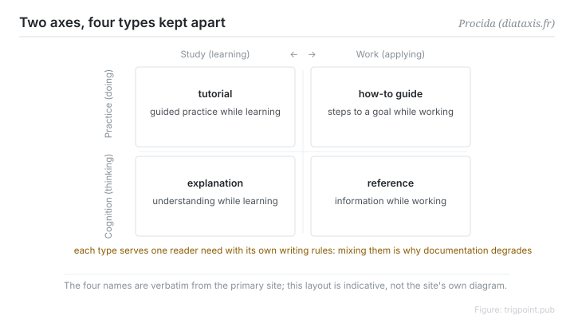

Canonical: https://trigpoint.pub/collections/pkm/diataxis-procida  
Captured: 2026-10-05T03:32:10.595769+08:00

> Public theory reading mirror. Verification and Lab case sections remain on the website.

“One document covering everything is fine”: it is not that simple.

# Diátaxis

Diátaxis · Procida

Checked against the sources ✓  
Personal knowledge management · documentation

## In three sentences

Documentation usually fails for structural reasons rather than stylistic ones: four different reader needs get pushed into one document. Diátaxis separates them along two axes, whether the reader is doing or thinking and whether they are learning or working, producing four types: tutorial, how-to, reference and explanation. The core discipline is a single rule. Maintain the four separately and never mix them in one document.

<strong>Figure 1</strong> · Two axes producing four types: practice against cognition, doing or thinking, crossed with learning against application, studying or working. The four cells are tutorial, how-to, reference and explanation, each serving one reader need. Redrawn; the layout is not the original site's diagram.

## 1. What happened

Procida published early versions of these ideas while at Divio between 2014 and 2021, later judged that several aspects of them were wrong, then took the work independent and kept refining it on its own site[\[1\]](#reference-note-1).

The derivation is not an arbitrary taxonomy. Reader situations divide along two axes, practice against cognition, knowing-how against knowing-that, and studying against working. Two by two yields four types, each serving one need with its own writing criteria.

A tutorial is guided practice while learning. A how-to is the steps to an outcome while working. Reference is looking information up while working. Explanation is seeking understanding while learning.

The failure mode of mixing them is one everybody has seen: a "tutorial" that opens by teaching operations, turns into a parameter table in the middle, and closes with design philosophy, so every kind of reader has to skim.

<strong>Attribution where due:</strong>The framework has no single year of origin. Early versions were published during the author's time at Divio, and 2021 refers to a fellowship, so it should not be cited as proposed in 2021. The breadth of adoption, given as hundreds of documentation projects, is the site's own account and has not been independently verified; keep that qualification when citing[\[1\]](#reference-note-1).

## 2. Why this matters to you

To decide whether a document should be split, ask which quadrant the reader is in right now, not which topic the content belongs to.

This is also one of three questions in knowledge system design that routinely get answered together when they should not be: where things go, which is organisation; how you find them again, which is navigation; and what type to write, which is this framework. The three are orthogonal and answering them jointly makes each one worse.

There is a corollary for personal notes. The operating manual you write for yourself and the conceptual explanation you write for yourself should not be the same file either. They update on different rhythms and they fail in different ways.

## References

<strong>How to read the source notes</strong> “Checked against the primary site” means the claim was compared with the project's own website. Definitions as of 2026-09-20.

- \[1\] Procida, D. Diátaxis. https://diataxis.fr/ The two-axis derivation and the notes on the Divio years and 2021 checked against the primary site. An early version was published during the author's time at Divio, 2014–2021.

Cite as: Trigpoint, “Diátaxis”, trigpoint.pub/collections/pkm/diataxis-procida · © Strategitect Limited. · Content last revised 2026-10-01

## Source notes

**[1]** Procida, D. Diátaxis. The two-axis derivation and the notes on the Divio years and 2021 checked against the primary site. Available at diataxis.fr. The home page, the foundations page and the colophon of the primary site were checked. The names and etymology of the four types match word for word. Attribution note: an early version was published during the author's time at Divio (2014–2021), and Procida later acknowledged that he had misjudged parts of it. “2021” refers to a Software Sustainability Institute fellowship, not the year of first publication. The breadth of adoption is the site's own account and has not been verified by a third party.

---

[繁體中文](../../../zh-Hant/collections/pkm/diataxis-procida.md) · [简体中文](../../../zh-Hans/collections/pkm/diataxis-procida.md)

[Index](../../README.md) · [Original page](https://trigpoint.pub/collections/pkm/diataxis-procida) · [Citation and versions](../../../READING.md)

[Original SVG](assets/diataxis-procida.svg) · Display copy adds a white background only.
