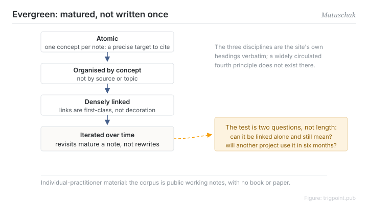

Canonical: https://trigpoint.pub/collections/pkm/evergreen-notes-matuschak  
Captured: 2026-10-05T03:32:10.685219+08:00

> Public theory reading mirror. Verification and Lab case sections remain on the website.

“The more detail the better”: wrong.

# Evergreen notes

Evergreen Notes · Matuschak

Checked against the sources ✓  
Lab case ✓  
Personal knowledge management · note-taking

## In three sentences

Evergreen notes are a set of disciplines: one concept per node, organised by concept rather than by source or topic, densely linked between nodes, and iterated on each revisit rather than rewritten. The test is not length. Whether a note is evergreen depends on whether it can be cited precisely and reused in a new situation. Treating detail as the goal produces exactly the long-form writing that nothing can cite.

<strong>Figure 1</strong> · The three disciplines: one concept per node, organised by concept rather than by source or topic, and densely linked, with notes maturing through revisits rather than rewrites. The three are verbatim headings from the original site. A fourth principle in wide circulation does not exist there. Redrawn.

## 1. What happened

Matuschak, previously an iOS engineer at Apple and a researcher at Khan Academy, has practised and set out these disciplines on a public working-notes site that he keeps updating; its pages carry no date of writing[\[1\]](#reference-note-1).

The three principles are verbatim headings on that site. A note should be atomic, one concept per node, so that a reference has a precise target, while still covering that concept as fully as possible. It should be organised by concept, since a single topic can split into several concept nodes and the concept is the unit of reuse. And it should be densely linked, with links treated as first-class rather than decorative.

He states that the concept is deeply indebted to the slip-box tradition. This is a restatement and refinement of networked note-taking for the era of digital tools, not a new invention. A fourth principle in wide circulation, that notes should be context-free, does not exist on the site; it is derivative spirit mistaken for a standalone rule; the site carries two further principle headings, neither of them context-free.

<strong>Attribution where due:</strong>Matuschak states that the concept is deeply indebted to the slip-box tradition, making him the popularising voice for the digital era rather than the concept ancestor. The three disciplines, atomic, concept-oriented and densely linked, are verbatim headings from the original site, and context-free is not a fourth one. The status also needs preserving: this is individual practitioner content whose corpus is a public set of working notes, with no book and no paper, and the pages carry no date of writing[\[1\]](#reference-note-1).

## 2. Why this matters to you

The intuition that more detail is better treats a note like an essay. An essay's unit is the argument; a note system's unit is the concept. An eight-hundred-word reflection cannot be cited for the one criterion inside it that actually matters. Split into three atomic nodes, each can be called precisely by the future you.

So the operational test for evergreen is two questions. Can this note be linked on its own without losing its meaning? And in six months, on a different project, will it still be usable?

There is one position that inverts easily. Evergreen means matured, not written well the first time. Notes get there through revisits. Writing one perfectly at the outset actually stops you going back to change it.

## References

<strong>How to read the source notes</strong> “Checked against the primary site” means the claim was compared with the project's own website. Definitions as of 2026-09-20.

- \[1\] Matuschak, A. Working Notes. https://notes.andymatuschak.org/Evergreen_notes The three disciplines checked against the primary site. Continuously updated, with no date of writing; individual practitioner working notes.

## Knowledge graph

- [<em>Compare ▸</em>Hypertext and transclusion](hypertext-transclusion-nelson-1965.md)
- [<em>Applied by ▸</em>Memex](memex-bush-1945.md)

Cite as: Trigpoint, “Evergreen notes”, trigpoint.pub/collections/pkm/evergreen-notes-matuschak · © Strategitect Limited. · Content last revised 2026-10-01

## Source notes

**[1]** Matuschak, A. Working Notes. The three disciplines checked against the primary site. Available at notes.andymatuschak.org, continuously updated; the pages carry no date of writing. This is an individual practitioner's working notes. There is no book and no paper. They are atomic, concept-oriented and densely linked, and appear as verbatim headings on the site. Attribution note: a fourth principle, “context-free”, circulates widely but was checked and does not exist on the original site. It is a common misreport.

---

[繁體中文](../../../zh-Hant/collections/pkm/evergreen-notes-matuschak.md) · [简体中文](../../../zh-Hans/collections/pkm/evergreen-notes-matuschak.md)

[Index](../../README.md) · [Original page](https://trigpoint.pub/collections/pkm/evergreen-notes-matuschak) · [Citation and versions](../../../READING.md)

[Original SVG](assets/evergreen-notes-matuschak.svg) · Display copy adds a white background only.
