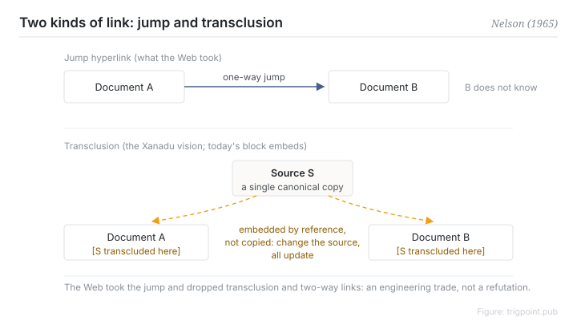

Canonical: https://trigpoint.pub/collections/pkm/hypertext-transclusion-nelson-1965  
Captured: 2026-10-05T03:32:11.478907+08:00

> Public theory reading mirror. Verification and Lab case sections remain on the website.

“A link is a link”: it is not that simple.

# Hypertext and transclusion

Hypertext & Transclusion · Nelson (1965)

Bibliography checked ✓  
Personal knowledge management · history of ideas

## In three sentences

The word "hypertext" is defined in Nelson's 1965 paper, meaning interconnected text that paper cannot present. Transclusion, which Nelson says his concept already contained, goes one layer deeper: the same content is embedded by reference in several places, so changing the source changes every instance. The bidirectional links and block embeds in today's note-taking tools are partial realisations of that vision.

<strong>Figure 1</strong> · Two kinds of link. A jump hyperlink is one-way and the target does not know it has been linked. Transclusion embeds content by reference in several places, so a change at the source propagates everywhere. The Web took the first and dropped the second, which was an engineering trade rather than a refutation of the vision. Redrawn.

## 1. What happened

Nelson's problem was this: human thought is interconnected, changing and indeterminate, while paper and sequential file structures force it into a line. In a 1965 ACM conference paper he proposed a file structure capable of carrying non-linear text, and set out a definition of hypertext for that kind of text. A 1963 coinage is often reported, but no primary source from Nelson was found[\[1\]](#reference-note-1).

The deeper mechanism in the vision is transclusion: content exists in many places by reference rather than by copy, so a change at the source propagates to every embedding. That word is generally credited to Literary Machines, first published in 1981 (which edition first uses it was not checked here), although Nelson says the concept already sits inside the 1965 description[\[2\]](#reference-note-2).

The complete vision, with bidirectional links, transclusion, versioning and micropayments, was never fully realised. Project Xanadu became a famously unfinished long-running project, and the thing that actually made hypertext universal was the Web, which deliberately dropped bidirectionality and transclusion in exchange for simplicity and scale.

<strong>Attribution where due:</strong>The concept ancestor is Bush's associative trails of 1945, which Nelson cites as a precedent[\[3\]](#reference-note-3). A 1963 coinage is commonly reported, but no primary source from Nelson was found; the 1965 ACM paper defines the word, though by Nelson's own note it is not his first publication to use it. The word transclusion is generally credited to the 1981 first edition of Literary Machines, more than a decade after the concept by Nelson's own account. Concept, coinage and printing are three separate things and each needs its own credit.

## 2. Why this matters to you

Distinguish three different promises hiding behind the word "link". A jump, which is the Web's hyperlink, one-way, with the target unaware. Backward visibility, where both ends know about each other. And embedded synchronisation, where content is transcluded rather than copied.

If your note tool supports backlinks and block embeds, it is doing precisely the part of the vision the Web discarded. So "a link is a link" does not hold: the three promises differ in maintenance cost and in payoff, and each is worth asking about separately when choosing a tool.

There is a second lesson in Xanadu. Never shipping is not the same as being wrong. Features sacrificed by one generation's engineering trade can be vindicated decades later under different constraints, and reading "unrealised" as "worthless" means missing the designs that are currently coming back.

## References

<strong>How to read the source notes</strong> “Bibliographic details checked” means author, year, title and venue were confirmed. It does not mean the source's claims were checked. “Matched against the full text” means the claim was compared with the text of the source itself. “Follows secondary accounts” means the claim rests on sources that report it, not on the original document. “Verification inherited” means the check was done on another page of this site and not repeated here. Definitions as of 2026-09-20.

- \[1\] Nelson, T. H. (1965). Complex Information Processing: A File Structure for the Complex, the Changing and the Indeterminate. Proceedings of the ACM 20th National Conference, 84–100. https://doi.org/10.1145/800197.806036
- \[2\] Nelson, T. H. (1981). Literary Machines. Swarthmore, PA: self-published. Bibliographic details cross-checked against multiple sources. The attribution of the word \\"transclusion\\" to this book follows secondary accounts that agree with one another. First edition 1981; some catalogues give 1980.
- \[3\] Bush, V. (1945). As We May Think. The Atlantic, 176(1), 101–108. https://www.theatlantic.com/magazine/archive/1945/07/as-we-may-think/303881/

## Knowledge graph

- [<em>Prerequisite ▸</em>Memex](memex-bush-1945.md)
- [<em>Compare ▸</em>Zettelkasten](zettelkasten-luhmann-1981.md)
- [<em>Compare ▸</em>Evergreen notes](evergreen-notes-matuschak.md)

Cite as: Trigpoint, “Hypertext and transclusion”, trigpoint.pub/collections/pkm/hypertext-transclusion-nelson-1965 · © Strategitect Limited. · Content last revised 2026-10-01

## Source notes

**[1]** Nelson, T. H. (1965). Complex Information Processing: A File Structure for the Complex, the Changing and the Indeterminate. Proceedings of the ACM 20th National Conference, 84–100. DOI 10.1145/800197.806036. Bibliographic details checked against the official record. Claims matched against the full text. Attribution note: the word “hypertext” is defined in this paper (page 96), the most widely cited place. Nelson himself says that his FID conference paper of the same year, “The Hypertext”, was the first publication in which he used the term.

**[2]** Nelson, T. H. (1981). Literary Machines. Swarthmore, PA: self-published. Bibliographic details cross-checked against multiple sources. The attribution of the word \\"transclusion\\" to this book follows secondary accounts that agree with one another. Attribution note: the word “transclusion” is generally credited to this book (this page did not check which edition first uses it) and defined as the same content knowably in more than one place. The concept is already present in the description in the 1965 paper. The first edition is 1981, per the copyright pages of the first and third editions held by the Internet Archive; some catalogues give 1980.

**[3]** Bush, V. (1945). As We May Think. The Atlantic, 176(1), 101–108. Verification inherited from Memex; not re-run here. Attribution note: associative trails are the conceptual ancestor of hypertext. Nelson cites them as a precedent.

---

[繁體中文](../../../zh-Hant/collections/pkm/hypertext-transclusion-nelson-1965.md) · [简体中文](../../../zh-Hans/collections/pkm/hypertext-transclusion-nelson-1965.md)

[Index](../../README.md) · [Original page](https://trigpoint.pub/collections/pkm/hypertext-transclusion-nelson-1965) · [Citation and versions](../../../READING.md)

[Original SVG](assets/hypertext-transclusion-nelson-1965.svg) · Display copy adds a white background only.
