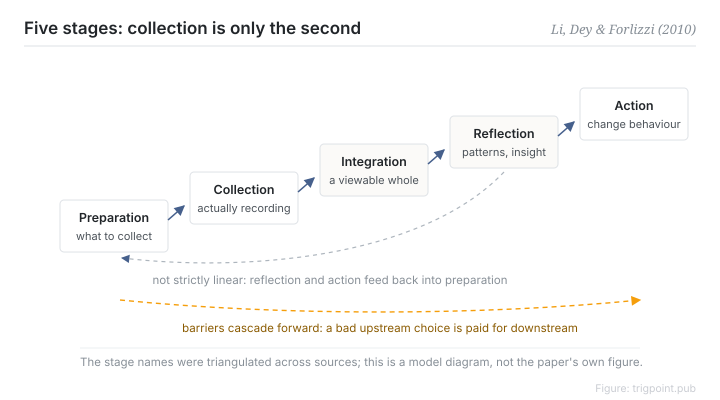

Canonical: https://trigpoint.pub/collections/pkm/li-dey-forlizzi-2010-personal-informatics  
Captured: 2026-10-05T03:32:11.481679+08:00

> Public theory reading mirror. Verification and Lab case sections remain on the website.

“Collecting it means using it”: they are two different things.

# Stage-based model of personal informatics

Stage-Based Model of Personal Informatics · Li, Dey & Forlizzi (2010)

Checked against the sources ✓  
Personal knowledge management · empirical science

## In three sentences

Self-tracking systems pass through five stages: preparation, collection, integration, reflection and action. Each stage has its own barriers, and the barriers cascade forwards, so choosing the wrong collection tool only shows up at reflection when the data will not assemble. The last three stages, integration, reflection and action, each have barriers of their own, and each has to be designed separately.

<strong>Figure 1</strong> · The five stages: preparation, collection, integration, reflection, action. The stages are iterative, since users change data, tools or processes as they progress, and the barriers at each stage cascade into the ones that follow. Redrawn; not the paper's own figure.

## 1. What happened

Li, Dey and Forlizzi proposed a five-stage model at a 2010 conference, built on a survey of 68 people and 11 follow-up interviews[\[1\]](#reference-note-1): preparation, deciding what to collect and which tool to use; collection, the actual recording; integration, assembling heterogeneous data into a viewable whole; reflection, finding patterns and extracting insight; and action, changing behaviour on that basis.

The model has two properties that get read past. The stages are iterative, since users change data, tools or processes as they progress. And the barriers at each stage cascade into later ones, so a wrong choice upstream is paid for downstream.

The same paper also lists the barriers stage by stage, which lets tool design intervene at a specific stage.

<strong>Attribution where due:</strong>This is the first academic formalisation of the stage model; the paper already uses personal informatics as an established name, and the quantified self community predates it. The stage-by-stage barriers list comes from this same 2010 paper. The 2011 follow-up subdivided reflection into two types and is frequently miscited as the source of the barriers list, so keep the two apart[\[1\]](#reference-note-1).

## 2. Why this matters to you

Use the five stages as a diagnostic grid. Where is your knowledge system or your self-tracking practice actually stuck?

The illusion that collecting is using comes from collection being immediately satisfying while the last three stages are not. Finishing a record feels like having done something, but integration means assembling data, reflection means holding a fixed rhythm of looking back, and action means changing behaviour. Each is a separate piece of engineering.

When designing your own system, spend the resources on the weakest stage. Buying one more collection tool usually just pushes the bottleneck further back.

The cascade property also gives you an ordering rule. Make upstream choices with downstream needs in hand: work out what you want to reflect on before deciding what to collect.

## References

<strong>How to read the source notes</strong> “Bibliographic details checked” means author, year, title and venue were confirmed. It does not mean the source's claims were checked. “Matched against the full text” means the claim was compared with the text of the source itself. Definitions as of 2026-09-20.

- \[1\] Li, I., Dey, A. K., & Forlizzi, J. (2010). A Stage-Based Model of Personal Informatics Systems. CHI 2010, 557–566. https://doi.org/10.1145/1753326.1753409

Cite as: Trigpoint, “Stage-based model of personal informatics”, trigpoint.pub/collections/pkm/li-dey-forlizzi-2010-personal-informatics · © Strategitect Limited. · Content last revised 2026-10-01

## Source notes

**[1]** Li, I., Dey, A. K., & Forlizzi, J. (2010). A Stage-Based Model of Personal Informatics Systems. CHI 2010, 557–566. DOI 10.1145/1753326.1753409. Bibliographic details cross-checked against multiple sources. Claims matched against the full text. The names of the five stages were cross-checked against the author's publication page and several indexes, and the claims were compared against the full text. Attribution note: the stage-by-stage list of barriers comes from this same paper.

---

[繁體中文](../../../zh-Hant/collections/pkm/li-dey-forlizzi-2010-personal-informatics.md) · [简体中文](../../../zh-Hans/collections/pkm/li-dey-forlizzi-2010-personal-informatics.md)

[Index](../../README.md) · [Original page](https://trigpoint.pub/collections/pkm/li-dey-forlizzi-2010-personal-informatics) · [Citation and versions](../../../READING.md)

[Original SVG](assets/li-dey-forlizzi-2010-personal-informatics.svg) · Display copy adds a white background only.
