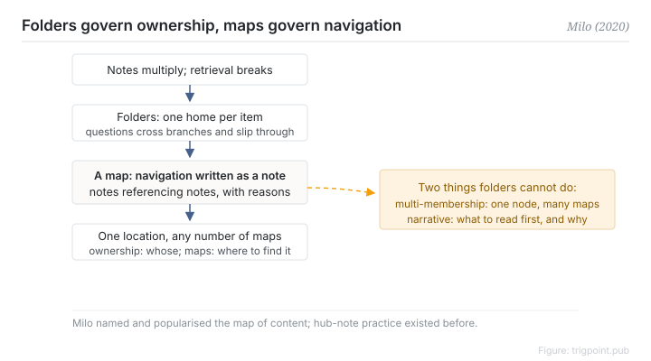

Canonical: https://trigpoint.pub/collections/pkm/lyt-nick-milo  
Captured: 2026-10-05T03:32:11.691514+08:00

> Public theory reading mirror. Verification and Lab case sections remain on the website.

“A map of content is a folder with a new name”: not necessarily.

# LYT and maps of content

LYT / Map of Content · Milo (2020)

Checked against the sources ✓  
Lab case ✓  
Personal knowledge management · navigation

## In three sentences

A map of content is a note that references other notes: a hub for gathering, developing and navigating rather than a container. The essential difference from a folder is membership. A folder requires each thing to have exactly one home; a map only references, so one node can appear on any number of maps at once. Folders govern ownership and maps govern navigation. They divide labour rather than replace each other.

<strong>Figure 1</strong> · The map-of-content mechanism. Once notes multiply, single-home folders cannot carry retrieval across domains; a map is a note referencing notes and acts as a navigation hub. Folders govern ownership, maps govern navigation, and one node can appear in any number of maps. Redrawn.

## 1. What happened

Milo released the first version of his vault template in May 2020, later renamed, and popularised the term map of content in the bidirectional-link tool community[\[1\]](#reference-note-1).

What it answers is the retrieval problem that appears once notes multiply. A folder tree demands a single home, but real questions routinely cut across branches, while tags are too flat and search requires knowing what you are looking for first.

The map's answer is to write the navigation itself as a note. One node references a set of related nodes, with a note on why they are related and in what order to read them. Maps are first-class: there can be many, they can reference each other, and they can be edited when they go stale. A folder can do none of those.

<strong>Attribution where due:</strong>Milo promoted and popularised the term; it is not a wholly new invention. The hub-note convention of a note referencing other notes predates it, and third-party commentary says he was influenced by Matuschak and Luhmann, though this page has no first-hand statement from him. The status also needs preserving: this is individual practitioner content whose corpus is video, templates and paid workshops, with no book and no paper, and the line about a map not being a folder is a paraphrase of the concept rather than a quotation that can be anchored to a page[\[1\]](#reference-note-1).

## 2. Why this matters to you

Reading it as a folder with a new name misses two structural properties.

The first is multiple membership. The same node joins different maps according to different questions, without copying and without having to choose between two folders.

The second is the narrative layer. A map can tell you which to read first and why these belong together. Folder ordering cannot do that.

The practical division of labour: location answers who owns this node and is always singular; a map answers which nodes to read for this class of question and can be unlimited. Mix the two layers and the vault collapses once it grows.

## References

<strong>How to read the source notes</strong> “Bibliographic details checked” means author, year, title and venue were confirmed. It does not mean the source's claims were checked. “Checked against the primary site” means the claim was compared with the project's own website. Definitions as of 2026-09-20.

- \[1\] Milo, N. Linking Your Thinking. https://www.linkingyourthinking.com/ Bibliographic details cross-checked against multiple sources. The LYT name and the MOC definition checked against the primary site. First version, LYT Kit, 2020-05, later renamed Ideaverse; individual practitioner content.

Cite as: Trigpoint, “LYT and maps of content”, trigpoint.pub/collections/pkm/lyt-nick-milo · © Strategitect Limited. · Content last revised 2026-10-01

## Source notes

**[1]** Milo, N. Linking Your Thinking. Bibliographic details cross-checked against multiple sources. The LYT name and the MOC definition checked against the primary site. Available at linkingyourthinking.com. This is individual practitioner content: YouTube, templates and paid workshops. There is no book and no paper. The first version, the LYT Kit, dates from May 2020. It was later renamed Ideaverse. The line that an MOC is not a folder is a paraphrase of the concept, and the exact segment where it first appeared has not been anchored.

---

[繁體中文](../../../zh-Hant/collections/pkm/lyt-nick-milo.md) · [简体中文](../../../zh-Hans/collections/pkm/lyt-nick-milo.md)

[Index](../../README.md) · [Original page](https://trigpoint.pub/collections/pkm/lyt-nick-milo) · [Citation and versions](../../../READING.md)

[Original SVG](assets/lyt-nick-milo.svg) · Display copy adds a white background only.
