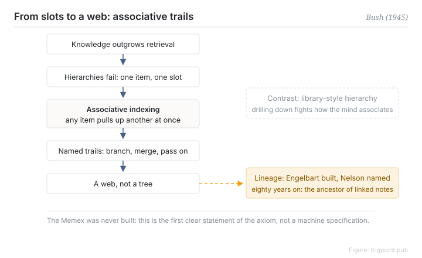

Canonical: https://trigpoint.pub/collections/pkm/memex-bush-1945  
Captured: 2026-10-05T03:32:11.694586+08:00

> Public theory reading mirror. Verification and Lab case sections remain on the website.

“The Memex is where hypertext begins”: they are two different things.

# Memex

Memex · Bush (1945)

Bibliography checked ✓  
Personal knowledge management · history of ideas

## In three sentences

The Memex is a hypothetical personal information desk proposed in 1945: microfilm storage for a person's entire library and records, with entries chained together by associative trails. The insight is not the capacity. It is the retrieval paradigm: any item can pull up another instantly, replacing library-style hierarchical indexing. The machine was never built. The design axiom that association beats hierarchy became the shared ancestor of everything digital that followed in personal knowledge management.

<strong>Figure 1</strong> · The associative trail mechanism. Once knowledge outgrows hierarchical indexing, associative indexing lets any item pull up another; named trails can branch, merge and be passed on, and the endpoint is a web rather than a tree. The Memex was never built; this shows a design axiom, not a machine specification.

## 1. What happened

Just before the end of the Second World War, Bush published "As We May Think" in The Atlantic. Scientific knowledge was about to explode in volume, and he argued the bottleneck was retrieval rather than storage: every index is artificial, an item can only be filed in one slot, and finding it means drilling down through levels, which is not how a mind works[\[1\]](#reference-note-1).

His answer was associative indexing. The user places two documents side by side, presses a key, and creates a named trail; afterwards one key jumps from the first to the next. Trails can branch, merge, persist, and be handed to someone else[\[1\]](#reference-note-1). The Memex was a thought experiment and was never built. It is a design vision, not an engineered product.

<strong>Attribution where due:</strong>The word "hypertext" is not Bush's. Ted Nelson defined it in an ACM conference paper in 1965[\[2\]](#reference-note-2); a 1963 coinage is often reported, but no primary source was found. Bush framed the problem and fathered the associative trail; the implementation lineage runs through Engelbart with NLS and the hyperlink, and the naming lineage runs through Nelson. Concept ancestor and word coiner get separate credit.

## 2. Why this matters to you

Every time you hesitate over which folder a note belongs in, you are standing on the crack Bush identified. Hierarchical classification demands that each thing have exactly one home. Associative links allow one thing to have any number of routes leading to it. The entire pitch of modern bidirectional-link tools was written out eighty years ago.

So the question worth asking of a tool is not whether it has links. It is whether retrieval runs on someone else's classification or on the trails you laid yourself. The first is a world thought out for you; only the second is the Memex.

## References

<strong>How to read the source notes</strong> “Bibliographic details checked” means author, year, title and venue were confirmed. It does not mean the source's claims were checked. Definitions as of 2026-09-20.

- \[1\] Bush, V. (1945). As We May Think. The Atlantic, 176(1), 101–108. https://www.theatlantic.com/magazine/archive/1945/07/as-we-may-think/303881/
- \[2\] Nelson, T. H. (1965). Complex Information Processing: A File Structure for the Complex, the Changing and the Indeterminate. Proceedings of the ACM 20th National Conference. https://doi.org/10.1145/800197.806036

## Knowledge graph

- [<em>Applied in ▸</em>Evergreen notes](evergreen-notes-matuschak.md)
- [<em>Downstream ▸</em>Hypertext and transclusion](hypertext-transclusion-nelson-1965.md)

Cite as: Trigpoint, “Memex”, trigpoint.pub/collections/pkm/memex-bush-1945 · © Strategitect Limited. · Content last revised 2026-10-01

## Source notes

**[1]** Bush, V. (1945). As We May Think. The Atlantic, 176(1), 101–108. Bibliographic details cross-checked against multiple sources. Two propositions, the Memex definition and the associative indexing proposition, were checked word for word against two web transcriptions (the Duchier 1994 edition hosted by W3C, and a PDF from the Free University of Berlin, which is a separate transcription). Neither is a scan of the print edition. A magazine article from 1945 carries no DOI, which is a structural limitation, not an omission.

**[2]** Nelson, T. H. (1965). Complex Information Processing: A File Structure for the Complex, the Changing and the Indeterminate. ACM 20th National Conference. Bibliographic details cross-checked against multiple sources. The word “hypertext” appears in this paper (page 96). Nelson himself says that his FID conference paper of the same year, “The Hypertext”, was the first publication in which he used the term.

---

[繁體中文](../../../zh-Hant/collections/pkm/memex-bush-1945.md) · [简体中文](../../../zh-Hans/collections/pkm/memex-bush-1945.md)

[Index](../../README.md) · [Original page](https://trigpoint.pub/collections/pkm/memex-bush-1945) · [Citation and versions](../../../READING.md)

[Original SVG](assets/memex-bush-1945.svg) · Display copy adds a white background only.
