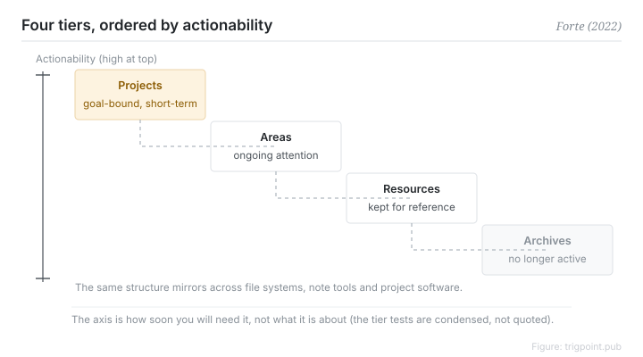

Canonical: https://trigpoint.pub/collections/pkm/para-tiago-forte-2022  
Captured: 2026-10-05T03:32:12.500037+08:00

> Public theory reading mirror. Verification and Lab case sections remain on the website.

“Filing by topic is enough”: it will not carry that.

# The PARA method

PARA Method · Forte (2022)

Bibliography checked ✓  
Lab case ✓  
Personal knowledge management · organisation

## In three sentences

The first question in personal organisation is not what topic this belongs to. It is when you will need it. PARA arranges the answer into four tiers ordered by actionability: Projects are short-term efforts with a goal, Areas need ongoing attention, Resources are held for reference, Archives are no longer active. The same structure mirrors across every tool. Classification serves action rather than collection.

<strong>Figure 1</strong> · Four tiers ordered by actionability, highest first: Projects as short-term efforts with a goal, Areas needing ongoing attention, Resources kept for reference, Archives no longer active. The axis is how soon you will need it, not what it is about. Redrawn; not a reproduction of the book's own diagram.

## 1. What happened

Forte first set out PARA in a 2017 online post (month not verified) and systematised it in Building a Second Brain in 2022[\[2\]](#reference-note-2).

His diagnosis: filing by topic like a librarian produces a cabinet that looks tidy but cannot answer the question you actually have mid-task, which is where the material relevant to the thing in front of me is.

His slogan is organise by actionability[\[1\]](#reference-note-1). Projects are short-term efforts with a goal. Areas need ongoing attention and have no finished state. Resources are reference material you may need later. Archives are no longer active. The four form a slope ordered by how soon you will need something.

The same structure is mirrored across the file system, the note tool and the project software, so changing tools does not mean reinventing the classification[\[1\]](#reference-note-1).

<strong>Attribution where due:</strong>PARA first appeared online in 2017, and the 2022 book is the milestone for systematisation and reach rather than the year of origin, so a citation to 2022 refers to the book. The expansion is usually given as the plural Archives; the author's spoken interviews and some pages on his own site have used the singular. Organise by actionability is his own phrase, while the commonly appended contrast about context does not appear on his page and reads as a paraphrase against a different productivity system; the contrast on his page is with topic-based filing. Keep the original phrase and the paraphrase apart.

## 2. Why this matters to you

You test an organisation system not by how tidy it is but by whether it can hand you the relevant material halfway through a task. Filing by topic is most comfortable when collecting and slowest when acting. Filing by actionability is the reverse.

It also comes with an honest decay path. A finished project drops to Archives, and an area nobody is maintaining a standard for has in fact stopped. Topic-based filing lets expired things live respectably where they are. One question about actionability exposes them immediately.

One boundary to keep. PARA governs where things go, not how they link. It does not compete with networked notes; it divides labour with them. One answers where something lives, the other answers how the concepts connect.

## References

<strong>How to read the source notes</strong> “Bibliographic details checked” means author, year, title and venue were confirmed. It does not mean the source's claims were checked. “Checked against the primary site” means the claim was compared with the project's own website. “Follows secondary accounts” means the claim rests on sources that report it, not on the original document. Definitions as of 2026-09-20.

- \[1\] Forte, T. (2022). Building a Second Brain: A Proven Method to Organize Your Digital Life and Unlock Your Creative Potential. New York: Atria Books / Simon & Schuster. https://www.simonandschuster.com/books/Building-a-Second-Brain/Tiago-Forte/9781982167387
- \[2\] Forte Labs blog. The PARA Method: The Simple System for Organizing Your Digital Life in Seconds. https://fortelabs.com/blog/para/ Bibliographic details checked against the official record. The \\"organize by actionability\\" wording and the four tier names checked against the primary site. First published in 2017; 2023 republished version.

Cite as: Trigpoint, “The PARA method”, trigpoint.pub/collections/pkm/para-tiago-forte-2022 · © Strategitect Limited. · Content last revised 2026-10-01

## Source notes

**[1]** Forte, T. (2022). Building a Second Brain: A Proven Method to Organize Your Digital Life and Unlock Your Creative Potential. Atria Books / Simon & Schuster. ISBN 9781982167387. Bibliographic details cross-checked against multiple sources. The wording of the slogan “organize by actionability” follows secondary accounts that agree with one another.

**[2]** Forte Labs. Bibliographic details checked against the official record. The \\"organize by actionability\\" wording and the four tier names checked against the primary site. Blog, available at fortelabs.com/blog/para. Attribution note: PARA first appeared online in 2017 (month not verified). The current online version is a 2023 republication.

---

[繁體中文](../../../zh-Hant/collections/pkm/para-tiago-forte-2022.md) · [简体中文](../../../zh-Hans/collections/pkm/para-tiago-forte-2022.md)

[Index](../../README.md) · [Original page](https://trigpoint.pub/collections/pkm/para-tiago-forte-2022) · [Citation and versions](../../../READING.md)

[Original SVG](assets/para-tiago-forte-2022.svg) · Display copy adds a white background only.
