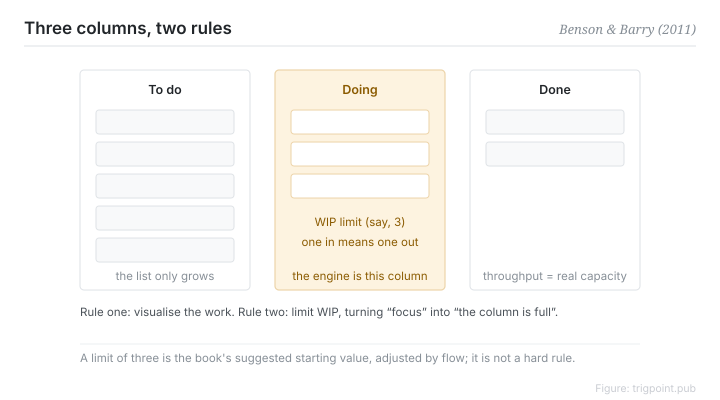

Canonical: https://trigpoint.pub/collections/pkm/personal-kanban-benson-barry-2011  
Captured: 2026-10-05T03:32:12.692365+08:00

> Public theory reading mirror. Verification and Lab case sections remain on the website.

“A kanban board is just a to-do list”: they are two different things.

# Personal kanban

Personal Kanban · Benson & Barry (2011)

Bibliography checked ✓  
Lab case ✓  
Personal knowledge management · workflow

## In three sentences

Personal kanban has two rules: visualise the work, and limit how much of it runs at once. A to-do list answers what needs doing. A board answers two more questions: how much is running right now, and where is it stuck. The second rule is the engine. A work-in-progress limit forces you to finish rather than start, and switching costs fall as a result.

<strong>Figure 1</strong> · A three-column board: to do, doing with a work-in-progress limit attached, done. Two rules: visualise the work and limit how much runs at once. The book suggests starting an individual at a limit of three, which is a recommendation rather than a hard rule. Redrawn; not a reproduction of the book's own figure.

## 1. What happened

Kanban comes from the Toyota production line: a signalling mechanism that landed around 1953, using physical cards to control the flow of work in progress, and one of the core components of lean production[\[2\]](#reference-note-2).

Anderson's 2010 book systematised it as a change method for software development[\[3\]](#reference-note-3). In 2011 Benson and Barry made it personal: one board, three columns of to do, doing and done, and two rules, visualise the work and limit work in progress[\[1\]](#reference-note-1). The book suggests an individual start at a limit of three and adjust to their own throughput. That is a recommendation, not a hard rule.

The insight in the personal version is that overload in knowledge work is usually not too many tasks. It is too many tasks open at once, each one charging a switching tax.

<strong>Attribution where due:</strong>Kanban is not the invention of Benson and Barry. The mechanism landed on the Toyota production line around 1953 under Ohno[\[2\]](#reference-note-2), entered the academic canon with lean production in 1990, was systematised as a change method for software development in Anderson's 2010 book[\[3\]](#reference-note-3), and was made personal by the two authors in 2011[\[1\]](#reference-note-1). This is a gradient of application rather than a chain of invention, so keep the layers apart when citing.

## 2. Why this matters to you

The difference between a to-do list and a board is the difference between a list and flow control. A list only grows. The doing column has a ceiling, so something has to leave before something new can enter.

That constraint turns a vague question of character, be more focused, into a mechanical question of structure, the column is full.

The largest trap in practice is treating the limit as decoration. Eight cards in the column with a limit of three written above it is the same as having no limit. A limit that bites usually needs a surface that forces you to declare, rather than a daily reminder to yourself.

Visualising the work is not decorative either. A queue you can see gets settled. A queue you cannot see just ferments.

## References

<strong>How to read the source notes</strong> “Bibliographic details checked” means author, year, title and venue were confirmed. It does not mean the source's claims were checked. “Checked against the primary site” means the claim was compared with the project's own website. Definitions as of 2026-09-20.

- \[1\] Benson, J., & Barry, T. D. (2011). Personal Kanban: Mapping Work | Navigating Life. Seattle: Modus Cooperandi Press. https://moduscooperandi.com/modus-cooperandi/blog/personal-kanban-the-book
- \[2\] Ohno, T. (1988). Toyota Production System: Beyond Large-Scale Production. Cambridge, MA: Productivity Press. 2019 digital reprint: https://doi.org/10.4324/9780429273018
- \[3\] Anderson, D. J. (2010). Kanban: Successful Evolutionary Change for Your Technology Business. Blue Hole Press.
- \[4\] Womack, J. P., Jones, D. T., & Roos, D. (1990). The Machine That Changed the World. Rawson Associates.

Cite as: Trigpoint, “Personal kanban”, trigpoint.pub/collections/pkm/personal-kanban-benson-barry-2011 · © Strategitect Limited. · Content last revised 2026-10-01

## Source notes

**[1]** Benson, J., & Barry, T. D. (2011). Personal Kanban: Mapping Work | Navigating Life. Modus Cooperandi Press. ISBN 9781453802267. Bibliographic details cross-checked against multiple sources. The wording of the two core rules checked against the primary site. A wrong ISBN that does not match this book is in circulation. The suggested starting limit of three is the book's recommended value, not a hard rule.

**[2]** Toyota Production System: Beyond Large-Scale Production. Productivity Press. Bibliographic details confirmed by two sources. Ohno, T. (1978; English translation 1988). The kanban mechanism landed on the Toyota production line around 1953. The broader Toyota Production System developed from around 1948.

**[3]** Anderson, D. J. (2010). Kanban: Successful Evolutionary Change for Your Technology Business. Blue Hole Press. Bibliographic details confirmed by two sources. This is the bridge by which kanban was transplanted from manufacturing to software development.

---

[繁體中文](../../../zh-Hant/collections/pkm/personal-kanban-benson-barry-2011.md) · [简体中文](../../../zh-Hans/collections/pkm/personal-kanban-benson-barry-2011.md)

[Index](../../README.md) · [Original page](https://trigpoint.pub/collections/pkm/personal-kanban-benson-barry-2011) · [Citation and versions](../../../READING.md)

[Original SVG](assets/personal-kanban-benson-barry-2011.svg) · Display copy adds a white background only.
