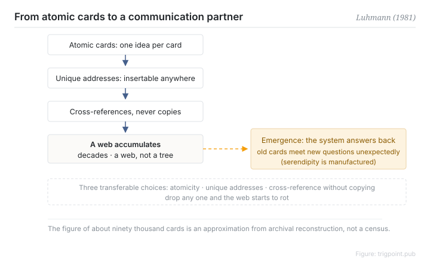

Canonical: https://trigpoint.pub/collections/pkm/zettelkasten-luhmann-1981  
Captured: 2026-10-05T03:32:12.700899+08:00

> Public theory reading mirror. Verification and Lab case sections remain on the website.

“Luhmann invented the slip box”: not necessarily.

# Zettelkasten

Zettelkasten · Luhmann (1981)

Bibliography checked ✓  
Lab case ✓  
Personal knowledge management · note-taking

## In three sentences

A Zettelkasten is a networked accumulation system. Each card carries one concept and a unique address, cards point at one another by reference, and decades of accumulation turn the pile into a web of knowledge. The sociologist Luhmann worked this way for life with roughly ninety thousand cards, and in 1981 described the system as his communication partner: it answers you with old cards you had forgotten, rather than merely storing them. The method itself is centuries older than he is. He is its best-known practitioner and the person who theorised it.

<strong>Figure 1</strong> · The slip box mechanism: atomic cards, unique addresses, cross-references accumulating into a web, and the emergent layer Luhmann called a communication partner. The figure of roughly ninety thousand cards is an approximation from archival reconstruction, not a census. Redrawn.

## 1. What happened

From the 1950s onward Luhmann accumulated physical cards. Each held one concept, atomically, with a unique positional address whose numbering alternated between digits and letters so that a new card could always be inserted between any two existing ones. Cross-references to other cards were written on the card by hand, unconstrained by any tree, so any branch could point at any other.

After decades of this the pile stopped being a filing cabinet. In a 1981 experience report he described it as a second memory he could hold a conversation with, where both sides had to be able to surprise each other[\[1\]](#reference-note-1). The scale of roughly ninety thousand cards comes from a later archival reconstruction[\[2\]](#reference-note-2). That study gave the emergent property an accurate name: serendipity is manufactured. Once the web is dense enough, old cards start meeting new questions in places you did not plan.

<strong>Attribution where due:</strong>Card indexing has been in use since the early modern period, from the sixteenth century on. Luhmann is its best-known practitioner and theoriser, and the 1981 experience report is where the idea that the system answers its user gets stated clearly. The figure of roughly ninety thousand cards is an approximation from Schmidt's 2018 reconstruction and should not be cited as an exact count[\[2\]](#reference-note-2). The practice popular in the English-speaking world largely comes from Ahrens's 2017 book, which turns it into an operational workflow; how its steps differ from Luhmann's own practice was not checked here. Cite the two separately[\[3\]](#reference-note-3).

## 2. Why this matters to you

The portable lesson is not "use cards". It is three structural choices: atomicity, so that a reference has a precise target; a unique address, so that pointing is possible at all; and cross-reference without copying, so that a concept exists in exactly one version.

In digital tools those map onto atomic notes, stable links and embedded references. Drop any one and the web starts to rot: concepts get smeared through long documents where nothing can cite them, or the same fact is copied into several versions that then drift apart.

It also has a design domain. This is a long-term system for accumulation across time, not a tool for digesting a single input. Work out which one you are building before deciding which parts to borrow.

## References

<strong>How to read the source notes</strong> “Bibliographic details checked” means author, year, title and venue were confirmed. It does not mean the source's claims were checked. “Matched against the full text” means the claim was compared with the text of the source itself. Definitions as of 2026-09-20.

- \[1\] Luhmann, N. (1981). Kommunikation mit Zettelkästen. In Öffentliche Meinung und sozialer Wandel. Opladen: Westdeutscher Verlag, 222–228. https://doi.org/10.1007/978-3-322-87749-9_19
- \[2\] Schmidt, J. F. K. (2018). Niklas Luhmann's Card Index: The Fabrication of Serendipity. Sociologica, 12(1), 53–60. https://doi.org/10.6092/issn.1971-8853/8350
- \[3\] Ahrens, S. (2017). How to Take Smart Notes.

## Knowledge graph

- [<em>Compare ▸</em>Hypertext and transclusion](hypertext-transclusion-nelson-1965.md)

Cite as: Trigpoint, “Zettelkasten”, trigpoint.pub/collections/pkm/zettelkasten-luhmann-1981 · © Strategitect Limited. · Content last revised 2026-10-01

## Source notes

**[1]** Luhmann, N. (1981). Kommunikation mit Zettelkästen. Ein Erfahrungsbericht. In Baier, Kepplinger & Reumann (Hrsg.), Öffentliche Meinung und sozialer Wandel. Opladen: Westdeutscher Verlag, 222–228. Bibliographic details cross-checked against multiple sources. Attribution note: this 1981 original is often miscited as the 1992 reprint, Universität als Milieu. The “communication partner” phrase was checked against the English translation.

**[2]** Schmidt, J. F. K. (2018). Niklas Luhmann's Card Index: The Fabrication of Serendipity. Sociologica, 12(1), 53–60. DOI 10.6092/issn.1971-8853/8350. Bibliographic details checked against the publisher's record. Claims matched against the full text. This is the source for the count of roughly ninety thousand cards. It is a scholarly reconstruction from the Bielefeld archive. The figure is an approximation, not a census.

**[3]** Ahrens, S. (2017). How to Take Smart Notes. Bibliographic details cross-checked against multiple sources. Attribution note: this is the popularising book for the English-speaking world. It systematises the method into an operational process. It is not Luhmann's original practice.

---

[繁體中文](../../../zh-Hant/collections/pkm/zettelkasten-luhmann-1981.md) · [简体中文](../../../zh-Hans/collections/pkm/zettelkasten-luhmann-1981.md)

[Index](../../README.md) · [Original page](https://trigpoint.pub/collections/pkm/zettelkasten-luhmann-1981) · [Citation and versions](../../../READING.md)

[Original SVG](assets/zettelkasten-luhmann-1981.svg) · Display copy adds a white background only.
