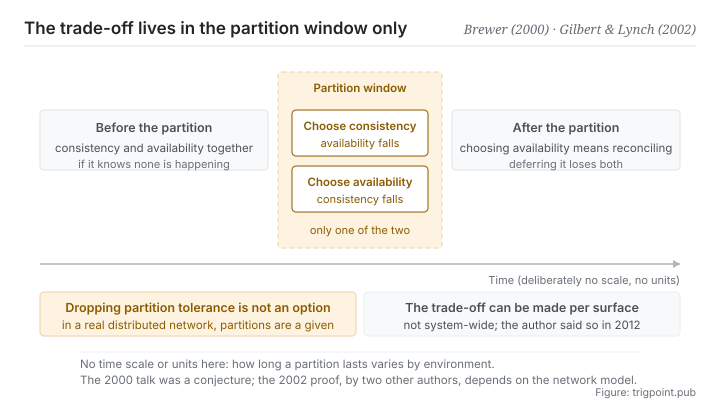

Canonical: https://trigpoint.pub/collections/software-systems-architecture/cap-theorem-brewer-2000  
Captured: 2026-11-02T21:27:22.410307+08:00

> Public theory reading mirror. Verification and Lab case sections remain on the website.

In 2012 the original author wrote that the popular “two of three” formulation was always misleading.

# CAP theorem

CAP Theorem · Brewer (2000) / Gilbert & Lynch (2002)

Checked against the sources ✓  
Lab case ✓  
Systems design · distributed trade-offs  
Read first: Microservices

## In three sentences

When a network partition happens, you can have consistency or availability, and not both. A partition is not an option you can decline. It is a condition of the environment. So the real question is not which two of the three. It is which side you want at the moment the partition occurs.

<strong>Figure 1</strong> · Time runs along the horizontal axis, and the middle stretch is the window in which a network partition occurs. Outside the window, provided the system knows it is not partitioned, consistency and availability can both be had. Inside it, only one of the two, and which one you choose decides whether conflicts have to be reconciled once the window closes. The figure deliberately carries no time scale and no units: how long a partition lasts varies by environment, and it is not a number this page can supply.

## 1. What happened

Twelve years after the claim was made, its original author wrote a retrospective saying the popular version oversimplified the tensions among the three. Take the three properties first. Consistency: every read sees the result of the most recent write. Availability: every non-failing node returns a valid response to every request. Partition tolerance: the system keeps working even when messages between nodes are arbitrarily lost or delayed.

The 2000 keynote proposed that you can have at most two of the three[\[1\]](#reference-note-1). And the popular version of that sentence is its own biggest problem, <strong>because it makes partition tolerance sound like an option</strong>. On a real distributed network, dropped packets and unreachable nodes are certain to happen. A partition is a condition of the environment, not a checkbox.

So the correct shape is this. While a partition is <strong>not</strong> happening, and the system knows it is not, consistency and availability can both be had, with no trade-off. Once a partition <strong>does</strong> happen, you can only have one: either you refuse or block the requests that would break consistency (availability drops), or you let both sides of the partition keep serving (consistency drops, and conflicts have to be reconciled afterwards).

The word knows is doing work. On a network where message delay has no upper bound and nodes have no clocks, a late message cannot be told apart from a lost one, so a system that insists on always answering cannot guarantee consistency even in a run where nothing was actually lost[\[4\]](#reference-note-4). With clocks the picture changes: the same paper shows that there are then algorithms that return consistent data when every message arrives and return stale data only when messages are lost. The practical counterpart is to put a time limit on communication and treat a timeout without agreement as a partition.

Attribution here has to go down in three parts, and most retellings compress it into one. The 2000 keynote was a <strong>conjecture</strong>: one of its slides is titled The CAP Theorem and the statement opens with the word Theorem, but no proof is given[\[1\]](#reference-note-1).

The 2002 paper by two other authors, titled after Brewer's conjecture, is the <strong>proof</strong>: first in an asynchronous network model, with no clocks and no upper bound on message delay, and then for a partially synchronous model with a clock at each node, where the result still holds whenever messages may be lost arbitrarily[\[2\]](#reference-note-2)[\[4\]](#reference-note-4). The status of theorem comes from that paper and not from the 2000 keynote.

And in 2012 the original author wrote a retrospective saying that the popular <strong>two of three formulation was always misleading</strong>, because it oversimplified the tensions among the properties, and clarifying that because partitions are rare there is little reason to give up consistency or availability while the system is not partitioned[\[3\]](#reference-note-3).

Put together, those three parts teach something beyond distributed systems: <strong>a widely cited claim can have its own author say publicly, twelve years later, that it is being read wrongly, and the popular version can carry on being popular regardless.</strong>

<strong>Attribution where due:</strong>The statement of the trade-off belongs to Brewer (by his 2012 retrospective the theorem first appeared in autumn 1998 and was published in 1999, while the consistency-versus-availability argument had appeared earlier as ACID versus BASE in a 1997 paper he co-authored[\[3\]](#reference-note-3); the slides of the July 2000 keynote call it a theorem but give no proof, and the literature calls it a conjecture[\[1\]](#reference-note-1)). <strong>The formal proof belongs to Gilbert and Lynch (2002, ACM SIGACT News)</strong>, and the status of theorem comes from that paper rather than the 2000 keynote[\[2\]](#reference-note-2). The clarification against the popular misreading belongs to Brewer himself (2012)[\[3\]](#reference-note-3). Three separate attributions, and the third matters especially: the original author has said publicly that the popular version misleads people.

## 2. Why this matters to you

This page applies wherever the same thing is being changed in two places at once. You do not need a server for it.

The common shapes: your notes or files on two devices, or you and a collaborator each editing a copy, or several lines of work running at once against the same body of material. The network drops, or you forget to sync, or both sides edit simultaneously. That is a partition. And in that moment you have already chosen a side, usually without choosing consciously.

<strong>What choosing consistency looks like</strong>: nothing may continue until the sync completes (locking, queueing, preferring to stop). The benefit is that there is never a second version. The cost is that you are blocked.

<strong>What choosing availability looks like</strong>: both sides keep editing and conflicts get handled afterwards. The benefit is that work does not stop. The cost is that reconciliation has to actually happen, and most people skip that step, which leaves two versions that are both incomplete.

Three judgements transfer directly.

First, <strong>outside a partition there is nothing to trade off in advance</strong>. That is the point of the author's 2012 retrospective and the most usable sentence here: partitions are rare, and while there is none there is little reason to give up consistency or availability. Do not pre-emptively sacrifice something because you once read the theorem. But not partitioned has to be something the system knows, not something it assumes: put a time limit on syncing and treat a timeout as a partition, rather than taking for granted that the network never drops.

Second, <strong>the trade-off can be made per surface</strong> rather than once for a whole system. Choose consistency for what goes out publicly (prefer to queue), availability for internal drafts (let them run separately), and availability with a visible generation stamp for derived boards (admitting they lag).

Third, and this is the one almost nobody does: <strong>if you choose availability, schedule the reconciliation as work.</strong> Choosing availability does not mean conflicts need not be handled. It means handling them later. Defer it and never do it, and you have lost consistency and availability both.

## Common misreadings

Page verification: Checked against the sources ✓ · Page version v2 · Content last revised 2026-10-25

- A common retelling, pick two of the three properties: the author's own 2012 piece says plainly that the two of three formulation was always misleading, because it oversimplified the tensions among the three; partitions are rare, and while a system is not partitioned there is little reason to forfeit consistency or availability. The trade-off happens only during a partition, and locally.
- A common retelling, giving up partition tolerance is also an option: on a real distributed network a partition is a condition of the environment, not a box to tick. Having consistency and availability together holds only on the assumption that partitions do not happen, typically a single machine or a single site.
- A common retelling, this is a theorem proved in 2000: one slide of the 2000 keynote has theorem in its title, but no proof is given; the proof is the 2002 paper by two other authors titled after Brewer's conjecture, and the proof is bound to a particular network model and definitions. Three things to keep apart.

## Corrections

- 2026-10-09 · An earlier version of this page had three statements that did not match the original material, and all three have been corrected against the originals. First, it said the 2000 author did not frame the trade-off as a theorem and drew it from operational observation; one of the slides is in fact titled The CAP Theorem, it simply gives no proof, and the name conjecture comes from the title of the 2002 paper. Second, the two sentences it quoted as the author's own words from 2012, including that the theorem is misleading, came from a third-party reading summary; what the author wrote is that the two of three formulation was misleading, not the theorem itself. Third, it stated without condition that consistency and availability can both be had while not partitioned; that holds only when the system knows it is not partitioned.

## References

<strong>How to read the source notes</strong> “Bibliographic details checked” means author, year, title and venue were confirmed. It does not mean the source's claims were checked. “Matched against the full text” means the claim was compared with the text of the source itself. Definitions as of 2026-09-20.

- \[1\] Brewer, E. A. (2000). Towards Robust Distributed Systems. Keynote, ACM PODC, Portland, OR, 19 July 2000. Abstract in Proceedings of PODC '00, p. 7.
- \[2\] Gilbert, S. & Lynch, N. (2002). Brewer's Conjecture and the Feasibility of Consistent, Available, Partition-Tolerant Web Services. ACM SIGACT News, 33(2), 51–59.
- \[3\] Brewer, E. (2012). CAP Twelve Years Later: How the 'Rules' Have Changed. Computer, 45(2), 23–29.
- \[4\] Gilbert, S. & Lynch, N. (2002). Brewer's Conjecture and the Feasibility of Consistent, Available, Partition-Tolerant Web Services. ACM SIGACT News, 33(2), 51–59.
- \[5\] Editorial note, no external source; see note \[5\] in the text.

## Knowledge graph

- [<em>Compare ▸</em>Single source of truth (concept history)](single-source-of-truth-concept-history.md)

Cite as: Trigpoint, “CAP theorem”, trigpoint.pub/collections/software-systems-architecture/cap-theorem-brewer-2000 · © Strategitect Limited. · Content last revised 2026-10-25

## Source notes

**[1]** Brewer, E. A. (2000-07-19). Towards Robust Distributed Systems. Keynote, ACM PODC, Portland, OR. Abstract in Proceedings of PODC '00, p. 7. DOI 10.1145/343477.343502. Bibliographic details confirmed by two sources. Claims matched against the full text. Slides from the keynote at the symposium on Principles of Distributed Computing (PODC). One slide is titled The CAP Theorem and its statement opens with Theorem:, but no proof is given; the name conjecture comes from the title of the 2002 paper. By the author's 2012 retrospective, the theorem first appeared in autumn 1998, was published in 1999, and was presented in this 2000 keynote; the same piece records that the first version of the consistency-versus-availability argument appeared as ACID versus BASE in a 1997 systems paper of which he was a co-author.

**[2]** Gilbert, S. & Lynch, N. (2002). Brewer's Conjecture and the Feasibility of Consistent, Available, Partition-Tolerant Web Services. ACM SIGACT News, 33(2), 51–59. DOI 10.1145/564585.564601. Bibliographic details checked against the official record. Claims matched against the full text. Proves, in the asynchronous network model, that when messages may be lost a read/write data object cannot guarantee both availability and atomic consistency; it also proves that in a partially synchronous model, where each node has a clock, the result still holds whenever messages may be lost arbitrarily. This paper, not the keynote, is the source of the status of theorem.

**[3]** Brewer, E. (2012). CAP Twelve Years Later: How the ‘Rules’ Have Changed. Computer, 45(2), 23–29. DOI 10.1109/MC.2012.37. Bibliographic details checked against the official record. Claims matched against the full text. The author's own words: “The ‘2 of 3’ formulation was always misleading because it tended to oversimplify the tensions among properties.” And: “Because partitions are rare, there is little reason to forfeit C or A when the system is not partitioned.” What misleads is the two of three formulation, not the theorem itself.

**[4]** Gilbert, S. & Lynch, N. (2002). Brewer's Conjecture and the Feasibility of Consistent, Available, Partition-Tolerant Web Services. ACM SIGACT News, 33(2), 51–59. Bibliographic details checked against the official record. Claims matched against the full text. Corollary 1.1 of the same paper: in the asynchronous model, with no clocks, an always-available algorithm cannot guarantee atomic consistency even in executions where no message is lost, because a lost message cannot be told apart from an arbitrarily delayed one. In the partially synchronous model, with a clock at each node, the paper proves the impossibility still holds (Theorem 2), but the analogue of Corollary 1.1 does not: there are algorithms that return consistent data when every message is delivered and return stale data only when messages are lost.

---

[繁體中文](../../../zh-Hant/collections/software-systems-architecture/cap-theorem-brewer-2000.md) · [简体中文](../../../zh-Hans/collections/software-systems-architecture/cap-theorem-brewer-2000.md)

[Index](../../README.md) · [Original page](https://trigpoint.pub/collections/software-systems-architecture/cap-theorem-brewer-2000) · [Citation and versions](../../../READING.md)

[Original SVG](assets/cap-theorem-brewer-2000.svg) · Display copy adds a white background only.
