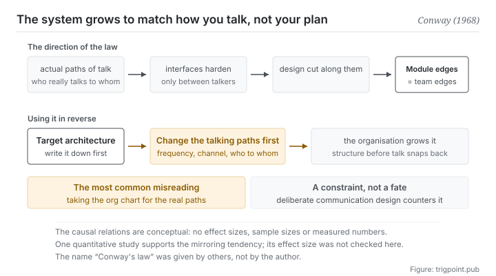

Canonical: https://trigpoint.pub/collections/software-systems-architecture/conways-law-conway-1968  
Captured: 2026-11-02T21:27:22.853091+08:00

> Public theory reading mirror. Verification and Lab case sections remain on the website.

The lines on the org chart and the paths along which people actually talk are two different maps.

# Conway's law

Conway's Law · Conway (1968)

Abstracts checked ✓  
Lab case ✓  
Software architecture · organisation and structure  
Read first: Modularity and thin crossing points

## In three sentences

Organisations that design systems produce designs that mirror their own communication structures. Communication structure here means the paths along which people actually talk, not the org chart. It is a constraint rather than a fate, so its most valuable use is the reverse one: change how people talk first.

<strong>Figure 1</strong> · The top row is the direction the law runs: the actual communication paths of an organisation harden into interfaces, the design gets cut along those interfaces, and module boundaries grow into team boundaries. The bottom row is the law used in reverse: change the communication structure first and let the organisation grow the architecture you want. The most common misreading is marked bottom left, taking the org chart for the actual paths of communication.

## 1. What happened

The communication structure in this law means who actually talks to whom; the lines on the org chart are a different map. The 1968 paper makes one claim: organisations that design systems are <strong>constrained</strong> to produce designs that are copies of the communication structures of those organisations[\[1\]](#reference-note-1).

The mechanism is not mysterious. Once a division of labour is settled, fixed interfaces of communication form with it: who talks to whom every day, who talks to whom once a quarter, who never talks to whom at all. And an interface between two modules <strong>can only be negotiated between people who can communicate</strong>.

Two people who speak daily will negotiate a fine-grained interface they can adjust at any time. Between two people who do not speak, what appears is a coarse, hard-coded interface that neither dares touch. The boundaries of the system therefore grow into the boundaries of the teams.

The claim has since been tested empirically: a 2012 study found that loosely coupled organisations produce significantly more modular products[\[4\]](#reference-note-4). So it is more than a serviceable metaphor; it has quantitative support. This site checked that study at the level of its abstract, not its full text.

Its most valuable use is <strong>the reverse one</strong>. If architecture mirrors communication structure, then to get a particular architecture you go and build that communication structure, letting the organisation grow the shape you want rather than pushing a design that sits crosswise to it. In practice this reverse use is what turns the law from an observation into an instrument.

One point of attribution has to be stated: <strong>the name is not the author's</strong>. Sources give two accounts: one says people at a July 1968 symposium on modular programming were already calling it that; the author's own website records that a widely read software engineering book (first edition 1975) gave it the name when citing his paper[\[2\]](#reference-note-2). What the author put forward was the claim and the paper. This site cites the issue as 14(4), in line with most bibliographic records; another source gives 14(5)[\[3\]](#reference-note-3).

<strong>Attribution where due:</strong>The claim and the paper belong to Conway (1968, issue 14(4) of that periodical)[\[1\]](#reference-note-1). <strong>The name Conway's law belongs to other people</strong>: by one account people at a 1968 symposium were already calling it that, by another a widely read book (first edition 1975) gave it the name when citing the paper[\[2\]](#reference-note-2). The empirical test of the mirroring hypothesis belongs to the three authors of the 2012 research policy paper[\[4\]](#reference-note-4). Three separate attributions. Crediting the name to the author himself is the most common error here, and this site carries an explicit correction on this page.

## 2. Why this matters to you

The most direct sentence this page has for you: <strong>your working system will grow into the shape of how you talk, not into the shape of your plan.</strong>

Concretely. How you collaborate with a model decides what tools you end up building. If your habit is to open a new conversation each time and paste the background in again, you will build a stock of prompt templates. If your habit is to let one context accumulate, you will build state files. Those two products are not a difference of taste. They are a mirror of two ways of communicating.

The same thing is more visible with people. With a collaborator you speak to daily, the interface between you will be vague and flexible (use your judgement). With one you speak to monthly, the interface turns into a written-down specification. <strong>Both interfaces are products of the frequency of communication rather than products of a design decision.</strong> And when you complain that the specification is too rigid, what actually wants changing may be how often you talk.

So this page offers two questions and one ordering.

First question: <strong>is my current working structure something I designed, or a copy of how I communicate.</strong> Most of the time it is the second, and the second grows faster than the first.

Second question: <strong>what paths of communication would the structure I want need in order to grow.</strong> If the answer is daily conversation and you actually speak once a week, that structure will not appear, and forcing it will not make it appear.

The ordering: <strong>move communication first, then wait for structure.</strong> Doing it the other way round, changing structure and expecting communication to follow, is nearly always pulled back into shape by organisational inertia, which is the other half of the law talking.

## Common misreadings

Page verification: Abstracts checked ✓ · Content last revised 2026-10-25

- A common retelling, Conway named it Conway's law himself: the name was given by others. One account has people at a 1968 symposium already calling it that; another, on the author's own website, has a widely read software engineering book (first edition 1975) giving it the name when citing the paper. What the author put forward was a claim and a paper, not the name.
- A common retelling, architecture mirrors the org chart: the law is about <strong>actual communication paths</strong>, who really talks to whom, and these often disagree with the formal hierarchy. Fitting an org chart to an architecture leads to misjudgement.
- A common retelling, it is an iron law, so changing the architecture is pointless: it is a constraint, not a fate. Deliberate design of the communication structure can turn it to use in reverse, which is its most valuable use.

## Corrections

- This site gives the issue as 14(4), in line with most bibliographic records; another source gives 14(5).

## References

<strong>How to read the source notes</strong> “Bibliographic details checked” means author, year, title and venue were confirmed. It does not mean the source's claims were checked. “Consistent with the abstract” means the claim agrees with the paper's abstract. It does not include sentence-by-sentence checking against the full text. “Matched against the full text” means the claim was compared with the text of the source itself. Definitions as of 2026-09-20.

- \[1\] Conway, M. E. (1968). How Do Committees Invent? Datamation, 14(4), 28–31.
- \[2\] Brooks, F. P. (1975). The Mythical Man-Month: Essays on Software Engineering. Addison-Wesley.
- \[3\] Conway, M. E. (1968). How Do Committees Invent? Datamation, 14(4), 28–31.
- \[4\] MacCormack, A., Baldwin, C., & Rusnak, J. (2012). Exploring the duality between product and organizational architectures: A test of the “mirroring” hypothesis. Research Policy, 41(8), 1309–1324.

## Knowledge graph

- [<em>Applied in ▸</em>Microservices](microservices-lewis-fowler-2014.md)
- [<em>Downstream ▸</em>Modularity and thin crossing points](modularity-baldwin-clark-2000.md)
- [<em>Downstream ▸</em>Team topologies](team-topologies-skelton-pais-2019.md)
- [<em>Downstream ▸</em>Data mesh](data-mesh-dehghani-2022.md)

Cite as: Trigpoint, “Conway's law”, trigpoint.pub/collections/software-systems-architecture/conways-law-conway-1968 · © Strategitect Limited. · Content last revised 2026-10-25

## Source notes

**[1]** Conway, M. E. (1968). How Do Committees Invent? Datamation, 14(4), 28–31. Bibliographic details confirmed by two sources. Claims matched against the full text. Published in the April 1968 issue. The sentence carrying the claim is confirmed word for word against the full text: organizations which design systems (in the broad sense used here) are constrained to produce designs which are copies of the communication structures of these organizations.

**[2]** Attribution of the name: the author did not name it himself, and there are two accounts. The IEEE Computer Society's pioneer biography records that George Mealy named it at a symposium on modular programming in July 1968; the author's own website records that Brooks called it Conway's law when citing the paper in The Mythical Man-Month. This site sets both accounts side by side and does not rule between them.

**[3]** Issue: most bibliographic records give 14(4), and this site follows them; volume 14 of the periodical ran to 12 issues in 1968. Another source gives 14(5).

**[4]** MacCormack, A., Baldwin, C., & Rusnak, J. (2012). Exploring the duality between product and organizational architectures: A test of the “mirroring” hypothesis. Research Policy, 41(8), 1309–1324. Bibliographic details checked against the official record. Consistent with the abstract. Empirical test of the mirroring hypothesis. The abstract reports that, comparing matched pairs of products, in every pair the product developed by the more loosely coupled organisation was significantly more modular. This site checked the abstract of the working-paper version under the same title, not the full text of the journal article.

---

[繁體中文](../../../zh-Hant/collections/software-systems-architecture/conways-law-conway-1968.md) · [简体中文](../../../zh-Hans/collections/software-systems-architecture/conways-law-conway-1968.md)

[Index](../../README.md) · [Original page](https://trigpoint.pub/collections/software-systems-architecture/conways-law-conway-1968) · [Citation and versions](../../../READING.md)

[Original SVG](assets/conways-law-conway-1968.svg) · Display copy adds a white background only.
