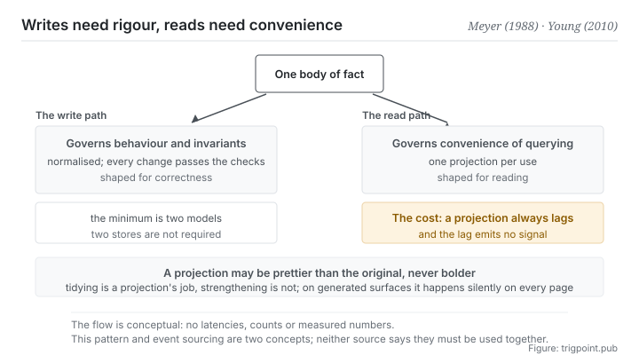

Canonical: https://trigpoint.pub/collections/software-systems-architecture/cqrs-young-2010  
Captured: 2026-11-02T21:27:23.137937+08:00

> Public theory reading mirror. Verification and Lab case sections remain on the website.

Should reading and writing share one model, or be split into two along their boundary?

# Command query responsibility segregation (CQRS)

Command Query Responsibility Segregation (CQRS) · Young (2010) / Meyer CQS (1988)

Bibliography checked ✓  
Lab case ✓  
Software architecture · separating reads from writes  
Read first: Event sourcing

## In three sentences

The model you use to update information does not have to be the model you use to read it. The two sides want opposite things: writing wants strictness, reading wants convenience. Separate them and you acquire one more thing to look after, namely a projection that will always lag the original.

<strong>Figure 1</strong> · One body of fact travelling in two directions. On the left, the write path, which governs behaviour and invariants. On the right, the read path, which governs convenience of querying. Each side may take its own shape. A discipline is marked along the bottom: a projection may be prettier than the original, and may never claim more than the original.

## 1. What happened

Whether reading and writing should share one model or have one each is a trade-off to judge part by part. When one model serves reads and writes at once, it has to satisfy two sets of requirements pulling against each other. The write side wants strictness: normalised data, invariants that hold, every change passing its checks. The read side wants convenience: views assembled from several places, a different shape prepared for each purpose, and speed.

A model pulled from both sides ends up distorted, either loosening its structure for the sake of reading or making every query take the long way round for the sake of writing. The claim of this pattern is plain: <strong>split one model into two along the boundary between reading and writing</strong>[\[2\]](#reference-note-2). The write side concentrates on behaviour and consistency; the read side concentrates on projections optimised for querying.

Its ancestry is the command query separation of the 1988 classic: a method either changes state and returns nothing, or returns a value and has no side effects[\[1\]](#reference-note-1). That rule governs the method level, and this pattern <strong>raises the same cut to the model level</strong>. The vocabulary of command and query comes from that same book. The 2011 piece, which this site marks as one that carried the pattern into mainstream architecture discussion, does not in fact mention that author[\[3\]](#reference-note-3), so this site anchors directly to the book rather than reasoning back through a secondary source.

Two more points of attribution. A self-published document of November 2010 systematised the pattern[\[2\]](#reference-note-2), but it was not the starting point: in 2008 another practitioner had already written about splitting commands and queries into two services at the architectural level, and by December 2009 the same author was using the acronym throughout an article[\[4\]](#reference-note-4). This site therefore marks the author of the 2010 document as <strong>the one who crystallised it rather than an isolated originator</strong>. As for the year he first spoke about these ideas in public, this page could not settle it from his own words, and so gives no year[\[5\]](#reference-note-5).

One last thing: the 2011 piece stresses that the pattern should be applied <strong>locally</strong>, to the part actually being distorted by the conflict between reading and writing, rather than as a uniform architecture across a whole system[\[3\]](#reference-note-3).

<strong>Attribution where due:</strong>The classic statement of command query separation and that pair of terms belong to Meyer (1988)[\[1\]](#reference-note-1). This site credits systematising this pattern to Young (the document of November 2010)[\[2\]](#reference-note-2), though separating reads from writes at the architectural level, and the acronym itself, appear earlier in articles by Dahan from 2008 and 2009, so this site marks Young as the one who crystallised it rather than an isolated originator[\[4\]](#reference-note-4). Arguing for local application belongs to Fowler (14 July 2011), and this site also marks that piece as one that carried the pattern into mainstream architecture discussion[\[3\]](#reference-note-3). The year of the first talk could not be settled from the practitioner's own words, and this page gives none[\[5\]](#reference-note-5). Four separate attributions. Compressing the line into someone proposed this in 2010 gets both the origin of the vocabulary and the precursors wrong at once.

## 2. Why this matters to you

You are already using this pattern. You have simply not brought its discipline along with it.

Anything derived for people to look at is a read model: a monthly report, a board, a page of public explanation, a summary fed to a model. Their originals live elsewhere. The reason you made them is precisely that the original's shape does not suit that purpose, which is the reason for separating, and the reason is a good one.

Separating costs exactly one thing, and that thing is structural: <strong>a projection will always lag its original.</strong> How far behind depends on how often you regenerate it, and being behind <strong>emits no signal at all</strong>. A board generated three weeks ago looks exactly like one generated today.

So this page offers three practices, and the third is the one almost nobody does.

<strong>First, before deciding whether to separate, ask whether the readers and the writers are the same people.</strong> If they are one person (your own record of decisions, say), separating is probably just one more thing to maintain. If they are not (a public page, an explanation handed to a collaborator, context fed to a model), separating is nearly always right.

<strong>Second, stamp every projection with the time it was generated.</strong> That is admitting the lag rather than pretending to be in step.

<strong>Third, and this is what the page really wants to leave you with: a projection may be prettier than the original and may never claim more than the original.</strong> Deriving makes it very easy to add something: turning a vague grade into a definite phrase, tidying a passage full of reservations into one clean conclusion. Tidying is what a projection is for. Strengthening is not. And strengthening is especially dangerous on an automatically generated surface, because it happens <strong>consistently and silently</strong> on every single page.

## Common misreadings

Page verification: Bibliography checked ✓ · Content last revised 2026-10-25

- A common account says this pattern is part of event sourcing. They are two concepts: command query responsibility segregation can sit on ordinary data access, with no need to convert to event sourcing first. Both original sources present them separately. The 2010 document says the two are most interesting when combined and support each other; the 2011 piece says the pattern fits well with event-based programming models. Neither says they must be used together.
- A common account says that separating means two databases and accepting eventual consistency. The minimal form needs only two models and does not require two stores. Treating the eventual consistency of split stores as mandatory turns an optional enlargement into the definition.
- A common account says that practitioner invented it in 2010. This site marks the document of November 2010 as a systematisation of the pattern; it is not the starting point. Separating reads from writes at the architectural level was written up in 2008, and the acronym was used throughout a public article in December 2009, while the vocabulary of command and query comes from the 1988 classic. Invention, naming and the origin of the vocabulary have to be recorded separately.

## Corrections

- Year of the first talk: the two first-person accounts set side by side in an earlier version (2006 and 2007) could not be checked against his own words, and the page now gives no year.

## References

<strong>How to read the source notes</strong> “Bibliographic details checked” means author, year, title and venue were confirmed. It does not mean the source's claims were checked. “Matched against the full text” means the claim was compared with the text of the source itself. “Follows secondary accounts” means the claim rests on sources that report it, not on the original document. Definitions as of 2026-09-20.

- \[1\] Meyer, B. (1988). Object-Oriented Software Construction. Prentice Hall. ISBN 0-13-629049-3.
- \[2\] Young, G. (2010). CQRS Documents. cqrs.files.wordpress.com/2010/11/cqrs_documents.pdf.
- \[3\] Fowler, M. (2011). CQRS. martinfowler.com/bliki/CQRS.html. Published 14 July 2011.
- \[4\] Dahan, U. (2008). Command Query Separation and SOA. udidahan.com/2008/08/11/command-query-separation-and-soa/; Dahan, U. (2009). Clarified CQRS. udidahan.com/2009/12/09/clarified-cqrs/.
- \[5\] Editorial note, no external source; see note \[5\] in the text.

## Knowledge graph

- [<em>Compare ▸</em>Event sourcing](event-sourcing-fowler-2005.md)

Cite as: Trigpoint, “Command query responsibility segregation (CQRS)”, trigpoint.pub/collections/software-systems-architecture/cqrs-young-2010 · © Strategitect Limited. · Content last revised 2026-10-25

## Source notes

**[1]** Meyer, B. (1988). Object-Oriented Software Construction (1st ed.). Prentice Hall. Bibliographic details confirmed by two sources. The attribution of command query separation and its terms follows secondary accounts that agree with one another. The classic statement of command query separation: a method either changes state and returns nothing, or returns a value and has no side effects. It is the source of the command and query vocabulary. The relevant chapters were not checked word for word here.

**[2]** Young, G. (2010-11). CQRS Documents (PDF). Bibliographic details checked against the official record. Claims matched against the full text. A practitioner document, self-published by its author, that systematises the pattern. It says that the pattern was at first treated simply as command query separation applied at a higher level, and was deemed a different pattern only after much confusion between the two.

**[3]** Fowler, M. (2011-07-14). CQRS. martinfowler.com/bliki/CQRS.html. Bibliographic details checked against the official record. Claims matched against the full text. The original sentence says this is a pattern the author first heard described by Greg Young. The same piece argues that it should be used only on specific portions of a system, not on the system as a whole.

**[4]** Dahan, U. (2008, August 11). Command Query Separation and SOA. udidahan.com; Dahan, U. (2009, December 9). Clarified CQRS. udidahan.com. Bibliographic details checked against the official record. Claims matched against the full text. Both pieces predate the document of November 2010. The 2008 piece already splits commands and queries into two services at the architectural level, each with its own data store, though it still calls this command query separation. The 2009 piece uses the acronym throughout.

**[5]** Year of the first talk: this page could not settle from the practitioner's own words the year he first spoke about these ideas in public, and so gives no year.

---

[繁體中文](../../../zh-Hant/collections/software-systems-architecture/cqrs-young-2010.md) · [简体中文](../../../zh-Hans/collections/software-systems-architecture/cqrs-young-2010.md)

[Index](../../README.md) · [Original page](https://trigpoint.pub/collections/software-systems-architecture/cqrs-young-2010) · [Citation and versions](../../../READING.md)

[Original SVG](assets/cqrs-young-2010.svg) · Display copy adds a white background only.
