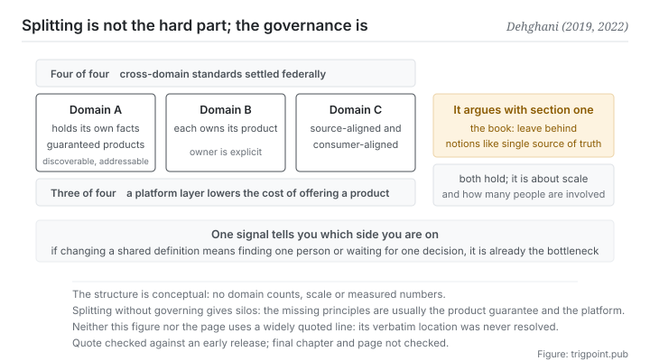

Canonical: https://trigpoint.pub/collections/software-systems-architecture/data-mesh-dehghani-2022  
Captured: 2026-11-02T21:27:23.395081+08:00

> Public theory reading mirror. Verification and Lab case sections remain on the website.

Should data be managed centrally by one team, or held by each domain itself?

# Data mesh

Data Mesh · Dehghani (2019, 2022)

Bibliography checked ✓  
Software architecture · federated governance  
Read first: Single source of truth (concept history)  
Read first: CAP theorem

## In three sentences

Once scale arrives, holding one globally uniform canonical model makes that model the bottleneck. The data mesh answer is to leave the facts in the hands of each domain, and to require each domain to turn them into a product carrying a guarantee of quality. Standards for interoperating across domains are settled federally rather than dictated centrally.

<strong>Figure 1</strong> · How the four principles relate. Domains hold their own facts and turn them into products carrying a guarantee of quality; a platform layer drives down the cost of offering a product; and the standards for interoperating across domains are settled federally rather than dictated centrally. The right-hand side marks where this page argues with the first section of this shelf: here the single source of truth is named outright as one of the notions to leave behind.

## 1. What happened

Whether data should be managed by one central team or left in the hands of the domains that produce it is a trade-off at enterprise scale. This is the one node on this shelf that <strong>argues explicitly with the first section</strong>, and the way it argues is worth looking at closely.

Its diagnosis starts from an operational phenomenon: the central data team becomes the bottleneck, and an integrated reservoir explodes in integration complexity at enterprise scale. The reason is not that the technology is inadequate. It is <strong>structural</strong>: every new requirement has to pass through the same people and the same model.

Its answer is four things[\[2\]](#reference-note-2). First, <strong>domains hold their own data</strong>. Second, <strong>data is made into a product</strong>: discoverable, addressable, interoperable with others, which means it carries a guarantee of quality rather than being a file thrown over the wall. Third, <strong>a platform layer has to drive down the cost of offering one product</strong>, or autonomy is merely a transfer of burden onto the domains. Fourth, <strong>standards across domains are settled federally and enforced computationally</strong> rather than dictated centrally.

Its most direct sentence: a data mesh has to leave behind data myths such as the <strong>single source of truth</strong>, or a single rigorously controlled canonical model[\[2\]](#reference-note-2). That sentence was once confirmed word for word against an early release of the book rather than summarised by later readers.

It also draws a useful distinction[\[1\]](#reference-note-1): between source-aligned datasets (the immutable, time-stamped facts each domain produces) and consumer-aligned datasets (views transformed and worked up for downstream purposes). Those two should not be managed together: the first is fact, the second is derivation. <strong>That distinction is the enlarged version of the two pages in the second section of this shelf</strong>: fact in one place, derivations as many as you like.

Attribution and genealogy here are clean: concept and name belong to one person, one article in 2019 and one book in 2022[\[1\]](#reference-note-1)[\[2\]](#reference-note-2). The ancestry this site marks within the shelf is three pages it already holds (the constraint of organisational communication structure, domain-driven design, team topologies), given as examples[\[5\]](#reference-note-5), and there is now one systematic academic review, though what it gathers is industry grey literature, and it notes that academic work defining the concept is still lacking[\[4\]](#reference-note-4).

<strong>Attribution where due:</strong>Both concept and name belong to Dehghani (the 2019 article and the 2022 book)[\[1\]](#reference-note-1)[\[2\]](#reference-note-2), where originator and coiner are the same person. As ancestry, this site gives three pages the shelf already holds as examples: the constraint of organisational communication structure (1968), domain-driven design (2003), and team topologies (2019)[\[5\]](#reference-note-5). The systematic review at the academic layer belongs to the authors of the 2024 surveys paper[\[4\]](#reference-note-4). <strong>One widely requoted sentence is not used on this page</strong>: its verbatim location is unresolved and it is judged a paraphrase[\[3\]](#reference-note-3).

## 2. Why this matters to you

This page is what gives you <strong>a sense of scale</strong>, and a sense of scale is usually harder to come by than the principles themselves.

The page in the first section said that each element is maintained in one place and referred to from everywhere else. That is almost always right inside your own knowledge base. This page says that once the number of domains and the rate of change pass a certain point, holding one globally uniform canonical model makes that model the bottleneck. Both pages are correct, and what separates them is scale and headcount.

There is a practical signal for telling which side you are on: <strong>if changing a shared definition means finding a person first, or waiting for a decision, that shared definition is already the bottleneck.</strong> A system with one person in it does not have this problem (that person is you). A system with two or three starts to. A system with ten certainly does.

What this page really wants you to take away is the two of the four principles that get skipped most easily.

<strong>Made into a product matters more than autonomy does.</strong> Leaving facts in the hands of each domain is easy. What is hard is requiring each one to be discoverable, to have a named owner, and to carry a commitment about quality. Without that, decentralisation degrades into a scatter of islands: you have traded a bottleneck for being lost.

<strong>The platform driving down cost is what decides the outcome.</strong> If offering one acceptable product is expensive, domains will do it badly or route around it entirely. The equivalent at personal scale: if your filing discipline is too much trouble, you will not follow it, and then you will blame your own lack of discipline when what wants repairing is the cost.

## Common misreadings

Page verification: Bibliography checked ✓ · Content last revised 2026-10-25

- A common retelling, data mesh just means breaking the data lake into a few small lakes: two of the four principles have nothing to do with splitting (product-grade quality guarantees, federated governance). Split without governing and what you get is a handful of islands each going its own way.
- A common retelling, federated governance means no governance: it means that standards for interoperating across domains are decided jointly by the participants and enforced computationally, not that standards are abolished. What separates it from central dictation is who decides, not whether there are standards.

## Corrections

- This page does not use a certain widely requoted sentence: the depth review could not locate it word for word in the version searched, the nearest thing being a section heading, so the sentence is judged a paraphrase rather than a quotation, and its status is unresolved. This site does not quote sentences whose status is unresolved.

## References

<strong>How to read the source notes</strong> “Bibliographic details checked” means author, year, title and venue were confirmed. It does not mean the source's claims were checked. “Consistent with the abstract” means the claim agrees with the paper's abstract. It does not include sentence-by-sentence checking against the full text. “Matched against the full text” means the claim was compared with the text of the source itself. Definitions as of 2026-09-20.

- \[1\] Dehghani, Z. (2019). How to Move Beyond a Monolithic Data Lake to a Distributed Data Mesh. martinfowler.com/articles/data-monolith-to-mesh.html. Published 20 May 2019.
- \[2\] Dehghani, Z. (2022). Data Mesh: Delivering Data-Driven Value at Scale. O'Reilly. ISBN 978-1-492-09239-1.
- \[3\] Editorial note, no external source; see note \[3\] in the text.
- \[4\] Goedegebuure, A., Kumara, I., Driessen, S., Van Den Heuvel, W.-J., Monsieur, G., Tamburri, D. A., & Di Nucci, D. (2024). Data Mesh: A Systematic Gray Literature Review. ACM Computing Surveys, 57(1), Article 11, 1–36.
- \[5\] Editorial note, no external source; see note \[5\] in the text.

## Knowledge graph

- [<em>Prerequisite ▸</em>Domain-driven design (DDD)](domain-driven-design-evans-2003.md)
- [<em>Prerequisite ▸</em>Conway's law](conways-law-conway-1968.md)
- [<em>Compare ▸</em>Single source of truth (concept history)](single-source-of-truth-concept-history.md)
- [<em>Compare ▸</em>Event sourcing](event-sourcing-fowler-2005.md)

Cite as: Trigpoint, “Data mesh”, trigpoint.pub/collections/software-systems-architecture/data-mesh-dehghani-2022 · © Strategitect Limited. · Content last revised 2026-10-25

## Source notes

**[1]** Dehghani, Z. (2019-05-20). How to Move Beyond a Monolithic Data Lake to a Distributed Data Mesh. martinfowler.com. Bibliographic details checked against the publisher's record. Claims matched against the full text. Provenance double-checked across models. Confirmed word for word in the article: source-aligned domain datasets must be separated from the internal source systems' datasets; they have a much larger volume, represent immutable timed facts, and change less frequently than their systems.

**[2]** Dehghani, Z. (2022). Data Mesh: Delivering Data-Driven Value at Scale. O'Reilly. Bibliographic details confirmed by two sources. Provenance double-checked across models. This sentence was once confirmed word for word against an early release: “Data Mesh must depart from data myths such as a single source of truth, or one tightly-controlled canonical model.” The early release places the passage in a chapter titled After the Inflection Point; in the final edition's contents that title is chapter 7, and chapter 2 has a section titled Embrace the Most Relevant Domain Data: Don’t Expect a Single Source of Truth. Chapter and page in the final edition were not checked here.

**[3]** One residual from the depth review: another widely requoted sentence could not be located word for word in the version searched, the nearest thing being a section heading in the early release. It is judged a paraphrase rather than a quotation, and its status is unresolved. This page therefore does not use that sentence at all.

**[4]** Goedegebuure, A., Kumara, I., Driessen, S., Van Den Heuvel, W.-J., Monsieur, G., Tamburri, D. A., & Di Nucci, D. (2024). Data Mesh: A Systematic Gray Literature Review. ACM Computing Surveys, 57(1), Article 11, 1–36. DOI 10.1145/3687301. Bibliographic details checked against the official record. Consistent with the abstract. A systematic review of grey literature in a 2024 computing surveys journal: it gathers 114 industry articles and sets out four principles. Its abstract notes that there is considerable grey literature from practitioners, while academic attempts at defining and building on the concept are still lacking.

**[5]** Ancestry as this site arranges it (examples, not a complete list): the constraint of organisational communication structure (1968) → domain-driven design (2003) → team topologies (2019) → this concept (2019, 2022). All four links are nodes this shelf already holds.

---

[繁體中文](../../../zh-Hant/collections/software-systems-architecture/data-mesh-dehghani-2022.md) · [简体中文](../../../zh-Hans/collections/software-systems-architecture/data-mesh-dehghani-2022.md)

[Index](../../README.md) · [Original page](https://trigpoint.pub/collections/software-systems-architecture/data-mesh-dehghani-2022) · [Citation and versions](../../../READING.md)

[Original SVG](assets/data-mesh-dehghani-2022.svg) · Display copy adds a white background only.
