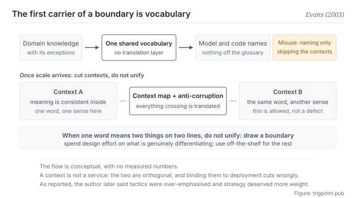

Canonical: https://trigpoint.pub/collections/software-systems-architecture/domain-driven-design-evans-2003  
Captured: 2026-11-02T21:27:23.953462+08:00

> Public theory reading mirror. Verification and Lab case sections remain on the website.

Draw the architecture first, or first get domain experts and developers using one set of terms?

# Domain-driven design (DDD)

Domain-Driven Design (DDD) · Evans (2003)

Bibliography checked ✓  
Software architecture · language and boundaries  
Read first: Modularity and thin crossing points

## In three sentences

The main battleground of complexity is the domain itself, not the technical layer. The first move against it is not drawing an architecture diagram. It is unifying the vocabulary: domain experts and developers share one set of terms, and those terms become the names inside the system. Once scale arrives, cut into contexts, keep meaning consistent inside each, and translate explicitly across them.

<strong>Figure 1</strong> · The top row is how knowledge gets into the system: domain experts and developers share one set of terms, and those terms become the names in the model and in the code with no translation layer in between. The bottom row is what happens once scale arrives: cut into several contexts, keep meaning consistent inside each, and manage what crosses between them through one map and a layer of anti-corruption translation. The common misuse is marked on the right: adopting the tactical naming and skipping the language and the contexts.

## 1. What happened

Whether to settle the architecture first, or first a vocabulary shared by domain experts and developers, is a trade-off to make as soon as work on a system begins. The position of the 2003 book is that the real difficulty in software lies in the <strong>business domain</strong> rather than in frameworks and databases[\[1\]](#reference-note-1). And the first bottleneck to getting knowledge into a system without loss is not technical. It is <strong>translation</strong>.

The typical failure looks like this. The domain expert speaks one set of terms, the developer translates them mentally into a second set, and then writes them down as a third (the variable and class names in the code). Every translation drops a little, and what it usually drops are conditions and exceptions. The expert says this kind of customer normally does not prepay, unless there was a dispute on the last order, and what reaches the code is one boolean field.

The book's first requirement is therefore a <strong>shared language</strong>: one vocabulary used by domain experts and developers alike, with no translation layer between them, and those terms <strong>become the names in the model and in the code</strong>. That sounds like advice about communication. It is actually a design constraint: if a concept has no name in the vocabulary, it should not have an implementation quietly growing for it in the code.

The second requirement comes from scale. A large system <strong>cannot sustain one unified model</strong>: the same word already means different things in sales and in logistics, and forcing them together only turns the model into a compromise nobody is happy with. The book's handling is to cut into several <strong>bounded contexts</strong>: meaning stays consistent inside each, what crosses between them is managed explicitly through a map, and where necessary a layer of anti-corruption translation sits at the join so the shape of an external model does not seep in[\[1\]](#reference-note-1).

The third requirement is about allocating resources: design effort is finite, so put it first into the <strong>core domain</strong>, the part that actually produces the difference, and buy the peripheral and generic parts off the shelf wherever you can.

Attribution on this page is fairly simple: the name of the method and the core vocabulary of its strategic layer (shared language, bounded context) are generally credited to this book. The tactical set of building blocks cannot be credited to it as a whole, though: the Repository pattern, for one, was already included in a book on enterprise application architecture patterns published the year before, and credited to two other authors[\[2\]](#reference-note-2). One piece of the author's own hindsight belongs here as well: according to a report of a 2009 talk, he said the tactical set of building blocks is over-emphasised, while contexts and the core domain deserve more weight[\[3\]](#reference-note-3).

<strong>Attribution where due:</strong>The method and its strategic vocabulary (shared language, bounded context, strategic design) are generally credited to Evans (2003)[\[1\]](#reference-note-1). Systematising the tactical building blocks belongs to that book, but <strong>some of them have precursors</strong>: the Repository pattern appears in the 2002 book on enterprise application architecture patterns, credited there to Hieatt and Mee[\[2\]](#reference-note-2). The hindsight that the tactical layer is over-emphasised and the strategic layer deserves more weight comes from a report of his 2009 talk[\[3\]](#reference-note-3). The conceptual neighbours (the cost criterion for module boundaries, service boundaries, the communication structure of an organisation) each have owners of their own, on the first page of this section and in the fourth and fifth sections.

## 2. Why this matters to you

The most direct use of this page is that it explains why your collaboration with a model so often comes apart <strong>on a single word</strong>.

You hold a vocabulary of your own: what a certain file is called, what a certain stage is called, what a certain criterion is called. When you hand work over, you use your terms and the model uses the general sense it learned from the whole internet. Eight tenths of that overlaps. The remaining two tenths is where the misunderstanding comes from, and <strong>the misunderstanding does not show up as the model failing to answer; it shows up as a very fluent answer to a different question</strong>.

The shared-language move transfers directly. Fix your vocabulary, one name per concept, and <strong>carry those definitions in the context you give the model</strong>. That costs less than correcting it repeatedly, because you are repairing the input rather than the output.

The bounded-context layer is more interesting, because it licenses inconsistency in return. You do not have to make the word project mean the same thing everywhere. You only have to be consistent <strong>inside each context</strong>, and to convert explicitly when something crosses. That is unusually useful for one person running several lines at once: delivery on the client line and delivery on your own line were never the same thing, and forcing them together costs more than keeping them apart.

In practice this page offers three moves. First, write that vocabulary down, one name per concept, with synonyms marked as synonyms. Second, when you find one word meaning different things on two lines, <strong>do not unify, draw a context</strong>. Third, put design effort first into the part that genuinely differentiates you, and use standard approaches everywhere else rather than inventing your own.

## Common misreadings

Page verification: Bibliography checked ✓ · Content last revised 2026-10-25

- A common account says domain-driven design is that set of naming conventions (entities, value objects, aggregates, repositories). That is the tactical layer. According to a report of a 2009 talk, the author said this set of building blocks is over-emphasised, and that bounded contexts and the core domain deserve more weight. Adopting the naming without doing the language and the contexts degrades into ordinary create-read-update-delete with fancier names.
- A common account says one bounded context is one microservice. The two are orthogonal: one service can hold several contexts, and the reverse. Binding context boundaries hard to deployment boundaries cuts in the wrong places.

## References

<strong>How to read the source notes</strong> “Bibliographic details checked” means author, year, title and venue were confirmed. It does not mean the source's claims were checked. “Checked against the primary site” means the claim was compared with the project's own website. “Cited as reported in” means the original was not read here; the citation is taken from the source named. Definitions as of 2026-09-20.

- \[1\] Evans, E. (2003). Domain-Driven Design: Tackling Complexity in the Heart of Software. Boston: Addison-Wesley Professional. ISBN-13 978-0-321-12521-7. 560 pp.
- \[2\] Hieatt, E. & Mee, R. Repository. In Fowler, M. (2002). Patterns of Enterprise Application Architecture. martinfowler.com/eaaCatalog/repository.html.
- \[3\] Evans, E. (2009). What I've learned about DDD since the book. QCon London 2009. As reported in Adzic, G. (2009, March 12), gojko.net/2009/03/12/qcon-london-2009-eric-evans-what-ive-learned-about-ddd-since-the-book.

## Knowledge graph

- [<em>Applied in ▸</em>Microservices](microservices-lewis-fowler-2014.md)
- [<em>Applied by ▸</em>Modularity and thin crossing points](modularity-baldwin-clark-2000.md)
- [<em>Applied by ▸</em>Hexagonal architecture (ports and adapters)](hexagonal-architecture-cockburn-2005.md)
- [<em>Downstream ▸</em>Data mesh](data-mesh-dehghani-2022.md)

Cite as: Trigpoint, “Domain-driven design (DDD)”, trigpoint.pub/collections/software-systems-architecture/domain-driven-design-evans-2003 · © Strategitect Limited. · Content last revised 2026-10-25

## Source notes

**[1]** Evans, E. (2003). Domain-Driven Design: Tackling Complexity in the Heart of Software. Addison-Wesley. ISBN-13 978-0-321-12521-7. Bibliographic details checked against the publisher's record. 560 pages, published August 2003. The book systematises shared language, bounded contexts, the building blocks of model-driven design, and strategic design (context maps, distillation, the core domain). Passages in the book were not checked word for word here.

**[2]** Hieatt, E. & Mee, R. Repository. In Fowler, M. (2002). Patterns of Enterprise Application Architecture. martinfowler.com/eaaCatalog/repository.html. Bibliographic details checked against the official record. The credit and source of the Repository pattern checked against the primary site. A precursor earlier than the 2003 book: the Repository pattern was already included in the 2002 book on enterprise application architecture patterns, and the entry on the author's site credits two other authors. The tactical building blocks therefore cannot be credited as a set to the 2003 book.

**[3]** Evans, E. (2009, March). What I've learned about DDD since the book. Talk at QCon London 2009. Cited as reported in Adzic (2009). A report of the session (Adzic, 12 March 2009, gojko.net) records him as saying that the tactical building blocks (value objects, entities, factories, repositories, services) are over-emphasised; that the chapter on context boundaries is one of his few regrets about how he wrote the book; and that core domains, which appear very late in the book, deserve much more emphasis in the whole process.

---

[繁體中文](../../../zh-Hant/collections/software-systems-architecture/domain-driven-design-evans-2003.md) · [简体中文](../../../zh-Hans/collections/software-systems-architecture/domain-driven-design-evans-2003.md)

[Index](../../README.md) · [Original page](https://trigpoint.pub/collections/software-systems-architecture/domain-driven-design-evans-2003) · [Citation and versions](../../../READING.md)

[Original SVG](assets/domain-driven-design-evans-2003.svg) · Display copy adds a white background only.
