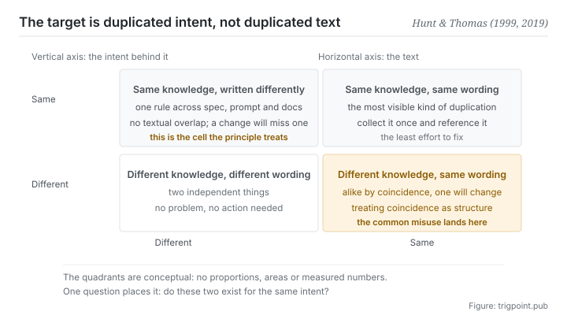

Canonical: https://trigpoint.pub/collections/software-systems-architecture/dry-pragmatic-programmer-1999  
Captured: 2026-11-02T21:27:24.317974+08:00

> Public theory reading mirror. Verification and Lab case sections remain on the website.

Twenty years on, the two authors added a sentence: the principle is about knowledge and intent.

# Don't repeat yourself (DRY)

Don't Repeat Yourself (DRY) · Hunt & Thomas (1999)

Bibliography checked ✓  
Software architecture · design principles

## In three sentences

What the original says is that every piece of knowledge in a system must have a single, unambiguous, authoritative representation. What it governs is knowledge and intent, not wording. So two passages that look nothing alike can violate it, and two that match word for word can be entirely fine.

<strong>Figure 1</strong> · Four cases that appear once the two axes are kept apart. The horizontal axis is whether two pieces of text are literally the same. The vertical axis is whether the intent behind them is the same. The principle treats only the top-left cell. The bottom-right cell is the common misuse: forcing together two things that read alike and mean different things.

## 1. What happened

Twenty years after writing the principle down, its two authors went back and added a sentence of explanation in the new edition. The 1999 book puts the principle in one sentence: every piece of knowledge must have a single, unambiguous, authoritative representation within a system[\[1\]](#reference-note-1). The section that holds it is called The Evils of Duplication. The twentieth anniversary edition states the symptom plainly: the same thing is expressed in two or more places, and when you change one you have to remember to change the others; the question is not whether you will remember but when you will forget[\[2\]](#reference-note-2). A common example: one business rule lives at once in a database column definition, in a check on the back end, in a form on the front end, and in a document written for people to read. When the rule changes, you have to remember all four. Nobody remembers every time, and the system starts contradicting itself.

Twenty years later the two authors added a sentence in the new edition, and that addition gets needed more often than the original: the principle is about the duplication of knowledge, of intent[\[2\]](#reference-note-2). They added it because the first edition had not explained it well, and many people had read it as don't copy and paste code[\[2\]](#reference-note-2).

The two readings drive opposite behaviour. Read as written, you go looking for one judgement scattered across several places, then nominate one of them as authoritative and have the rest point at it. Read as the industry reads it, you go looking for two passages that resemble each other and merge them into something shared.

That second move breaks when the wording matches and the intent does not. Two rules happen to be identical today; tomorrow one of them has to change for a business reason, and they are already bound together. The copy you saved buys you a coupling that is harder to take apart.

One point of attribution needs stating. The definition is confirmed word for word in the 1999 first edition and the chapter name is confirmed, but the numbering differs between editions (tip 11 in the first; topic 9 and tip 15 in the twentieth anniversary edition) and the page that carries the definition in the first edition could not be checked against the book[\[3\]](#reference-note-3). This site therefore cites chapter and number, and no page.

<strong>Attribution where due:</strong>The statement of the principle and its name belong to Hunt and Thomas (1999 first edition, chapter 2, tip 11)[\[1\]](#reference-note-1). The clarification at the level of intent belongs to the same two authors in the twentieth anniversary edition (2019), which also moved it to topic 9 (tip 15)[\[2\]](#reference-note-2). This page does not credit those two authors with the term single source of truth. That is a separate line of concept history, and this site covers it on its own page. The two are compatible and they do not share an origin, so the attributions go down separately.

## 2. Why this matters to you

Swap the word knowledge for the word criterion and this page lands directly on your own workflow.

How many places does your criterion live in right now? A spec you wrote for yourself, a block of instructions you paste to a model, an explanation you gave a collaborator, and possibly an exception you hold in your head and never wrote down. Those four will drift. And while they drift they <strong>raise no error</strong>: each one reads sensibly on its own, and the contradiction is visible only if you put them side by side, which you do not do in the normal course of things.

The original move is to nominate one of them as authoritative and have the others say see that one. It sounds like paperwork. What it actually does is change the shape of the failure: drift goes from four copies evolving separately with no way to tell which is right, to one copy changing and everything pointing at it following along.

The misreading needs guarding against too, and it is easier to walk into when a model is involved. You will want to merge three instruction blocks that look repetitive into one general block, because eight tenths of the wording matches. Stop there and ask the question that matters: <strong>are these three the same intent?</strong> If one of them exists to handle an exception the other two do not handle, its resemblance to them is a coincidence, and merging it deletes the exception.

In practice this page leaves one usable sentence. Ask whether it is the same piece of knowledge before deciding whether to merge. Do it the other way round and you will turn a coincidence into a structure.

## Common misreadings

Page verification: Bibliography checked ✓ · Content last revised 2026-10-25

- A common account says the principle just tells you not to have duplicated code. The original addresses duplication of knowledge and intent, not of wording. The authors said so again, explicitly, in the edition twenty years later, and admitted that the first edition had not explained it well, which is why many people took it to be about code only.
- A common account calls it tip 11 of the book. It is tip 11 in the 1999 first edition; the 2019 twentieth anniversary edition places it in topic 9 and renumbers the tip as 15. Cite the edition along with the number, or a reader following the number will not find it. This site gives no page for the definition in the first edition, because that page was not checked against the book.

## References

<strong>How to read the source notes</strong> “Bibliographic details checked” means author, year, title and venue were confirmed. It does not mean the source's claims were checked. “Matched against the full text” means the claim was compared with the text of the source itself. “Follows secondary accounts” means the claim rests on sources that report it, not on the original document. Definitions as of 2026-09-20.

- \[1\] Hunt, A. & Thomas, D. (1999). The Pragmatic Programmer: From Journeyman to Master. Addison-Wesley. ISBN 0-201-61622-X. Chapter 2, Tip 11.
- \[2\] Hunt, A. & Thomas, D. (2019). The Pragmatic Programmer, 20th Anniversary Edition. Addison-Wesley. ISBN 978-0-13-595705-9. Chapter 2, Topic 9.
- \[3\] Editorial note with no external source; the full text is in note \[3\] of the body.

Cite as: Trigpoint, “Don't repeat yourself (DRY)”, trigpoint.pub/collections/software-systems-architecture/dry-pragmatic-programmer-1999 · © Strategitect Limited. · Content last revised 2026-10-25

## Source notes

**[1]** Hunt, A. & Thomas, D. (1999). The Pragmatic Programmer: From Journeyman to Master. Addison-Wesley. Chapter 2, The Evils of Duplication; Tip 11. Bibliographic details checked against the official record. The tip number 11 and the definition sentence follows secondary accounts that agree with one another. The original definition: every piece of knowledge must have a single, unambiguous, authoritative representation within a system. The section is titled The Evils of Duplication.

**[2]** Hunt, A. & Thomas, D. (2019). The Pragmatic Programmer: Your Journey to Mastery, 20th Anniversary Edition. Addison-Wesley. Chapter 2, Topic 9; Tip 15. Bibliographic details checked against the publisher's record. Claims matched against the full text. The authors' addition twenty years on: DRY is about the duplication of knowledge, of intent. The same section says the first edition did a poor job of explaining this, and that many people took it to refer to code only.

**[3]** Tip 11 and the definition sentence of the first edition appear in that edition's list of tips. Library catalogue records place the start of the section in the first edition at page 26, but the page that carries the definition was not checked against the book, so this site gives no page. The twentieth anniversary edition places it in topic 9 (from page 30) and renumbers the tip as 15.

---

[繁體中文](../../../zh-Hant/collections/software-systems-architecture/dry-pragmatic-programmer-1999.md) · [简体中文](../../../zh-Hans/collections/software-systems-architecture/dry-pragmatic-programmer-1999.md)

[Index](../../README.md) · [Original page](https://trigpoint.pub/collections/software-systems-architecture/dry-pragmatic-programmer-1999) · [Citation and versions](../../../READING.md)

[Original SVG](assets/dry-pragmatic-programmer-1999.svg) · Display copy adds a white background only.
