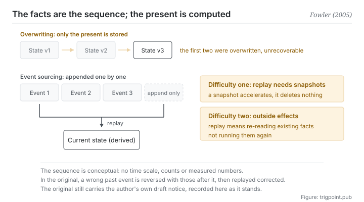

Canonical: https://trigpoint.pub/collections/software-systems-architecture/event-sourcing-fowler-2005  
Captured: 2026-11-02T21:27:24.877605+08:00

> Public theory reading mirror. Verification and Lab case sections remain on the website.

The record of changes and the current state: one is the fact, the other is computed from it.

# Event sourcing

Event Sourcing · Fowler (2005)

Checked against the sources ✓  
Software architecture · facts and derivations  
Read first: Single source of truth (concept history)

## In three sentences

Store every change as one immutable event, and obtain the current state by replaying that sequence. What things look like now stops being something you keep and becomes something you compute. The price is that you may never go back and edit the earlier entries.

<strong>Figure 1</strong> · The upper half is the approach that stores only current state: each change overwrites the last, and the history goes with it. The lower half is event sourcing: changes stack up one by one and are never altered in place, current state is obtained by replay, and any past point can therefore be rebuilt. Two difficulties the original discusses are marked on the right: rebuilding gets slow when there are many events and needs snapshots, and outside effects must not be sent again during replay.

## 1. What happened

The record of changes and the state at this moment are two different things: the second can be replayed from the first, and the first cannot be recovered from the second. Most systems store current state only: a record changes and the new value overwrites the old. That approach carries a quiet loss. <strong>The history of changes vanishes permanently at the moment it is overwritten.</strong> You have how things look now, and nothing about how they came to look that way. Three things become impossible at once: auditing, rebuilding any past point in time, and going back to correct an earlier error.

Event sourcing inverts the order: <strong>the sequence of events is the fact, and current state is derived from it.</strong> The original defines it as capturing every change to application state as a sequence of events[\[1\]](#reference-note-1). In practice there are only two hard rules: events are appended and never modified in place, and current state is obtained by replaying all events from empty. Once those two hold, time travel comes free: replay to the kth entry and you have how things looked at that point.

The original also discusses several practical difficulties, and three of them teach more than the definition does[\[1\]](#reference-note-1). First, rebuilding from scratch gets slow when there are many events, so you need snapshots: store the state at some point and replay forward from there. Second, when an earlier event turns out to be wrong, the original's approach is to reverse it and the events after it, then replay with the corrected event; reversal is easiest when an event is written as a difference (add 10 rather than set to 110).

Third, and this is where things go wrong most: if processing an event triggers an effect outside the system (sending a letter, taking a payment), then replay cannot actually run it again, or you charge twice and the result stops being reproducible. The semantics of replay must be reading existing facts again, not running the thing again.

Two points of attribution need stating. In the original the author gives version control systems as a common example of the approach and says he has seen strong examples in accounting systems[\[3\]](#reference-note-3), so this site marks him as the one who recorded it systematically rather than the one who invented it. And the page still carries his own draft notice, stating that this body of writing stopped in the mid-2000s and will not be revised until he can return to it[\[2\]](#reference-note-2). It is often treated as the standard reference while it declares itself a draft. That fact is worth booking on its own.

<strong>Attribution where due:</strong>This site credits Fowler with recording it systematically under this name (the piece of 12 December 2005)[\[1\]](#reference-note-1). He gives version control systems and accounting systems in the original as existing examples, so this site <strong>does not mark him as the inventor</strong>; whether the name originated with him has not been checked here[\[3\]](#reference-note-3). The pairing with command query responsibility segregation is the result of later practitioner advocacy and is <strong>not</strong> in the 2005 original[\[4\]](#reference-note-4). The draft status of that piece is the author's own statement rather than an inference by this site[\[2\]](#reference-note-2). Four separate attributions.

## 2. Why this matters to you

The thing in your workflow closest to this pattern is your record of decisions.

Most people hold their criteria in overwrite mode: the rule changed, so delete the old sentence and write the new one. A year later you hold a set of rules that looks very clean, and zero entries explaining how it came to be that way. This is fine while you remember. It leaves you with no material at all the moment you have forgotten, or need to convince someone else, or need to judge whether the reason behind a rule still holds.

The event sourcing move is this: the page of rules is a <strong>derivation</strong>, and the entry-by-entry record of changes is the fact. When you change a rule you append an entry (what changed, why, what triggered it), and the derived page is regenerated. A year later you have two things: a readable current value, and a traceable provenance.

Three rules transfer directly, each adapted from the difficulties above. <strong>First, never edit an old entry.</strong> When you find you recorded something wrongly, append a correction rather than going back to fix it: allow going back to fix things and the whole record loses the only value it had. <strong>Second, add a summary layer when it gets long, and never let the summary replace the record.</strong> That is a snapshot, not a deletion.

<strong>Third, replay is not redo.</strong> You go back and read old decisions to understand the judgement of the time, not to carry it out again, and the premises of the time may no longer hold.

That third rule is easy to trip over with a model. Feed a whole run of historical decisions in and ask it to continue in this pattern, and it will very obligingly carry the expired premises along with everything else.

## Common misreadings

Page verification: Checked against the sources ✓ · Content last revised 2026-10-25

- A common account treats event sourcing as part of command query responsibility segregation. The 2005 piece does not mention the latter anywhere. The two appear together as a result of later practitioner advocacy, not a dependency in the definition. You can use either one alone.
- A common account says the author invented the approach. In the original he himself gives version control systems as a common example and says he has seen strong examples in accounting systems. This site therefore marks him as recording it systematically, not as its inventor. Keep the two apart.
- A common account treats the original as a mature piece of architecture literature. The page still carries the author's own draft notice, saying it will not be revised until he can return to it. It is often treated as the standard reference, and it declares itself a draft.

## References

<strong>How to read the source notes</strong> “Matched against the full text” means the claim was compared with the text of the source itself. Definitions as of 2026-09-20.

- \[1\] Fowler, M. (2005). Event Sourcing. martinfowler.com/eaaDev/EventSourcing.html. Published 12 December 2005 (draft status per author's own notice).
- \[2\] Fowler, M. (2005). Event Sourcing. martinfowler.com/eaaDev/EventSourcing.html. Published 12 December 2005 (draft status per author's own notice).
- \[3\] Fowler, M. (2005). Event Sourcing. martinfowler.com/eaaDev/EventSourcing.html. Published 12 December 2005 (draft status per author's own notice).
- \[4\] Fowler, M. (2005). Event Sourcing. martinfowler.com/eaaDev/EventSourcing.html. Published 12 December 2005 (draft status per author's own notice).
- \[5\] Fowler, M. (2004). Reporting Database. martinfowler.com/bliki/ReportingDatabase.html. Original publication 2 April 2004.

## Knowledge graph

- [<em>Compare ▸</em>Command query responsibility segregation (CQRS)](cqrs-young-2010.md)
- [<em>Compare ▸</em>Data mesh](data-mesh-dehghani-2022.md)

Cite as: Trigpoint, “Event sourcing”, trigpoint.pub/collections/software-systems-architecture/event-sourcing-fowler-2005 · © Strategitect Limited. · Content last revised 2026-10-25

## Source notes

**[1]** Fowler, M. (2005-12-12). Event Sourcing. martinfowler.com/eaaDev/EventSourcing.html. Claims matched against the full text. The original defines it as capturing all changes to an application state as a sequence of events. The same page discusses several practical difficulties: rebuilding from scratch is slow when there are many events, so a snapshot can be stored instead; an event recorded wrongly can be reversed together with the events after it, and the corrected event replayed; and outside systems cannot tell real processing from replay, so they have to be handled through a gateway.

**[2]** The draft notice on the same page: the author says this writing was done in the mid-2000s, that other things have claimed his attention since, and that the material remains in draft form and will not be corrected or updated until he can return to it.

**[3]** The same page gives a version control system as a common example of an application that uses the approach, and says he has seen particularly strong examples in accounting systems, so the practice predates the article. This site marks the author as the one who recorded it systematically, not its inventor; whether the name itself originated with him has not been checked here.

**[4]** The 2005 piece makes no mention anywhere of command query responsibility segregation. The two are often paired as a result of later practitioner advocacy, not because the definition requires it. See this site's page on command query responsibility segregation.

---

[繁體中文](../../../zh-Hant/collections/software-systems-architecture/event-sourcing-fowler-2005.md) · [简体中文](../../../zh-Hans/collections/software-systems-architecture/event-sourcing-fowler-2005.md)

[Index](../../README.md) · [Original page](https://trigpoint.pub/collections/software-systems-architecture/event-sourcing-fowler-2005) · [Citation and versions](../../../READING.md)

[Original SVG](assets/event-sourcing-fowler-2005.svg) · Display copy adds a white background only.
