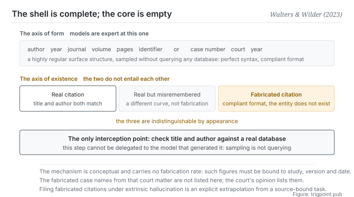

Canonical: https://trigpoint.pub/collections/software-systems-architecture/fabricated-citations-walters-wilder-2023  
Captured: 2026-11-02T21:27:25.211229+08:00

> Public theory reading mirror. Verification and Lab case sections remain on the website.

Lawyers used a generative tool to find precedents for a filing; several did not exist.

# Fabricated citations

Fabricated Citations · Walters & Wilder (2023)

Checked against the sources ✓  
Machine learning · high-stakes instances  
Read first: Hallucination in NLG  
Read first: Faithfulness vs factuality

## In three sentences

The citation is complete and convincing in form, and the thing it points at does not exist. The danger is not that it looks untrustworthy. It is that it <strong>looks entirely trustworthy</strong>. Credibility of form and truth of content come completely apart here, and the only action that intercepts it is going back and checking existence.

<strong>Figure 1</strong> · Two axes come completely apart here. The top row is the axis of form: bibliographic records and case numbers have a highly regular surface structure, and models sample it expertly. The bottom row is the axis of existence: whether the thing is actually there. The heuristic readers rely on, that form is credential, fails here, because what the judgement rests on and what it is about do not entail each other. The only interception point is going back and checking existence. The figure deliberately carries no rates.

## 1. What happened

In a US federal district court case, lawyers put precedents found with a generative tool into a filing; several of them did not exist, and the court imposed a penalty. The format of a bibliographic record or a case citation is a <strong>highly regular surface structure</strong>: author, year, journal, volume, pages, identifier; or docket number, court, year. Generative models sample that structure expertly. They can produce a syntactically perfect, format-compliant citation string without having queried any actual database at all.

So something happens: the heuristic that readers and reviewers rely on, that form is credential, <strong>fails</strong>. What the judgement rests on (whether the format is proper) and what the judgement is about (whether the thing exists) are <strong>independent and do not entail each other</strong>. This is not a matter of degree. The two axes come apart entirely.

The 2023 study measured it, and its methodological definition is worth keeping word for word: a citation is treated as real (not fabricated) if a genuine work can be found that matches or approximately matches on <strong>both title and author</strong>[\[1\]](#reference-note-1). The negative case is fabrication.

Its numbers are well known, and <strong>anyone citing them has to carry the conditions along</strong>: within that study's sample (42 topics across disciplines, 84 short papers, 636 bibliographic citations, measured in 2023), 55% of the citations from one version were fabricated, and 18% of those from a newer version[\[2\]](#reference-note-2). Both figures are bound to that study, those two model versions and that point in time. Talking about what the fabrication rate is away from those conditions is itself an over-generalisation.

It also drew a distinction that is easy to overlook[\[3\]](#reference-note-3): <strong>the fabrication rate and the rate of errors among real citations are two independent curves</strong>. A genuine work with the year or the pages recorded wrongly, and a work that does not exist being generated, are not the same thing and should not be reported together.

The judicial setting supplies one instance with a definite price. In a 2023 case in a US federal district court, lawyers used a generative tool to look for precedents and put them into a filing opposing the defendant's motion to dismiss, citing several non-existent precedents, and the court found the conduct to constitute subjective bad faith under the applicable rule and imposed a joint and several penalty[\[4\]](#reference-note-4).

<strong>This site does not list those fabricated case names</strong>; the court's opinion lists them one by one, and that is where to check them[\[5\]](#reference-note-5). That handling is itself what this page is about: whether a citation exists is settled by going back to the original.

<strong>Attribution where due:</strong>The empirical measurement of the fabrication rate and the methodological definition belong to Walters and Wilder (2023, peer-reviewed journal)[\[1\]](#reference-note-1)[\[2\]](#reference-note-2). That study is <strong>an empirical measurement rather than a coinage</strong>, and this page makes no claim about terminological attribution. The judicial instance is case law rather than scholarship, so no question of coinage arises, and its details were checked against the text of the court's opinion[\[4\]](#reference-note-4)[\[5\]](#reference-note-5). For the attribution of the intrinsic and extrinsic classification, see the two preceding pages of this shelf; this page's use of it is an <strong>explicit extrapolation</strong>[\[6\]](#reference-note-6). Four parts, booked separately.

## 2. Why this matters to you

This is the last page of the shelf, because it is where the previous sixteen converge: <strong>the trustworthiness of a system cannot rest on its looking right.</strong>

The shape you will meet is concrete. You ask a model to find literature supporting some claim, and it returns five entries, neatly formatted, with identifiers and page numbers. Three of them genuinely exist, one exists with the author swapped, one does not exist at all. <strong>And from the outside the five are indistinguishable.</strong>

So there is one thing to do, and there is no substitute for it: <strong>go back and check existence.</strong> Not check whether the format is right, but take the title and the author to an actual database and see whether the thing is there. That step cannot be delegated to the model that generated it, because its generation process is sampling rather than querying: it does not know it is making things up.

Three moves turn straight into rules.

<strong>First, split does this thing exist and does this thing say this sentence into two independent checks.</strong> The first is existence; the second is the faithfulness axis from the previous page. Either can fail on its own.

<strong>Second, bind conditions to any rate you quote.</strong> Which study, which model version, which point in time. The rule looks fussy, and what it blocks is a typical second-hand error: a figure from 2023 being used to describe today.

<strong>Third, say how far each check went, and no further.</strong> That is this site's method and what this page is demonstrating: every source is marked as checked at the level of bibliography, abstract or full text, and nothing unchecked is written up as checked. Marking low makes the page look less complete, and that is the shape honesty takes.

## Common misreadings

Page verification: Checked against the sources ✓ · Content last revised 2026-11-01

- A common account says this is a kind of citation error. It is not. A genuine work with the year or pages recorded wrongly, and a work that does not exist at all, are two categories. The original study measured them separately, and the two curves must not be reported together.
- A common account says the model is lying. There is no intent to speak of. This is a structural side effect of the sampling mechanism, and the model does not know it is making things up. Framing it as deliberate deception is an anthropomorphic misreading, and it also sends people off repairing the wrong thing.
- A common account says that some study found the fabrication rate to be X. The fabrication rate varies sharply with model and version. Any figure has to be bound to which study, which model version and which point in time, or it becomes an over-generalisation detached from its context.

## Corrections

- 2026-10-25 · Two corrections were made before the shelf opened, both against the text of the court's opinion. First, an earlier version said the lawyers used a generative tool to write a motion; it was a filing opposing the defendant's motion to dismiss. Second, an earlier version said the fabricated case names appeared only in search summaries and that the full text of the opinion could not be obtained, so details of the case were marked secondary; the opinion has now been read, it lists the case names one by one, and this page still does not list them.

## References

<strong>How to read the source notes</strong> “Bibliographic details checked” means author, year, title and venue were confirmed. It does not mean the source's claims were checked. “Matched against the full text” means the claim was compared with the text of the source itself. Definitions as of 2026-09-20.

- \[1\] Walters, W. H., & Wilder, E. I. (2023). Fabrication and errors in the bibliographic citations generated by ChatGPT. Scientific Reports, 13, 14045. DOI [10.1038/s41598-023-41032-5](https://doi.org/10.1038/s41598-023-41032-5).
- \[2\] Walters, W. H., & Wilder, E. I. (2023). Fabrication and errors in the bibliographic citations generated by ChatGPT. Scientific Reports, 13, 14045. DOI [10.1038/s41598-023-41032-5](https://doi.org/10.1038/s41598-023-41032-5).
- \[3\] Walters, W. H., & Wilder, E. I. (2023). Fabrication and errors in the bibliographic citations generated by ChatGPT. Scientific Reports, 13, 14045. DOI [10.1038/s41598-023-41032-5](https://doi.org/10.1038/s41598-023-41032-5).
- \[4\] Mata v. Avianca, Inc., 678 F. Supp. 3d 443 (S.D.N.Y. 2023), No. 1:22-cv-01461 (PKC), Opinion and Order on Sanctions (22 June 2023). Bibliographic details cross-checked against multiple sources. Claims matched against the full text.
- \[5\] Mata v. Avianca, Inc., 678 F. Supp. 3d 443 (S.D.N.Y. 2023), No. 1:22-cv-01461 (PKC), Opinion and Order on Sanctions (22 June 2023).
- \[6\] Editorial note, no external source; see note \[6\] in the text.

## Knowledge graph

- [<em>Specialised from ▸</em>Hallucination in NLG](llm-hallucination-ji-2023.md)
- [<em>Based on ▸</em>Hallucination in NLG](llm-hallucination-ji-2023.md)
- [<em>Applied ▸</em>Red-team a claim before you build on it: red teaming at the scale of one claim](https://trigpoint.pub/methods/red-team-a-claim)

Cite as: Trigpoint, “Fabricated citations”, trigpoint.pub/collections/software-systems-architecture/fabricated-citations-walters-wilder-2023 · © Strategitect Limited. · Content last revised 2026-11-01

## Source notes

**[1]** Walters, W. H., & Wilder, E. I. (2023-09-07). Fabrication and errors in the bibliographic citations generated by ChatGPT. Scientific Reports, 13, Article 14045. DOI 10.1038/s41598-023-41032-5. Bibliographic details checked against the official record. Claims matched against the full text. The methodological definition: a citation is treated as real (not fabricated) if a genuine work can be found that matches or nearly matches on both title and author.

**[2]** The same paper's measurements (anyone citing them has to carry the conditions along): within that study's sample (42 topics across disciplines, 84 short papers, 636 bibliographic citations, measured in 2023), 55% of the citations from one version were fabricated, against 18% of those from a newer version. Both figures are bound to that study, those two model versions and that point in time; detached from those conditions they become an over-generalisation.

**[3]** A separate measurement in the same paper: real citations still carry substantive citation errors; that rate uses only the real citations as its denominator, is calculated apart from the fabrication rate, and must not be reported together with it.

**[4]** The judicial instance: a 2023 case in a US federal district court in which lawyers used a generative tool to look for precedents and put them into a filing opposing the defendant's motion to dismiss, citing several non-existent precedents; the court found the conduct to constitute subjective bad faith under Rule 11 of the Federal Rules of Civil Procedure and imposed a joint and several penalty on the lawyers and their firm. This site does not list those fabricated case names; the court's opinion lists them one by one.

**[5]** Details of the case: the docket number, the penalty amount (5,000 US dollars), the date of the ruling and the nature of the filing were checked against the text of the opinion; the reporter citation agrees across several public bibliographic sources.

**[6]** Extending the classification: the intrinsic and extrinsic classification of the two preceding pages is natively defined for conditional generation with a definite source; fabricated citations mostly arise in open-ended generation, and this site still files them as a sub-case of extrinsic (the substance is the same), but this is a conceptual extrapolation rather than something the original classification covers directly.

---

[繁體中文](../../../zh-Hant/collections/software-systems-architecture/fabricated-citations-walters-wilder-2023.md) · [简体中文](../../../zh-Hans/collections/software-systems-architecture/fabricated-citations-walters-wilder-2023.md)

[Index](../../README.md) · [Original page](https://trigpoint.pub/collections/software-systems-architecture/fabricated-citations-walters-wilder-2023) · [Citation and versions](../../../READING.md)

[Original SVG](assets/fabricated-citations-walters-wilder-2023.svg) · Display copy adds a white background only.
