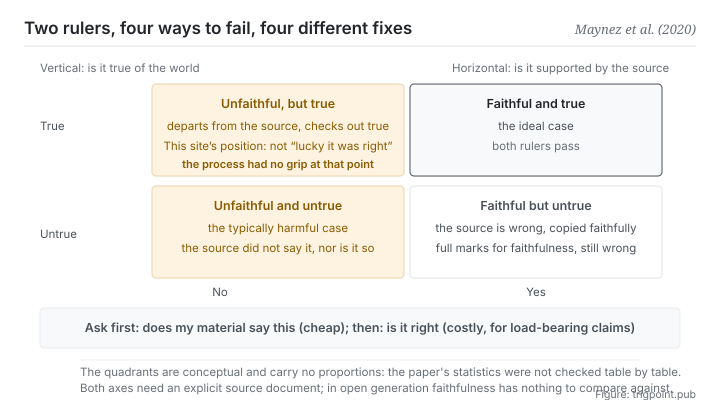

Canonical: https://trigpoint.pub/collections/software-systems-architecture/faithfulness-factuality-maynez-2020  
Captured: 2026-11-02T21:27:25.601421+08:00

> Public theory reading mirror. Verification and Lab case sections remain on the website.

Being faithful to the source and being true of the world are two independent lines of judgement.

# Faithfulness vs factuality

Faithfulness vs Factuality · Maynez et al. (2020)

Checked against the sources ✓  
Machine learning · axes of evaluation  
Read first: Hallucination in NLG

## In three sentences

Faithfulness asks whether a statement is supported by the source. Factuality asks whether it is true of the world. They are independent lines of judgement, crossing into four cases, and each case is repaired differently. Represent both with one score and you will repair the wrong thing.

<strong>Figure 1</strong> · Two independent lines of judgement crossing into four cases. The horizontal axis asks whether a statement is supported by the source; the vertical axis asks whether it is true of the world. Top right is the ideal. Top left is departing from the source yet checking out true. Bottom right is the source itself being wrong and being transcribed faithfully. Bottom left is the typically harmful case. The figure deliberately carries no proportions; the reason is in the verification section.

## 1. What happened

Whether an output is supported by its source and whether it is true of the world have to be judged on two separate lines. The 2020 paper pulled apart something that had long been used interchangeably.

The test for <strong>faithfulness</strong> is triggered: if a piece of output contains a span <strong>not supported by the input document</strong>, it counts as hallucination[\[1\]](#reference-note-1). Note that this test asks nothing about the world. It asks only about the source.

The test for <strong>factuality</strong> is a separate clause: if a piece of output contains information <strong>not in the document that is factually correct</strong>, then it contains factual hallucination[\[1\]](#reference-note-1). That wording is worth pausing on. It concedes that a piece of output can be both unfaithful to its source and true of the world, and that this still counts as a kind of hallucination, because it is not what the source said.

The two axes cross into four cases, and each of them really occurs: faithful and correct (the ideal); faithful but incorrect (<strong>the source itself is wrong, you transcribe it accurately, the verdict is still faithful, and you have passed an error along</strong>); unfaithful but correct (generated away from the source, yet confirmed true); unfaithful and incorrect (the typically harmful case).

The practical value of the split is that <strong>it points at different repairs</strong>: a faithfulness problem is distortion in transcription, treatable with entailment checks or enforced citation; a factuality problem is an error in world knowledge, treatable only by outside checking or retrieval. Blend them into one score and you will pick up the wrong tool.

The paper also gives the intrinsic and extrinsic distinction for the summarisation setting[\[2\]](#reference-note-2), and there is a trap in tracing it: later general surveys simplified it into contradicts the source and cannot be verified from the source, which is <strong>not word-for-word equivalent</strong> to this paper's original wording (misrepresenting content already present, versus generating entirely away from the source material)[\[4\]](#reference-note-4). Both versions are in circulation, so when tracing a definition you have to know which one you are holding.

Attribution: <strong>the concern predates this paper</strong> and already appears in summarisation research from 2017 to 2019. For example, a 2019 critique of evaluation already listed factual correctness as a gap in the evaluation protocols of the time, without proposing two orthogonal axes or this pair of names[\[3\]](#reference-note-3). This site therefore marks this paper as <strong>the one that crystallised and formalised it</strong>, not the first to raise the concern.

<strong>Attribution where due:</strong>Formalising the orthogonality of the two axes (this site's attribution), and the intrinsic and extrinsic distinction for the summarisation setting, belong to Maynez and three co-authors (2020; the paper states that it divides hallucinations into intrinsic and extrinsic by information source)[\[1\]](#reference-note-1)[\[2\]](#reference-note-2). <strong>The concern already appears earlier, in summarisation research from 2017 to 2019</strong> (for example, the 2019 critique of evaluation, which listed it as a gap in evaluation protocols, with no orthogonal split proposed)[\[3\]](#reference-note-3). The simplified wording in later general surveys belongs to those surveys and is not word-for-word equivalent to this paper[\[4\]](#reference-note-4). Three separate attributions. This page quotes none of the paper's statistics, for the reason given in the verification section[\[5\]](#reference-note-5).

## 2. Why this matters to you

This page is the <strong>acceptance instrument</strong> this shelf hands you, and you can use it today.

You ask a model to work up some material, and once the result comes back, most people ask is this right. This page asks you to split that into two questions, and the order matters.

<strong>Ask first: did the material I supplied say this.</strong> That question is cheap, quick and binary: go back and compare. It catches distortion in transcription.

<strong>Ask second: is this right.</strong> That question is expensive and needs outside knowledge or a second source. It catches errors in world knowledge.

The order matters because the first question filters out most of the problems, and <strong>its cost is low enough to run every time</strong>. The second belongs to the assertions that actually carry weight.

The second practical point is the quadrant that gets overlooked most: <strong>faithful but incorrect</strong>. The material you supplied was wrong, the model transcribed it accurately, and it is entirely faithful while you hold a wrong conclusion. That cell is the reminder that scoring a hundred on fidelity to a source will never correct an error in the source. So in a retrieval-augmented workflow, the quality of the corpus is still the ceiling, which buckles back to the first page of this section.

The third, and the least intuitive sentence here, is <strong>this site's position, and the paper itself takes the other side</strong>. The paper says outright that summarisation systems may draw on background knowledge: content that departs from the source is acceptable if it leads to a better summary, one that is true with respect to the document and the relevant background knowledge; it also notes that the research community has no consensus on this[\[1\]](#reference-note-1). For summarisation that makes sense, since a good summary naturally brings in its author's background knowledge. This page, though, is about acceptance: you hand over material and ask the model to work from it. In that setting, <strong>the cell where output departs from the source and is still true should not be read as a lucky escape.</strong> It means your process has no binding force at that position, and next time that same position may not be true. Being right by chance is a false negative for a failing process, not a success.

## Common misreadings

Page verification: Checked against the sources ✓ · Content last revised 2026-11-01

- A common account says being faithful and being correct are the same thing. They are two independent lines of judgement. Output entirely faithful to its source can be wrong (the source itself is wrong), and output that departs from the source can still be right. Mixing them up sends you off repairing the wrong thing.
- A common account says this pair of axes was invented by this paper out of nothing. The concern predates it (for example, a 2019 critique of evaluation already listed factual correctness as a gap), but setting the two axes as orthogonal and using faithfulness and factuality as a pair are what this site credits this paper with formalising. Origination and formalisation should be booked separately.
- A common account says intrinsic and extrinsic mean the same thing in every paper. This paper's original wording (misrepresenting content already present, versus generating entirely away from the source) is not word-for-word equivalent to the simplified wording of later general surveys. When tracing a definition, know which version you are holding.

## Corrections

- This page does not quote the paper's specific percentages: this site did not check its statistics table by table, and makes only qualitative statements.

## References

<strong>How to read the source notes</strong> “Bibliographic details checked” means author, year, title and venue were confirmed. It does not mean the source's claims were checked. “Matched against the full text” means the claim was compared with the text of the source itself. Definitions as of 2026-09-20.

- \[1\] Maynez, J., Narayan, S., Bohnet, B., & McDonald, R. (2020). On Faithfulness and Factuality in Abstractive Summarization. Proceedings of ACL 2020, 1906–1919.
- \[2\] Maynez, J., Narayan, S., Bohnet, B., & McDonald, R. (2020). On Faithfulness and Factuality in Abstractive Summarization. Proceedings of ACL 2020, 1906–1919.
- \[3\] Kryściński, W., Keskar, N. S., McCann, B., Xiong, C., & Socher, R. (2019). Neural Text Summarization: A Critical Evaluation. Proceedings of EMNLP-IJCNLP 2019, 540–551. DOI [10.18653/v1/D19-1051](https://doi.org/10.18653/v1/D19-1051). Bibliographic details checked against the official record. Claims matched against the full text.
- \[4\] Editorial note, no external source; see note \[4\] in the text.
- \[5\] Editorial note, no external source; see note \[5\] in the text.

## Knowledge graph

- [<em>Specialised from ▸</em>Hallucination in NLG](llm-hallucination-ji-2023.md)
- [<em>Based on ▸</em>Hallucination in NLG](llm-hallucination-ji-2023.md)
- [<em>Applied ▸</em>Red-team a claim before you build on it: red teaming at the scale of one claim](https://trigpoint.pub/methods/red-team-a-claim)

Cite as: Trigpoint, “Faithfulness vs factuality”, trigpoint.pub/collections/software-systems-architecture/faithfulness-factuality-maynez-2020 · © Strategitect Limited. · Content last revised 2026-11-01

## Source notes

**[1]** Maynez, J., Narayan, S., Bohnet, B., & McDonald, R. (2020). On Faithfulness and Factuality in Abstractive Summarization. Proceedings of the 58th Annual Meeting of the Association for Computational Linguistics (ACL 2020), 1906–1919. DOI 10.18653/v1/2020.acl-main.173. Bibliographic details checked against the official record. Claims matched against the full text. The triggered definition for faithfulness: a summary containing a span not supported by the input document counts as hallucinated. The separate clause for factuality: a summary containing information not found in the document that is factually correct contains a factual hallucination. The same paper states its own position: content in a summary that departs from the source is acceptable if it leads to a better summary, one that is true with respect to the document and the relevant background knowledge; it also notes that the research community has no consensus on this.

**[2]** The same paper's intrinsic and extrinsic distinction for summarisation: intrinsic is misrepresenting information already in the document; extrinsic is generating entirely away from the source material.

**[3]** Attribution: the concern behind the split predates this paper and already appears in summarisation research from 2017 to 2019. For example, this 2019 critique of evaluation already noted that the evaluation protocol of the time did not account for important characteristics such as factual correctness, but it neither proposed two orthogonal axes nor used the names faithfulness and factuality; and a summarisation preprint of November 2017 (arXiv 1711.04434) already has the word faithful in its title, its abstract noting that neural summarisation systems of the time tend to create fake facts. This site marks this paper as the one that crystallised and formalised the split, not the first to raise the concern.

**[4]** Difference in wording from later general surveys: those simplified intrinsic and extrinsic into contradicts the source and cannot be verified from the source, which is not word-for-word equivalent to this paper's original wording (misrepresenting content already present, versus generating entirely away from the source). When tracing a definition, keep the versions apart.

**[5]** Statistics: this site did not check the paper's statistics table by table, so no specific percentage is quoted and only qualitative statements are made; the qualitative statements in the text were matched against the full text.

---

[繁體中文](../../../zh-Hant/collections/software-systems-architecture/faithfulness-factuality-maynez-2020.md) · [简体中文](../../../zh-Hans/collections/software-systems-architecture/faithfulness-factuality-maynez-2020.md)

[Index](../../README.md) · [Original page](https://trigpoint.pub/collections/software-systems-architecture/faithfulness-factuality-maynez-2020) · [Citation and versions](../../../READING.md)

[Original SVG](assets/faithfulness-factuality-maynez-2020.svg) · Display copy adds a white background only.
