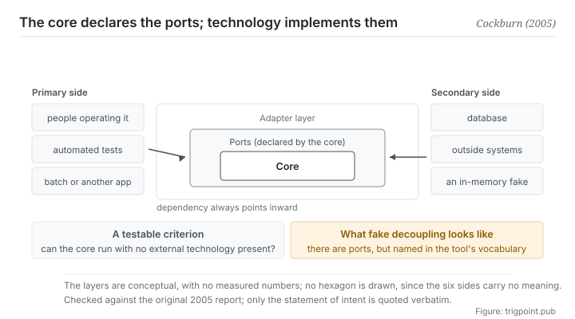

Canonical: https://trigpoint.pub/collections/software-systems-architecture/hexagonal-architecture-cockburn-2005  
Captured: 2026-11-02T21:27:25.853250+08:00

> Public theory reading mirror. Verification and Lab case sections remain on the website.

“Wrap it in an interface and it is decoupled”: not necessarily.

# Hexagonal architecture (ports and adapters)

Hexagonal Architecture (Ports and Adapters) · Cockburn (2005)

Checked against the sources ✓  
Software architecture · direction of dependency  
Read first: Domain-driven design (DDD)

## In three sentences

The core declares the kind of conversation it needs, and technologies implement that set of ports. Dependency therefore always points from the outside in, rather than the core having to know about some particular database or framework. There is one criterion: can the core be started up with no external technology present at all.

<strong>Figure 1</strong> · Three layers from the inside out. The core knows only the set of ports it declares, each technology writes an adapter that implements one of them, and dependency always points inward. The two sides are the same thing in two directions: people and tests drive the core from the primary side, databases and outside systems are called by the core on the secondary side. Along the bottom is the testable criterion: can the core be run on its own with no external technology present.

## 1. What happened

The symptom the author was addressing is concrete, and it has to do with testing: business logic had seeped into the interface layer, so the system <strong>could not be driven by automated tests</strong>, and switching from a person operating it to a batch run or a call from another program was difficult.

The root cause is that dependency points the wrong way: the core has come to know about concrete technologies (a particular database driver, a particular user-interface framework). Once that is true, testing the core means standing all of those technologies up first.

This architecture reverses the direction: <strong>the core declares a set of ports, and technologies write adapters that implement them</strong>[\[1\]](#reference-note-1). A port is a purposeful conversation defined by the core and independent of technology; an adapter is that conversation implemented against one concrete technology. The core programs only against ports and does not know what sits behind them. Testing the core then means attaching one fake in-memory adapter.

The statement of intent in the original is worth keeping word for word: allow an application to be driven <strong>equally</strong> by users, programs, automated tests or batch scripts, and to be developed and tested in isolation from its eventual runtime devices and databases[\[1\]](#reference-note-1).

The key idea of the 2005 piece is <strong>symmetry</strong>: this diagram has no upper and lower layers. Database and user interface are treated as equals, both merely external technologies attached to some port. The primary side (what drives the core: people, tests, batch) and the secondary side (what the core calls: databases, outside systems) are distinguished only by the direction of the port, not by architectural rank.

The naming has a history. The 2005 report gives Ports and Adapters as the pattern's name and lists hexagonal architecture as an alternative name[\[2\]](#reference-note-2). The author described the sequence himself in a 2020 interview: he first drew the hexagon in 1994, in notes for his object-oriented programming class, and first published it without the Ports and Adapters name; only in June 2005 did he see that each side of the hexagon is a port, and the same month he created a wiki page under the name Ports and Adapters[\[5\]](#reference-note-5). The six sides have nothing to do with the number six: the original says the hexagon was chosen only to leave room for drawing several ports, without being constrained by a one-dimensional layered drawing[\[2\]](#reference-note-2).

<strong>Attribution where due:</strong>Putting the concept forward and naming it both belong to Cockburn (the 2005 report, Ports and Adapters)[\[1\]](#reference-note-1). The original describes it as a particular use of the Adapter pattern and lists several closely related existing patterns, so this site marks him as the one who put it forward and named it, not as an originator without precedent. Hexagonal architecture is the alternative name and came first: by the author's own account he drew the hexagon in 1994 and took up the name Ports and Adapters in June 2005[\[2\]](#reference-note-2)[\[5\]](#reference-note-5). <strong>Onion architecture (2008) and clean architecture (2012) belong to their own authors</strong>: the first says it shares a premise with this architecture, and the second says it integrates this one with several others[\[4\]](#reference-note-4). How far the original was checked is recorded in the verification section[\[3\]](#reference-note-3).

## 2. Why this matters to you

Swap technology for tools and models and this page turns into a very practical piece of advice: <strong>your criteria should not be bound to any one tool.</strong>

Many people's workflows run the other way, with the criteria living inside the tool. Prompts written into one platform's project settings, classification rules written into one note application's fields, checklists stored as one service's templates. That is entirely fine while the single tool suits you, right up until you change tools, or want to do the same thing with a second one, or that tool changes what it offers.

What this architecture does is reverse the direction: the criteria live in a place of your own, declared in your own vocabulary as what inputs and outputs I need, and each tool then gets a thin layer of attachment. Change tools and you change the attachment. The criteria do not move.

It also gives you a <strong>testable</strong> criterion, which is the most valuable part of this page. The question is not do I have decoupling (that question has no answer). The question is: <strong>can my criteria be stated clearly and carried out by a person with no particular tool present.</strong> If your classification rules only make sense with reference to one application's fields, they are already bound.

The <strong>fake decoupling</strong> is worth guarding against too. You wrap a layer around the tool, and the shape of that layer follows the tool exactly: your spec, say, is full of one platform's proprietary terms. Formally that is one more layer. In substance nothing has been bought, because changing tools means rewriting the layer entirely. The shape of a port has to be settled by the core, and that is the sentence in the principle that gets skipped most easily.

## Common misreadings

Page verification: Checked against the sources ✓ · Content last revised 2026-10-25

- A common account says the six sides stand for six layers or six kinds of port. The hexagon is only a drawing convenience: the author chose it to leave room for drawing several ports, without being constrained by a one-dimensional layered drawing. Counting the sides misses the point.
- A common account says onion architecture and clean architecture are derivatives of this one. The three are one family by different authors, each named separately, and what they share is the principle that dependency points only inward. Do not mix up the attributions.

## References

<strong>How to read the source notes</strong> “Bibliographic details checked” means author, year, title and venue were confirmed. It does not mean the source's claims were checked. “Matched against the full text” means the claim was compared with the text of the source itself. Definitions as of 2026-09-20.

- \[1\] Cockburn, A. (2005). The Hexagonal (Ports & Adapters) Architecture. HaT Technical Report 2005.02. alistair.cockburn.us/hexagonal-architecture/
- \[2\] Editorial note, no external source; see note \[2\] in the text.
- \[3\] Editorial note, no external source; see note \[3\] in the text.
- \[4\] Palermo, J. (2008). The Onion Architecture: part 1. jeffreypalermo.com/2008/07/the-onion-architecture-part-1/; Martin, R. C. (2012). The Clean Architecture. blog.cleancoder.com/uncle-bob/2012/08/13/the-clean-architecture.html
- \[5\] Garrido de Paz, J. M. (2020). Interview with Alistair Cockburn. jmgarridopaz.github.io/content/interviewalistair.html

## Knowledge graph

- [<em>Applied in ▸</em>Domain-driven design (DDD)](domain-driven-design-evans-2003.md)
- [<em>Compare ▸</em>Model-view-controller (MVC)](mvc-reenskaug-1979.md)

Cite as: Trigpoint, “Hexagonal architecture (ports and adapters)”, trigpoint.pub/collections/software-systems-architecture/hexagonal-architecture-cockburn-2005 · © Strategitect Limited. · Content last revised 2026-10-25

## Source notes

**[1]** Cockburn, A. (2005, September 4). The Hexagonal (Ports & Adapters) Architecture. HaT Technical Report 2005.02, v0.9. alistair.cockburn.us/hexagonal-architecture/. Bibliographic details checked against the official record. Claims matched against the full text. Intent, verbatim: “Allow an application to equally be driven by users, programs, automated test or batch scripts, and to be developed and tested in isolation from its eventual run-time devices and databases.”

**[2]** Naming: the 2005 report gives Ports and Adapters as the name of the pattern and lists Hexagonal Architecture as an alternative name, which it says comes from the visual effect of the drawing. That the hexagonal name came first and Ports and Adapters was added in 2005 is the usual account, and the author said the same in a 2020 interview (see note 5). The six sides have nothing to do with the number six: the original says the shape leaves room for whoever is drawing to insert ports and adapters as needed, without being constrained by a one-dimensional layered drawing.

**[3]** The 2005 report (the version on the author's site, marked version 0.9 and dated 4 September 2005) was checked against its full text: the intent, the symmetry, the primary and secondary sides and the reason for the hexagon all follow the original. The order of the two names follows the author's 2020 interview (see note 5).

**[4]** Palermo, J. (2008, July 29). The Onion Architecture: part 1. jeffreypalermo.com; Martin, R. C. (2012, August 13). The Clean Architecture. blog.cleancoder.com. Bibliographic details checked against the official record. Claims matched against the full text. Onion architecture (2008, another author) and clean architecture (2012, yet another) each have their own author and name. The first says it shares a premise with hexagonal architecture; the second says it is an attempt to integrate hexagonal, onion and several other architectures into a single actionable idea.

**[5]** Garrido de Paz, J. M. (2020, September 9). Interview with Alistair Cockburn. jmgarridopaz.github.io/content/interviewalistair.html. Bibliographic details checked against the official record. Claims matched against the full text. The author, interviewed and speaking in the first person: he first drew the hexagon in 1994, in notes for his object-oriented programming class; he first published it without the Ports and Adapters name; only in June 2005 did he see that each side of the hexagon is a port, and the same month he created a wiki page under the name Ports and Adapters. What he saw was ports and adapters, not symmetry.

---

[繁體中文](../../../zh-Hant/collections/software-systems-architecture/hexagonal-architecture-cockburn-2005.md) · [简体中文](../../../zh-Hans/collections/software-systems-architecture/hexagonal-architecture-cockburn-2005.md)

[Index](../../README.md) · [Original page](https://trigpoint.pub/collections/software-systems-architecture/hexagonal-architecture-cockburn-2005) · [Citation and versions](../../../READING.md)

[Original SVG](assets/hexagonal-architecture-cockburn-2005.svg) · Display copy adds a white background only.
