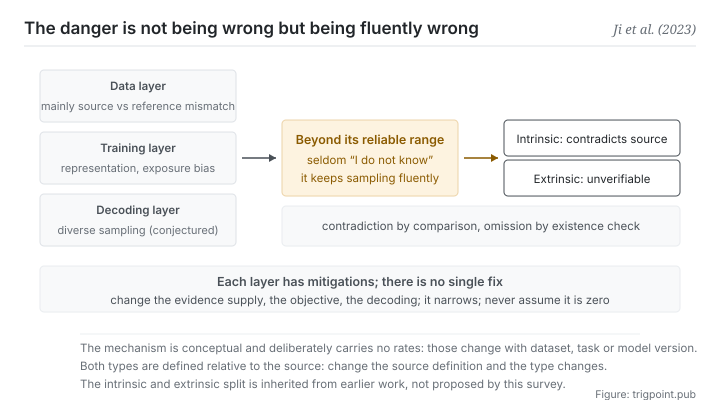

Canonical: https://trigpoint.pub/collections/software-systems-architecture/llm-hallucination-ji-2023  
Captured: 2026-11-02T21:27:26.120273+08:00

> Public theory reading mirror. Verification and Lab case sections remain on the website.

“A bit more progress and it will stop hallucinating”: it will not carry that.

# Hallucination in NLG

Hallucination in NLG · Ji et al. (2023)

Abstracts checked ✓  
Machine learning · failure modes  
Read first: Retrieval-augmented generation (RAG)

## In three sentences

Hallucination is generation that reads fluently while being unfaithful to its source, or making no sense at all. The danger is not that it is wrong. It is that it is <strong>wrong fluently</strong>: fluency lends an appearance of credibility that the truth value does not support. And its causes span the data, training and decoding layers, so for now it can be narrowed, and it should not be assumed to have reached zero.

<strong>Figure 1</strong> · The figure splits the survey's two broad groups of causes into three layers: in the data layer the main cause is a mismatch between source and reference (with unfiltered duplicates as another case); the training layer has poor representation learning, exposure bias and parametric knowledge bias; and at decoding, diversity-oriented sampling correlates with hallucination (the mechanism is the survey's conjecture). Each layer has its own mitigations, there is no single point of repair, and no layer claims to reach zero. The three layers feed into the middle, which marks the least intuitive thing on this page: beyond its reliable range the model tends not to say I do not know and carries on sampling fluently, a tendency tied to training and grading that reward guessing. The hallucinations produced this way split into two types, marked on the right: intrinsic, which contradicts the source, and extrinsic, which cannot be verified from the source. The figure deliberately carries no rates.

## 1. What happened

The definition the 2023 survey adopts, carried over from earlier studies, is generated content that is nonsensical or <strong>unfaithful to the provided source content</strong>[\[1\]](#reference-note-1). The classification has two types: intrinsic, which contradicts the source, and extrinsic, which cannot be verified from the source[\[2\]](#reference-note-2).

The mechanism is worth going through slowly, because it decides what you can do about it. A generative model is fundamentally a compression of its training distribution, sampling one token at a time at decoding. When a task needs information beyond what the model has reliably compressed (out of distribution, in the long tail, or the world changed after training), the model <strong>tends not to stop and say I do not know</strong>. It carries on sampling fluently. That is hallucination. Part of that tendency is rewarded into it: a 2025 study argues that current training and grading give credit for a guess and none for admitting uncertainty, so models lean towards guessing when unsure[\[6\]](#reference-note-6). It is not that a model cannot say it does not know; under the current rewards it seldom does.

The survey sorts the causes into two broad groups: data, and training and inference. This page splits the second into training and decoding, giving three layers, which is why there is no single point of repair: the data layer (mainly source and reference that already disagree; duplicates left unfiltered during data collection are another case), the training layer (poor representation learning, exposure bias between training and generation, and a model leaning on knowledge from pre-training rather than the source in hand), and the decoding layer (diversity-oriented sampling correlates with hallucination, though the survey marks the mechanism as conjecture). The tendency not to say I do not know, in the paragraph above, lies outside the survey and comes from the 2025 study. The mitigations can be divided the same three ways: change the supply of evidence (retrieval augmentation, the previous page), change the objective (train against a measure of faithfulness), and change decoding (constrain generation).

Attribution here carries a correction that <strong>has to be stated</strong>. The survey says in its own §2.1 that the intrinsic and extrinsic classification is <strong>carried over from prior work</strong>[\[3\]](#reference-note-3). So the correct way to cite it is the classification the survey adopts, and not the classification the survey proposes. Separately, the term was already in use for vision-language tasks earlier (a 2018 paper)[\[4\]](#reference-note-4), so it did not arrive with large language models.

<strong>Attribution where due:</strong>Assembling the survey belongs to Ji and nine co-authors (2023, peer-reviewed journal; journal version), and this site takes it as the anchor for the field[\[1\]](#reference-note-1). <strong>The intrinsic and extrinsic classification is carried over from prior work and does not belong to that paper</strong> (as its own §2.1 states)[\[3\]](#reference-note-3). For an earlier attested usage of the term, see the 2018 vision-language paper[\[4\]](#reference-note-4); the survey itself records that the term first appeared in computer vision research in 2000, with a more positive meaning at the time[\[1\]](#reference-note-1). Three separate attributions, and the second is the correction this page states explicitly.

## 2. Why this matters to you

What this page gives you is not a warning. It is a <strong>calibration</strong>: how much to discount fluency by.

When people judge credibility, fluency of language and tidiness of structure are strong cues. Those cues work reasonably well on things written by people, because people talking nonsense usually also talk messily. A generative model <strong>severs that correlation</strong>: its fluency has almost nothing to do with whether the content is true. So your intuition here is not unreliable. It is <strong>calibrated on the wrong distribution</strong>.

The second thing is the practical consequence of it seldom saying I do not know. You cannot rely on the model raising a flag to catch hallucination: when unsure it tends to guess, and a wrong guess reads just as fluently. That puts the burden of checking on your side, and it <strong>has to be a process rather than vigilance</strong>: vigilance fatigues, a process does not.

The third thing is where this shelf takes its position: since no layer can guarantee it has reached zero, and the model will not reliably raise a flag, trustworthy output cannot rest on a guarantee about model quality. It can only rest on <strong>checkability</strong>. That position is this shelf's own, not a conclusion of the survey. That is exactly why this site leaves a source and a verification status behind every judgement. Not because we are more rigorous, but because structurally there is no other way.

In practice two moves are enough. First, <strong>turn where is the basis for this sentence into a fixed question</strong>, rather than picking sentences to check by feel. Second, <strong>handle the two types separately</strong>: what contradicts the source you gave (intrinsic) is caught by comparison; what the source never mentions (extrinsic) is caught by checking existence. The two need different methods, and blending them leaks on both sides.

## Common misreadings

Page verification: Abstracts checked ✓ · Page version v2 · Content last revised 2026-11-01

- A common account says the intrinsic and extrinsic classification was proposed by that survey. The paper's own §2.1 states that it follows the classification of earlier studies. This site treats it as the anchor that organised the whole field; it is not the originator of the classification.
- A common account says newer models no longer hallucinate. What the survey lists is causes and mitigations by type, and no layer claims it can reach zero. This site therefore treats it as a standing risk that can only be narrowed and must not be assumed to be at zero; that is this site's design premise, not a conclusion of the survey. The point is not pessimism. It is the premise for deciding whether to build a checking process at all.
- A common account says the term only arrived in the era of large language models. An earlier attested usage appears, for example, in a 2018 paper on a vision-language task; the survey itself records that the term first appeared in computer vision research.

## Corrections

- 2026-10-12 · An earlier version of this page went beyond the survey in three places, and all three have been corrected against the full text. First, it presented hallucination arising from compression plus sampling, narrowable but not reducible to zero, as the source's conclusion; the survey lists causes and mitigations by type and does not claim hallucination cannot be removed. The shelf's position is kept, but its premise is now that no layer can guarantee zero and the model does not reliably raise a flag, and it is marked as this shelf's own position. Second, it gave the training-layer cause as a maximum-likelihood objective that rewards fluency over faithfulness; the survey lists poor representation learning, exposure bias and parametric knowledge bias, and names a mismatch between source and reference as the main data-layer cause. Third, it said faithfulness and factuality are not the same thing; the survey says they may or may not be the same.

## References

<strong>How to read the source notes</strong> “Bibliographic details checked” means author, year, title and venue were confirmed. It does not mean the source's claims were checked. “Consistent with the abstract” means the claim agrees with the paper's abstract. It does not include sentence-by-sentence checking against the full text. “Matched against the full text” means the claim was compared with the text of the source itself. Definitions as of 2026-09-20.

- \[1\] Ji, Z. et al. (2023). Survey of Hallucination in Natural Language Generation. ACM Computing Surveys, 55(12), Article 248. DOI [10.1145/3571730](https://doi.org/10.1145/3571730).
- \[2\] Ji, Z. et al. (2023). Survey of Hallucination in Natural Language Generation. ACM Computing Surveys, 55(12), Article 248. DOI [10.1145/3571730](https://doi.org/10.1145/3571730).
- \[3\] Ji, Z. et al. (2023). Survey of Hallucination in Natural Language Generation. ACM Computing Surveys, 55(12), Article 248. DOI [10.1145/3571730](https://doi.org/10.1145/3571730).
- \[4\] Rohrbach, A., Hendricks, L. A., Burns, K., Darrell, T., & Saenko, K. (2018). Object Hallucination in Image Captioning. Proceedings of EMNLP 2018, 4035–4045. arXiv:1809.02156.
- \[5\] Ji, Z. et al. (2023). Survey of Hallucination in Natural Language Generation. ACM Computing Surveys, 55(12), Article 248. DOI [10.1145/3571730](https://doi.org/10.1145/3571730).
- \[6\] Kalai, A. T., Nachum, O., Vempala, S. S., & Zhang, E. (2025). Why Language Models Hallucinate. arXiv:2509.04664. https://arxiv.org/abs/2509.04664

## Knowledge graph

- [<em>Extends ▸</em>Faithfulness vs factuality](faithfulness-factuality-maynez-2020.md)
- [<em>Extends ▸</em>Fabricated citations](fabricated-citations-walters-wilder-2023.md)
- [<em>Applied by ▸</em>Retrieval-augmented generation (RAG)](retrieval-augmented-generation-lewis-2020.md)
- [<em>Specialised by ▸</em>Faithfulness vs factuality](faithfulness-factuality-maynez-2020.md)
- [<em>Specialised by ▸</em>Fabricated citations](fabricated-citations-walters-wilder-2023.md)
- [<em>Applied ▸</em>Red-team a claim before you build on it: red teaming at the scale of one claim](https://trigpoint.pub/methods/red-team-a-claim)

Cite as: Trigpoint, “Hallucination in NLG”, trigpoint.pub/collections/software-systems-architecture/llm-hallucination-ji-2023 · © Strategitect Limited. · Content last revised 2026-11-01

## Source notes

**[1]** Ji, Z., Lee, N., Frieske, R., Yu, T., Su, D., Xu, Y., Ishii, E., Bang, Y. J., Madotto, A., & Fung, P. (2023). Survey of Hallucination in Natural Language Generation. ACM Computing Surveys, 55(12), Article 248. DOI 10.1145/3571730. Bibliographic details checked against the official record. Claims matched against the full text. The journal version has ten authors; the preprint arXiv:2202.03629 was first posted 2022-02-08, and later versions added authors, thirteen by the July 2024 version. The definition the survey adopts in §2 is taken from earlier studies: generated content that is nonsensical or unfaithful to the provided source content.

**[2]** The definitions of the classification (the paper's §2.1): intrinsic is output that contradicts the source content; extrinsic is output that cannot be verified from the source content.

**[3]** Attribution: the paper's §2.1 states that it follows the categorisation of earlier work (the prior work it cites includes Maynez et al. 2020). Cite it as the classification the survey adopts, not the classification the survey proposes.

**[4]** Rohrbach, A., Hendricks, L. A., Burns, K., Darrell, T., & Saenko, K. (2018). Object Hallucination in Image Captioning. Proceedings of the 2018 Conference on Empirical Methods in Natural Language Processing, 4035–4045. DOI 10.18653/v1/D18-1437. Bibliographic details checked against the official record. Consistent with the abstract. An earlier usage: this paper's abstract already uses hallucination for image-captioning models producing objects that are not in the scene, showing the term was in use for vision-language tasks before large language models became widespread.

**[6]** Kalai, A. T., Nachum, O., Vempala, S. S., & Zhang, E. (2025). Why Language Models Hallucinate. arXiv:2509.04664. Bibliographic details checked against the official record. Consistent with the abstract. The gist of the abstract: models sometimes guess when uncertain instead of admitting uncertainty, and the authors argue the cause is that training and evaluation procedures reward guessing over acknowledging uncertainty.

---

[繁體中文](../../../zh-Hant/collections/software-systems-architecture/llm-hallucination-ji-2023.md) · [简体中文](../../../zh-Hans/collections/software-systems-architecture/llm-hallucination-ji-2023.md)

[Index](../../README.md) · [Original page](https://trigpoint.pub/collections/software-systems-architecture/llm-hallucination-ji-2023) · [Citation and versions](../../../READING.md)

[Original SVG](assets/llm-hallucination-ji-2023.svg) · Display copy adds a white background only.
