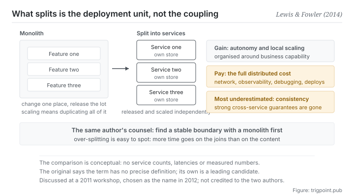

Canonical: https://trigpoint.pub/collections/software-systems-architecture/microservices-lewis-fowler-2014  
Captured: 2026-11-02T21:27:26.387026+08:00

> Public theory reading mirror. Verification and Lab case sections remain on the website.

“The finer you slice it, the more decoupled it is”: they are two different things.

# Microservices

Microservices · Lewis & Fowler (2014)

Checked against the sources ✓  
Software architecture · service boundaries  
Read first: Domain-driven design (DDD)  
Read first: Conway's law

## In three sentences

Split one application into a set of services that are released independently, and the unit of deployment and scaling gets smaller. What you buy is autonomy and local scaling. What you pay is the full cost of a distributed system. And the cost most easily underestimated is that consistency across services has stopped being free.

<strong>Figure 1</strong> · On the left the monolith: change one place and the whole package has to be released again, and scaling means duplicating all of it. On the right, after splitting: the unit of deployment and scaling becomes the service, at the cost of three things arriving at once, of which the most underestimated is the loss of consistency across services. Along the bottom is the same author's counsel from another piece: use a monolith to find a stable boundary first, then split.

## 1. What happened

The problem with a monolith is not that it is large. It is that it is <strong>coupled at the level of deployment</strong>: any small change anywhere means releasing the whole package again, and scaling means duplicating all of it even when the load falls on one feature.

The 2014 article pinned down the alternative: build a single application as <strong>a set of small services</strong>, each running in its own process and communicating through lightweight mechanisms[\[1\]](#reference-note-1). The article also lists nine common characteristics and notes that not every microservice architecture has all nine[\[1\]](#reference-note-1). This page dwells on three of them: <strong>organised around business capabilities, componentised as independently deployable services, and decentralised in both data and governance</strong>.

Organised around business capabilities buckles straight back to the previous page: service boundaries mirror team communication boundaries, so the ideal shape is one cross-functional small team owning one service entirely. That is not a coincidence; the article cites that law explicitly.

Decentralised data is the item underestimated most. Each service manages its own storage, so consistency across services <strong>stops being free</strong>: the guarantee you used to get from a single database transaction disappears, and what replaces it is eventual consistency, compensating flows and distributed debugging.

Three points of attribution need stating, and they are more tangled here than on most nodes. First, <strong>this site does not credit the term to the two authors</strong>: the article itself says it was discussed at a workshop of architects near Venice in May 2011 and settled on by the same group in May 2012, without saying who first proposed it[\[2\]](#reference-note-2).

Second, secondary accounts report a closely related coinage at an industry conference in 2005, out of a different technical line; the original source was not checked here[\[3\]](#reference-note-3).

Third, the article states that <strong>the term has no precise definition</strong>[\[4\]](#reference-note-4), so when you cite it you should say this is that article's definition, and not this is the definition of microservices.

One last thing. The same author gave a piece of counsel elsewhere that gets needed more often than the whole list of characteristics: <strong>use a monolith to find a stable boundary first, and split afterwards</strong>[\[5\]](#reference-note-5).

<strong>Attribution where due:</strong>This site credits crystallising the definition and popularising it to Lewis and Fowler (the article of 25 March 2014)[\[1\]](#reference-note-1). <strong>For the term itself, the article records only that it was discussed at a workshop in May 2011 and chosen as the name by that group in May 2012, without saying who first proposed it; this site does not credit it to the two authors</strong>[\[2\]](#reference-note-2). The earlier related coinage (2005) belongs, by secondary accounts, to a different technical line, and its original source was not checked here[\[3\]](#reference-note-3). The monolith first counsel and the three baseline capabilities belong to two other short pieces by the same author[\[5\]](#reference-note-5)[\[6\]](#reference-note-6). Four separate attributions. Compressing the line into those two proposed it in 2014 gets invention, naming and definition wrong in one go, and this site carries an explicit correction on this page.

## 2. Why this matters to you

What this page is useful for is not services. It is <strong>the timing of a split</strong>.

You will badly want to break your workflow into small pieces: one that writes outlines, one that looks things up, one that polishes, one that checks citations. Each piece is simple on its own and easy to test on its own, which sounds entirely right. What this page says is that <strong>the return on splitting depends on a set of preconditions, and without them a split is pure overhead.</strong>

What are the preconditions? Another short piece by the same author lists three: rapid provisioning, basic monitoring and rapid deployment[\[6\]](#reference-note-6). Translated to you: <strong>do you have a cheap way to connect those pieces up, to see what state they are in, and to find out which one went wrong when something breaks in the middle.</strong> If running the whole flow means moving output by hand three times, and finding a fault means walking back through each piece, the coordination cost you pay already exceeds what the split saved.

The second thing is the finer is better misreading. Small is a contrast with the monolith, not a target. The symptom of over-splitting is easy to recognise: <strong>you spend more time on the joins than on the content.</strong>

The third, and the most practical, is that piece of counsel translated directly: <strong>do not split before the boundary is clear.</strong> Get the whole thing working in one place first, until you can say which stretches are stable and which are different every time, then split along the stable seams. Do it the other way round, splitting before you have felt the boundary, and you will build interfaces in the wrong places, and those interfaces are hard to remove afterwards. That is exactly what the criterion on the first page of the third section is describing.

## Common misreadings

Page verification: Checked against the sources ✓ · Content last revised 2026-10-25

- A common retelling, microservices were proposed by those two authors: the article itself says the term was discussed at a workshop in May 2011 and settled on by that group in May 2012. This site marks the two authors as the ones who crystallised and popularised the definition. Secondary accounts report a related coinage as early as 2005, from a different technical line.
- A common retelling, small is the point and smaller is better: small is a contrast with the monolith, not an order to cut as fine as possible. The article notes that remote interfaces have to be coarser than in-process calls; the same author's other piece argues for starting with a monolith and splitting once the boundaries are stable.
- A common retelling, this is the authoritative definition of the term: the article itself says there is no precise definition, describes common characteristics only, and offers its definition as a leading candidate.

## References

<strong>How to read the source notes</strong> “Bibliographic details checked” means author, year, title and venue were confirmed. It does not mean the source's claims were checked. “Matched against the full text” means the claim was compared with the text of the source itself. Definitions as of 2026-09-20.

- \[1\] Lewis, J. & Fowler, M. (2014). Microservices: a definition of this new architectural term. martinfowler.com/articles/microservices.html. Published 25 March 2014.
- \[2\] Lewis, J. & Fowler, M. (2014). Microservices: a definition of this new architectural term. martinfowler.com/articles/microservices.html. Published 25 March 2014.
- \[3\] Editorial note, no external source; see note \[3\] in the text.
- \[4\] Lewis, J. & Fowler, M. (2014). Microservices: a definition of this new architectural term. martinfowler.com/articles/microservices.html. Published 25 March 2014.
- \[5\] Fowler, M. (2015). MonolithFirst. martinfowler.com/bliki/MonolithFirst.html. Published 3 June 2015.
- \[6\] Fowler, M. (2014). MicroservicePrerequisites. martinfowler.com/bliki/MicroservicePrerequisites.html. Published 28 August 2014.

## Knowledge graph

- [<em>Compare ▸</em>Single source of truth (concept history)](single-source-of-truth-concept-history.md)
- [<em>Applied by ▸</em>Modularity and thin crossing points](modularity-baldwin-clark-2000.md)
- [<em>Applied by ▸</em>Domain-driven design (DDD)](domain-driven-design-evans-2003.md)
- [<em>Applied by ▸</em>Conway's law](conways-law-conway-1968.md)
- [<em>Applied by ▸</em>Team topologies](team-topologies-skelton-pais-2019.md)

Cite as: Trigpoint, “Microservices”, trigpoint.pub/collections/software-systems-architecture/microservices-lewis-fowler-2014 · © Strategitect Limited. · Content last revised 2026-10-25

## Source notes

**[1]** Lewis, J. & Fowler, M. (2014-03-25). Microservices: a definition of this new architectural term. martinfowler.com/articles/microservices.html. Bibliographic details checked against the publisher's record. Claims matched against the full text. The article's definition: building a single application as a suite of small services, each running in its own process and communicating with lightweight mechanisms, often an HTTP resource API. The same article lists nine common characteristics and notes that not every microservice architecture has all of them.

**[2]** Lewis, J. & Fowler, M. (2014-03-25). Microservices: a definition of this new architectural term. martinfowler.com/articles/microservices.html. Bibliographic details checked against the publisher's record. Claims matched against the full text. History of the term, as the article tells it: it was discussed at a workshop of software architects near Venice in May 2011, and in May 2012 the same group settled on the name. The article does not say who first proposed the word; this site does not credit it to the two authors and places them as the ones who crystallised and popularised the definition.

**[3]** An earlier, related coinage: secondary accounts report that Micro-Web-Services was used to describe software components at an industry conference in 2005, out of a different technical line. The original source was not checked here.

**[4]** Lewis, J. & Fowler, M. (2014-03-25). Microservices: a definition of this new architectural term. martinfowler.com/articles/microservices.html. Bibliographic details checked against the publisher's record. Claims matched against the full text. Another of the article's own statements: there is no precise definition of this architectural style, and the article only attempts to describe common characteristics; its definition is a leading candidate, not an authoritative ruling.

**[5]** Fowler, M. (2015-06-03). MonolithFirst. martinfowler.com/bliki/MonolithFirst.html. Bibliographic details checked against the publisher's record. Claims matched against the full text. A short piece by the same author in 2015 argues that a new project should not start with microservices, and should use a monolith to find stable boundaries between services first; microservices work well only when those boundaries are stable, and pay off only for more complex systems.

**[6]** Fowler, M. (2014-08-28). MicroservicePrerequisites. martinfowler.com/bliki/MicroservicePrerequisites.html. Bibliographic details checked against the publisher's record. Claims matched against the full text. A short piece by the same author in August 2014 lists three baseline capabilities to have before adopting: rapid provisioning, basic monitoring and rapid application deployment; without these baseline competencies, the microservice style should not be considered.

---

[繁體中文](../../../zh-Hant/collections/software-systems-architecture/microservices-lewis-fowler-2014.md) · [简体中文](../../../zh-Hans/collections/software-systems-architecture/microservices-lewis-fowler-2014.md)

[Index](../../README.md) · [Original page](https://trigpoint.pub/collections/software-systems-architecture/microservices-lewis-fowler-2014) · [Citation and versions](../../../READING.md)

[Original SVG](assets/microservices-lewis-fowler-2014.svg) · Display copy adds a white background only.
