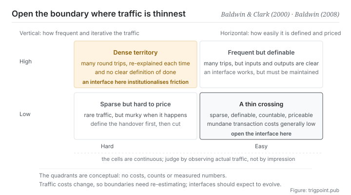

Canonical: https://trigpoint.pub/collections/software-systems-architecture/modularity-baldwin-clark-2000  
Captured: 2026-11-02T21:27:26.691282+08:00

> Public theory reading mirror. Verification and Lab case sections remain on the website.

“Cut along function and the boundary is a good one”: it is not that simple.

# Modularity and thin crossing points

Modularity & Thin Crossing Points · Baldwin & Clark (2000) / Baldwin (2008)

Bibliography checked ✓  
Software architecture · siting boundaries  
Read first: Don't repeat yourself (DRY)

## In three sentences

Where a boundary should open is settled by the cost of the traffic across it, not by which category the work falls into. The test is one sentence: can the traffic across this cut be defined, counted and priced. If it cannot, do not open an interface here.

<strong>Figure 1</strong> · Two axes decide where a boundary should open. The horizontal axis is how easily the traffic across that cut can be defined and priced; the vertical axis is how frequent and iterative that traffic is. The bottom-right cell is a thin crossing point, where an interface is cheapest to open. The top-left cell is dense territory, where forcing an interface institutionalises the friction. What lies between is continuous, not two cells.

## 1. What happened

The intuition behind modularity is old: cut a complex system into pieces, let each piece govern its own inside, and have the pieces deal with one another through agreements. The 1962 paper on near-decomposability[\[3\]](#reference-note-3) and the 1972 paper on information hiding[\[4\]](#reference-note-4) are examples this site gives of ancestors on this line.

What the 2000 book did was something else: <strong>it raised modularity from an engineering intuition to an economic theory</strong>[\[1\]](#reference-note-1). The core structure divides design information in two: visible design rules that everyone has to obey, and implementation hidden inside a module. After that division, each module becomes a real option that can be replaced independently. You can swap one piece to try something without touching the whole. So the value of modularity is not only that it is easier to maintain. It is that <strong>you can run many local experiments cheaply</strong>.

What pins the criterion down, though, is the 2008 paper. It asks a question that comes earlier: why does a boundary fall here rather than there. The answer is the cost of traffic. In a network of tasks, the places where exchanges are <strong>easy to define, easy to count and easy to pay for</strong> are where those mundane transaction costs are generally low, and module boundaries (along with firm boundaries) correspond to those thin crossing points[\[2\]](#reference-note-2). In regions where the traffic is dense, iterative and hard to price, forcing an interface into the middle institutionalises the friction.

The criterion has one very usable property: <strong>you can apply it before you start.</strong> Classification by function only becomes visible once the system exists. The cost of traffic can be observed in advance. You do not have to cut wrongly once in order to learn where the cut belongs.

<strong>Attribution where due:</strong>As conceptual ancestors, this site gives Simon (1962, near-decomposability)[\[3\]](#reference-note-3) and Parnas (1972, information hiding)[\[4\]](#reference-note-4) as examples. The economic formalisation of modularity and its option value belong to Baldwin and Clark (2000)[\[1\]](#reference-note-1). <strong>The criterion of thin crossing points and mundane transaction costs belongs to Baldwin (2008)</strong>, and the sentence at the heart of this page is taken word for word from that paper's abstract[\[2\]](#reference-note-2). Four separate attributions. Crediting the whole concept of modularity to the 2000 book erases ancestors who came thirty to forty years earlier, such as these two, and that is one of the corrections this site states explicitly on this page.

## 2. Why this matters to you

Most of the boundary decisions you make daily are cuts along which category does this belong to. This page asks you to cut along how expensive is this handover instead.

The difference shows up most clearly when handing work to a model. Suppose you want to cut a piece of work out. If the traffic across that cut is I give a definite input, it returns a definite output, and I can tell whether it is right, that is a thin crossing point, and handing it over is cheap, because the handover itself can be defined and accepted.

If the traffic is I have to explain a pile of background, we go back and forth several times, and I have no simple way to judge whether the result is right, that is dense territory. Open an interface there and you will spend most of your time maintaining the interface.

The same criterion explains a familiar frustration: why some work goes slower after it is contracted out. It is rarely that the other party is not up to it. It is that <strong>you opened the boundary in dense territory</strong>.

Three usable questions fall straight out of the criterion. First, can I state clearly what counts as finished for the output of this handover. Second, how long does accepting it take me, and does that beat doing it myself. Third, how many round trips does this line carry in a week: if the answer is many, and each one requires explaining things again, the line does not belong there.

## Common misreadings

Page verification: Bibliography checked ✓ · Content last revised 2026-10-25

- A common account says modularity was proposed by these two authors. The concept is at least thirty to forty years older (for example, near-decomposability in 1962 and information hiding in 1972). What the two contributed is the economic formalisation; the theory of where boundaries go comes from a 2008 paper by one of them. Do not cite them as the originators of the concept.
- A common account says thin and thick are two classes, so judging is classifying. The original's criteria are how dense and complex the traffic is, and how much work it takes to define, count and pay for what crosses. These are matters of degree, and a verdict needs actual observation of the traffic. Treating it as a binary leads people to sort by impression.

## References

<strong>How to read the source notes</strong> “Bibliographic details checked” means author, year, title and venue were confirmed. It does not mean the source's claims were checked. “Consistent with the abstract” means the claim agrees with the paper's abstract. It does not include sentence-by-sentence checking against the full text. “Follows secondary accounts” means the claim rests on sources that report it, not on the original document. Definitions as of 2026-09-20.

- \[1\] Baldwin, C. Y. & Clark, K. B. (2000). Design Rules, Volume 1: The Power of Modularity. MIT Press. ISBN 978-0-262-02466-2.
- \[2\] Baldwin, C. Y. (2008). Where Do Transactions Come from? Modularity, Transactions, and the Boundaries of Firms. Industrial and Corporate Change, 17(1), 155–195.
- \[3\] Simon, H. A. (1962). The Architecture of Complexity. Proceedings of the American Philosophical Society, 106(6), 467–482.
- \[4\] Parnas, D. L. (1972). On the Criteria To Be Used in Decomposing Systems into Modules. Communications of the ACM, 15(12), 1053–1058.

## Knowledge graph

- [<em>Prerequisite ▸</em>Conway's law](conways-law-conway-1968.md)
- [<em>Applied in ▸</em>Microservices](microservices-lewis-fowler-2014.md)
- [<em>Applied in ▸</em>Domain-driven design (DDD)](domain-driven-design-evans-2003.md)

Cite as: Trigpoint, “Modularity and thin crossing points”, trigpoint.pub/collections/software-systems-architecture/modularity-baldwin-clark-2000 · © Strategitect Limited. · Content last revised 2026-10-25

## Source notes

**[1]** Baldwin, C. Y. & Clark, K. B. (2000). Design Rules, Volume 1: The Power of Modularity. MIT Press. ISBN 9780262024662. Bibliographic details confirmed by two sources. The split between design rules and hidden modules and its option value follows secondary accounts that agree with one another. Raises modularity from an engineering intuition to an economic theory: visible design rules are separated from hidden modules, so the modules form a set of real options. The book's content was checked here only through several agreeing secondary accounts.

**[2]** Baldwin, C. Y. (2008). Where Do Transactions Come from? Modularity, Transactions, and the Boundaries of Firms. Industrial and Corporate Change, 17(1), 155–195. Bibliographic details checked against the official record. Consistent with the abstract. From the abstract, verbatim: “The costs of this work (labeled mundane transaction costs) are generally low at the thin crossing points of the task network, which correspond to module boundaries.”

**[3]** Simon, H. A. (1962). The Architecture of Complexity. Proceedings of the American Philosophical Society, 106(6), 467–482. Bibliographic details confirmed by two sources. The attribution of near-decomposability follows secondary accounts that agree with one another. Near-decomposability: marked by this site as one conceptual ancestor, about forty years earlier than this node's anchor.

**[4]** Parnas, D. L. (1972). On the Criteria To Be Used in Decomposing Systems into Modules. Communications of the ACM, 15(12), 1053–1058. Bibliographic details checked against the official record. The attribution of information hiding follows secondary accounts that agree with one another. Information hiding: marked by this site as another conceptual ancestor.

---

[繁體中文](../../../zh-Hant/collections/software-systems-architecture/modularity-baldwin-clark-2000.md) · [简体中文](../../../zh-Hans/collections/software-systems-architecture/modularity-baldwin-clark-2000.md)

[Index](../../README.md) · [Original page](https://trigpoint.pub/collections/software-systems-architecture/modularity-baldwin-clark-2000) · [Citation and versions](../../../READING.md)

[Original SVG](assets/modularity-baldwin-clark-2000.svg) · Display copy adds a white background only.
