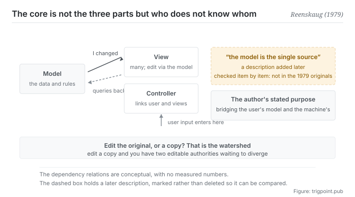

Canonical: https://trigpoint.pub/collections/software-systems-architecture/mvc-reenskaug-1979  
Captured: 2026-11-02T21:27:27.022711+08:00

> Public theory reading mirror. Verification and Lab case sections remain on the website.

“The point of it is to give the data a single source of truth”: that is a misreading.

# Model-view-controller (MVC)

Model-View-Controller (MVC) · Reenskaug (1979)

Checked against the sources ✓  
Software architecture · separation of concerns  
Read first: Single source of truth (concept history)

## In three sentences

Separate the data from the display, so that one body of data can have several presentations that stay in step. The model holds nothing about how it will be shown on screen, and dependency runs in one direction only; that is what the structure turns on. As for the model being the single source of truth: checking confirms that sentence is not in the original.

<strong>Figure 1</strong> · The direction of dependency between the three. The model need not know who is looking at it; a change travels outward as a notification (the author's 2003 handout writes this layer up as the pattern's own solution, with the Smalltalk-80 class library as one example), and the viewing end goes back and queries for itself. When a view wants a change, that too is sent back to the model to be made there. A dashed line on the right marks something added later: calling the model the single source of truth, a description that item-by-item checking confirmed is not in the 1979 originals.

## 1. What happened

Between 1978 and 1979 a visiting researcher at Xerox PARC was working on a problem[\[5\]](#reference-note-5): users needed to see several presentations of the same body of data at once (a diagram, a table, an input field), and those presentations had to stay in step.

His answer was to separate the data itself from its presentation. The May 1979 memo states that the model contains no information about how the information may be shown on the screen[\[1\]](#reference-note-1); a view, for its part, asks the model questions to get the data it presents[\[2\]](#reference-note-2). The author's 2003 handout writes the synchronisation up as a pattern: a view registers with the model as a dependent, <strong>and the model notifies its dependents whenever it changes, without needing to know what kind of view they are</strong>; the view then goes back and queries for what it needs[\[3\]](#reference-note-3). The handout gives two implementations: the change notification in the Smalltalk-80 class library, and the author's own OOram tool, which accumulates changes and then notifies the views once[\[3\]](#reference-note-3). Whether this notification mechanism already appears in the two 1979 memos has not been checked here. That one-directional dependency yields a property: however many presentations there are, and however many get added later, the integrity of the data end is untouched.

The naming has a small history. The May 1979 memo used four words, the last of which was editor, and the first of which referred to something of interest to the user[\[1\]](#reference-note-1). The December memo of the same year switched to today's three[\[2\]](#reference-note-2), which by the author's own account were settled after long discussions with another researcher[\[5\]](#reference-note-5).

The author wrote a retrospective in 2003 that gives the top-level goal as supporting the user's mental model of the relevant information and enabling the user to inspect and edit it[\[3\]](#reference-note-3). On his own MVC page he puts it more directly: the essential purpose is to <strong>bridge the gap between the user's mental model and the digital model in the computer</strong>, starting from the problem of users controlling a large and complex body of data[\[5\]](#reference-note-5). That retrospective is a self-published handout draft written for industry conferences rather than a peer-reviewed paper, and this site marks it as such.

The most important thing on this page, though, is a <strong>disconfirmation</strong>. The sentence the model is the single source of truth was checked item by item during depth review and found <strong>not</strong> to be in either 1979 memo, nor in the 2003 retrospective[\[4\]](#reference-note-4). It is a frame the community attached later. What the original was concerned with is the user's control, not the authority of the data.

The two are not in conflict (separating data from presentation does make the data end more like an authoritative place), but <strong>a later reading cannot be treated as the original claim</strong>. That is exactly why this site closes the first section with it: a separation that has entered every textbook, whose most widely circulated one-line explanation turns out on checking to have been added by other people.

<strong>Attribution where due:</strong>The concept and the naming belong to Reenskaug (the two Xerox PARC technical notes of May and December 1979)[\[1\]](#reference-note-1)[\[2\]](#reference-note-2), and of the two memos, today's three-word name first appears in the December one, by the author's own account the result of discussion with another researcher[\[2\]](#reference-note-2)[\[5\]](#reference-note-5). The author's own retrospective comes from the self-published handout draft of 2003[\[3\]](#reference-note-3), and the statement of purpose is also on his MVC page[\[5\]](#reference-note-5). <strong>The model is the single source of truth does not belong to the author</strong>: item-by-item checking confirms it is not in the original, and assigns it to later community reading[\[4\]](#reference-note-4). This is one of the entries where this site carries an explicit correction, and the attribution and the sentence go down separately.

## 2. Why this matters to you

This page has two uses, and the second is worth more than the first.

The first is the structure itself. Your workflow almost certainly holds several presentations of the same thing: a spec and its slide version, a list and its board view, a raw record and its monthly summary. The design question here is not whether to have several presentations (you should), but <strong>whether a presentation edits the original or a copy of its own</strong>. If it edits a copy, you now hold two editable authorities, and the rest is just waiting for them to diverge. The original design's answer: a view may ask for a change, but the change is sent as a message back to the model and made there, in the model's own terms[\[2\]](#reference-note-2); if a view keeps some of the data at hand, that is only a copy kept for faster display[\[1\]](#reference-note-1). There is one authority.

The second use is the thing this page demonstrates about itself: <strong>a sentence being widely believed and a sentence being in the original are two different things.</strong> Most of the architecture vocabulary you quote today has passed through one or several layers of community retelling. The retelling is usually more usable, because it files the concept closer to a contemporary problem. But the moment you need to trace back (why was it designed this way, what problem was this actually solving), you have to know whether what you hold is the original words or a retelling.

In practice this page leaves you a habit, and it applies more often than you would expect: <strong>when you quote the purpose of a framework, ask in passing who said that purpose.</strong> If you cannot answer, that sentence was quite possibly added later. It is not necessarily wrong, and it cannot be used as the author's intent in an argument.

## Common misreadings

Page verification: Checked against the sources ✓ · Content last revised 2026-10-25

- A common account says the point of the separation is to make the model the single source of truth. Checked item by item, that sentence is not in the two 1979 memos, nor in the author's own 2003 retrospective. The author gives the essential purpose as bridging the gap between the user's mental model and the digital model in the computer, starting from the problem of users controlling a large and complex body of data. The frame was attached later by the community, and this site corrects it in three places at once: the body, the abstract and here.
- A common account says the controller holds the application logic. The December 1979 memo describes it as the link between the user and the system: it arranges the views and translates the user's commands into messages for them, and it should never supplement the views. Concentrating application logic in the controller is what many later web frameworks did; the author has also said the problem has more facets than he realised in 1979. The two need to be told apart.
- A common account says it was already called model-view-controller in 1979. The May 1979 memo used four words, the last of which was editor; today's three-word name appears in the December memo of the same year, changed after a discussion with another researcher.

## References

<strong>How to read the source notes</strong> “Bibliographic details checked” means author, year, title and venue were confirmed. It does not mean the source's claims were checked. “Matched against the full text” means the claim was compared with the text of the source itself. “Checked against the primary site” means the claim was compared with the project's own website. Definitions as of 2026-09-20.

- \[1\] Reenskaug, T. (1979). Thing-Model-View-Editor — an Example from a planningsystem. Xerox PARC Technical Note, May 12, 1979.
- \[2\] Reenskaug, T. (1979). Models — Views — Controllers. Xerox PARC Technical Note, December 10, 1979.
- \[3\] Reenskaug, T. (2003). The Model-View-Controller (MVC): Its Past and Present. JavaZone / JAOO 2003 handout (self-published draft).
- \[4\] Editorial note with no external source; the full text is in note \[4\] of the body.
- \[5\] Reenskaug, T. (n.d.). MVC: Xerox PARC 1978-79. Author's web page, University of Oslo.

## Knowledge graph

- [<em>Compare ▸</em>Hexagonal architecture (ports and adapters)](hexagonal-architecture-cockburn-2005.md)

Cite as: Trigpoint, “Model-view-controller (MVC)”, trigpoint.pub/collections/software-systems-architecture/mvc-reenskaug-1979 · © Strategitect Limited. · Content last revised 2026-10-25

## Source notes

**[1]** Reenskaug, T. (1979, May 12). Thing-Model-View-Editor: An Example from a Planningsystem. Technical note, Xerox PARC. Bibliographic details confirmed by two sources. Claims matched against the full text. The earlier naming of the two original memos, four words in order: thing, model, view, editor. The first word means something of interest to the user, which can be concrete or an abstract idea. The memo also states that the model contains no information about how the information may be shown on the screen.

**[2]** Reenskaug, T. (1979, December 10). Models - Views - Controllers. Technical note, Xerox PARC. Bibliographic details confirmed by two sources. Claims matched against the full text. Of the two original memos, this is where today's three-word naming first appears. A view gets the data it presents by asking the model questions, and may also send the model messages to update it; the controller is the link between the user and the system.

**[3]** Reenskaug, T. (2003). The Model-View-Controller (MVC): Its Past and Present. Handout, JavaZone (Oslo) and JAOO (Aarhus), September 2003. Draft of August 20, 2003. Bibliographic details confirmed by two sources. Claims matched against the full text. A self-published handout draft for two industry conferences, not peer reviewed. Its abstract gives the top-level goal as supporting the user's mental model of the relevant information and enabling the user to inspect and edit it. The handout writes up the arrangement in which a view registers as a dependent of the model and is notified whenever the model changes as the solution of a pattern (synchronising model and view), giving the Smalltalk-80 class library and the author's OOram tool as two examples.

**[4]** The description of the model as the single source of truth was checked against the two 1979 memos and the 2003 handout, and appears in none of the three; it was added later by others.

**[5]** Reenskaug, T. (n.d.). MVC: Xerox PARC 1978-79. Author's web page, University of Oslo. The visiting period, the naming history and the statement of purpose checked against the primary site. The author's own MVC page.

---

[繁體中文](../../../zh-Hant/collections/software-systems-architecture/mvc-reenskaug-1979.md) · [简体中文](../../../zh-Hans/collections/software-systems-architecture/mvc-reenskaug-1979.md)

[Index](../../README.md) · [Original page](https://trigpoint.pub/collections/software-systems-architecture/mvc-reenskaug-1979) · [Citation and versions](../../../READING.md)

[Original SVG](assets/mvc-reenskaug-1979.svg) · Display copy adds a white background only.
