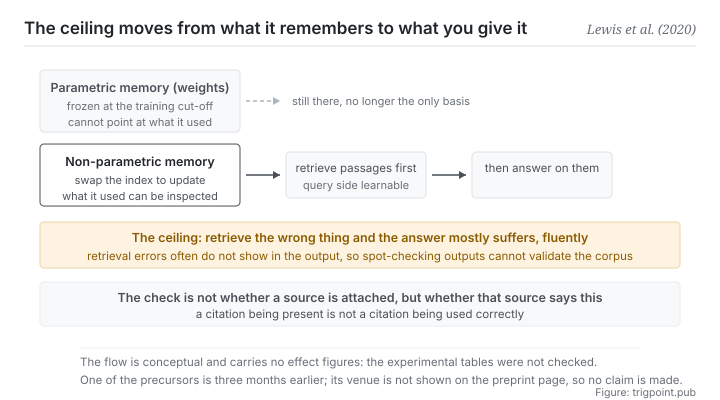

Canonical: https://trigpoint.pub/collections/software-systems-architecture/retrieval-augmented-generation-lewis-2020  
Captured: 2026-11-02T21:27:27.424704+08:00

> Public theory reading mirror. Verification and Lab case sections remain on the website.

On one question set, with the answer in no retrieved passage, just over one in ten was still answered right.

# Retrieval-augmented generation (RAG)

Retrieval-Augmented Generation (RAG) · Lewis et al. (2020)

Abstracts checked ✓  
Machine learning · external evidence  
Read first: Single source of truth (concept history)

## In three sentences

Split the model's memory in two: what is pressed into the weights, and what is fetched at the moment of generating. Knowledge can then be updated and the retrieved evidence can be inspected, and the surface available to hallucination narrows. But the ceiling on quality moves along with it, from how much the model remembers to how good your retrieval corpus is.

<strong>Figure 1</strong> · Memory split into two layers: the layer pressed into the weights, which cannot be updated and cannot point at what it relied on, and the layer hanging outside, which can be swapped and can be inspected. The layer in the weights is still there, but it is no longer the only basis for an answer. Generation retrieves first and answers second. The band below marks where the ceiling now sits: quality is capped no longer by how much the model remembers, but by how good the retrieval corpus is and how accurate the retriever is.

## 1. What happened

On one open-domain question-answering set the paper reports, a little over one answer in ten was still right even when none of the retrieved passages contained it. A purely parametric generative model seals knowledge inside its weights, and that brings three structural weaknesses: knowledge goes <strong>out of date</strong> (frozen at the training cut-off), it is <strong>untraceable</strong> (there is no way to point at what an answer rested on), and the model still <strong>generates with high confidence outside its distribution</strong>.

What the 2020 paper does is split memory into two layers: alongside parametric memory (the weights) it hangs a layer of <strong>non-parametric memory</strong>, an external corpus of text retrieved at the moment of generating[\[1\]](#reference-note-1). The flow is retrieve, then answer: turn the question into a retrieval, fetch some passages, and have generation condition on them. In the original design the retriever and the generator are trained together: the document side, its encoder and its index, stays fixed, while the question encoder and the generator are fine-tuned together. So part of the retrieval step is learnable rather than merely bolted on.

Each of the three weaknesses gets a treatment: updating knowledge becomes swapping an index rather than retraining, the retrieved passages can be pulled out and inspected (the paper lists marking provenance as an open problem of purely parametric models, as the reason for adding an external memory; the original model does not output citations), and the distribution of what is generated is narrowed by outside evidence.

The ceiling needs stating clearly, though[\[4\]](#reference-note-4): <strong>if the retrieval layer is weak, generation will mostly be dragged down with it.</strong> Not inevitably wrong: the paper reports that on one open-domain question-answering set a little over one answer in ten was still right when the answer was in none of the retrieved passages, because the layer in the weights fills in. So the cap on quality moves from how much the model remembers to how good the corpus is and how accurate the retriever is. This does not abolish the knowledge problem. It externalises it, and the benefit of externalising is that the problem becomes <strong>governable</strong> (you can inspect it, update it, scope it), not that it goes away.

Two points of attribution. This paper names its approach retrieval-augmented generation and is generally taken as the source of the term, and <strong>one of the precursors</strong> is a paper from February 2020, three months earlier, that put retrieval augmentation at the pre-training stage[\[3\]](#reference-note-3). This paper's own introduction lists it alongside a 2019 retrieval-based question-answering model, calling the two recently introduced models that combine masked language models with a differentiable retriever[\[1\]](#reference-note-1).

Separately, this site marks the conference acceptance of this paper as <strong>secondary</strong>: that information comes from a note the preprint page makes about itself rather than from the conference's official record[\[2\]](#reference-note-2). And the February paper's conference acceptance <strong>is not displayed on its preprint page, so this site does not claim it</strong>[\[3\]](#reference-note-3). Those two decisions look fussy, and they are exactly this site's method: say what can be checked, and no more.

<strong>Attribution where due:</strong>The architecture and its name belong to Lewis and eleven co-authors (2020, first version of the preprint on 22 May; generally taken as the source of the term)[\[1\]](#reference-note-1). <strong>One of the precursors is the February 2020 paper that put retrieval augmentation at the pre-training stage</strong>, three months earlier[\[3\]](#reference-note-3); the same introduction also lists a 2019 retrieval-based question-answering model[\[1\]](#reference-note-1). The marking of conference acceptance is secondary, and the February paper's conference acceptance is not claimed by this site[\[2\]](#reference-note-2)[\[3\]](#reference-note-3). Three separate attributions.

## 2. Why this matters to you

You are probably using this pattern already, in its weakest form.

Handing files to a model and having it read them before answering is the manual version of retrieval augmentation. It works, and how well it works depends entirely on what you handed over. This page asks you to move your attention from how to ask to <strong>what to give it</strong>, because the second is where the ceiling is.

Three things transfer directly.

<strong>First, build the layer you trust before worrying about phrasing.</strong> Most people put their effort into adjusting how they ask, and what phrasing improves is expression rather than grounds. If what you want answered depends on a particular body of facts, those facts have to exist first, be organised, and be known by you to be right.

<strong>Second, a citation being present is not the same as a citation being used correctly.</strong> That is the most usable sentence on this page. A model can attach a source that genuinely exists and in the same breath say something that source does not say. The checking action is not is there a source attached. It is <strong>does that source say this sentence</strong>. That connects straight to the last page of this shelf.

<strong>Third, this approach adds little on tasks that need no external knowledge</strong>[\[4\]](#reference-note-4). Pure reasoning, rewriting for style, restructuring: attaching retrieval does not necessarily help, and it can drag in irrelevant material. The test is simple. When this task comes out wrong, is it because the model did not know something, or because it thought about it wrongly. Retrieval helps with the first and not the second.

## Common misreadings

Page verification: Abstracts checked ✓ · Page version v2 · Content last revised 2026-10-25

- A common account says that once retrieval is attached there will be no hallucination. If retrieval goes wrong, generation will mostly be dragged down with it, and it will answer fluently. The approach externalises the knowledge problem rather than eliminating it, and a good part of the bottleneck on quality moves to the retrieval corpus and the retriever.
- A common account says that having a citation means having grounds. A citation being present is not the same as a citation being used correctly. An answer can attach a genuine source and in the same breath say something that source does not say.

## Corrections

- This site marks the conference acceptance of this paper as secondary: the information comes from a note the preprint page makes about itself, not from the conference's official record. The conference acceptance of one of the precursors (the February 2020 paper) is not displayed on its preprint page, and this site does not claim it.
- 2026-10-12 · An earlier version of this page went beyond the paper in three places, and all three have been corrected against the full text. First, it said that when retrieval goes wrong generation answers along with the error; the paper reports in §4.1 that 11.8% of answers were still right when the answer was in none of the retrieved documents, so this now reads mostly dragged down. Second, it said an answer can carry its sources; the original model does not output citations, and the paper says the retrieved knowledge can be inspected, so this now reads that retrieved passages can be inspected. Third, it said the retriever and the generator are fine-tuned together; in the original design the document encoder and the index stay fixed, and only the question side and the generator are fine-tuned. Separately, adds little and can subtract on tasks that need no outside knowledge now cites a preliminary observation in the paper's appendix, and can subtract has been removed.

## References

<strong>How to read the source notes</strong> “Bibliographic details checked” means author, year, title and venue were confirmed. It does not mean the source's claims were checked. “Consistent with the abstract” means the claim agrees with the paper's abstract. It does not include sentence-by-sentence checking against the full text. “Matched against the full text” means the claim was compared with the text of the source itself. Definitions as of 2026-09-20.

- \[1\] Lewis, P. et al. (2020). Retrieval-Augmented Generation for Knowledge-Intensive NLP Tasks. arXiv:2005.11401.
- \[2\] Lewis, P. et al. (2020). Retrieval-Augmented Generation for Knowledge-Intensive NLP Tasks. arXiv:2005.11401.
- \[3\] Guu, K., Lee, K., Tung, Z., Pasupat, P., & Chang, M.-W. (2020). REALM: Retrieval-Augmented Language Model Pre-Training. arXiv:2002.08909.
- \[4\] Editorial note, no external source; see note \[4\] in the text.

## Knowledge graph

- [<em>Applied in ▸</em>Hallucination in NLG](llm-hallucination-ji-2023.md)

Cite as: Trigpoint, “Retrieval-augmented generation (RAG)”, trigpoint.pub/collections/software-systems-architecture/retrieval-augmented-generation-lewis-2020 · © Strategitect Limited. · Content last revised 2026-10-25

## Source notes

**[1]** Lewis, P., Perez, E., Piktus, A., Petroni, F., Karpukhin, V., Goyal, N., Küttler, H., Lewis, M., Yih, W., Rocktäschel, T., Riedel, S., & Kiela, D. (2020). Retrieval-Augmented Generation for Knowledge-Intensive NLP Tasks. arXiv:2005.11401. Bibliographic details checked against the official record. Claims matched against the full text. First version of the preprint 2020-05-22, twelve authors. The abstract describes the approach as combining parametric and non-parametric memory for language generation; it lists providing provenance for decisions as an open problem of purely parametric models, as the reason for adding an external memory. In the original design the retriever and the generator are trained together, but the document encoder and the index stay fixed, and only the query side and the generator are fine-tuned (the paper's §2.4).

**[2]** On the conference acceptance: the preprint page states that the paper was accepted at a leading machine learning conference in 2020. This site marks that as secondary: it is a note on the preprint page, not the conference's official record.

**[3]** Guu, K., Lee, K., Tung, Z., Pasupat, P., & Chang, M.-W. (2020). REALM: Retrieval-Augmented Language Model Pre-Training. arXiv:2002.08909. Bibliographic details checked against the official record. Consistent with the abstract. One of the precursors: first version of the preprint 2020-02-10, putting retrieval augmentation at the pre-training stage, about three months before the paper this page is about. The introduction of the paper this page is about lists it alongside a 2019 retrieval-based question-answering model, so this site does not mark it as the only precursor. Its conference acceptance is not displayed on its preprint page, and this site deliberately does not claim it.

**[4]** Boundaries: that generation is mostly dragged down when retrieval goes wrong is an inference, not a conclusion of the paper; the paper's §4.1 also reports that on one open-domain question-answering set 11.8% of answers were still right when the answer was in none of the retrieved documents, with parametric memory filling in. That a citation being present is not a citation being used correctly is likewise an inference (the original model does not output citations). That gains are limited on tasks needing no outside knowledge comes from a preliminary observation in the paper's Appendix H, and the paper's account of why is conjecture.

---

[繁體中文](../../../zh-Hant/collections/software-systems-architecture/retrieval-augmented-generation-lewis-2020.md) · [简体中文](../../../zh-Hans/collections/software-systems-architecture/retrieval-augmented-generation-lewis-2020.md)

[Index](../../README.md) · [Original page](https://trigpoint.pub/collections/software-systems-architecture/retrieval-augmented-generation-lewis-2020) · [Citation and versions](../../../READING.md)

[Original SVG](assets/retrieval-augmented-generation-lewis-2020.svg) · Display copy adds a white background only.
