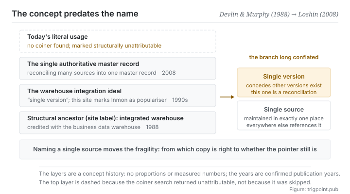

Canonical: https://trigpoint.pub/collections/software-systems-architecture/single-source-of-truth-concept-history  
Captured: 2026-11-02T21:27:27.720968+08:00

> Public theory reading mirror. Verification and Lab case sections remain on the website.

“Single version of the truth” concedes other versions exist; “only one place” does not.

# Single source of truth (concept history)

Single Source of Truth (concept history) · Devlin & Murphy (1988) → Loshin (2008)

Bibliography checked ✓  
Lab case ✓  
Software architecture · data governance  
Read first: Don't repeat yourself (DRY)

## In three sentences

A single source of truth says that every element is maintained in one place and everywhere else refers to it. It is a choice of structure rather than a choice of location. And the place it fails most easily is not that single source. It is the references pointing at it.

<strong>Figure 1</strong> · Four layers of concept history, read from the bottom up. The integrated warehouse of 1988 is the structural ancestor this site marks. Above it sits the warehouse ideal that concedes other versions exist elsewhere. Above that, the engineering practice of reconciling many sources into one authoritative master record. At the top, today's literal usage. The branch that matters is marked on the right: conceding that other versions exist elsewhere, and there genuinely being only one place, are not the same thing.

## 1. What happened

Two things are often taken as one when people speak of a single source of truth: keeping one reconciled, authoritative version, and maintaining something in one place only. The history of this concept is much longer than its name, and the name is much later than the concept.

What this site takes as the traceable engineering ancestor is a 1988 journal article, generally credited with proposing the architecture of a business data warehouse[\[1\]](#reference-note-1): pull operational data scattered across many systems into one warehouse, so that which copy is right becomes a question with an answer. What that paper solved was data consistency for decision support.

The next stretch is the one that gets told wrong most often. By the 1990s the phrase single version of the truth was already going around the data-warehousing industry. It is commonly associated with Inmon's corporate information factory writing, but it appears in neither the indexes nor the tables of contents of Inmon's or Kimball's original books on data warehousing[\[2\]](#reference-note-2). Note the word version. It concedes something: the operational systems hold other versions, and the warehouse is merely the one reconciled out of them. That differs in meaning from there genuinely being only one place, and the two have been used interchangeably for a long time.

A 2008 book on master data management is one of the representative works that set out reconciling into one authoritative master record as an engineering practice[\[3\]](#reference-note-3). As for single version of the truth as a book title, a different book, on customer data integration, already carried it in 2006[\[4\]](#reference-note-4).

And today's literal term, in the sense software architecture uses it, <strong>has no single coiner</strong>[\[5\]](#reference-note-5). It is a usage the community generalised into being: widely used, with no agreed point of origin. This site therefore marks it structurally unattributable rather than forcing a name onto it.

The shape the concept settled into across that history is this. Nominate one place as the sole point of maintenance, have every other position refer to it rather than copy it, and normalise the data to one standard form, so that which copy is right stops being a question anyone has to ask. Its opposite is not there are two copies. Its opposite is there are two copies and both can be edited.

One last thing belongs in this section: the principle has an explicit opponent. The 2022 book on data mesh gives a whole section of chapter 2 to the argument that you should not expect a single source of truth[\[6\]](#reference-note-6), and the reason has to do with scale. This shelf puts that page last so that it can turn round and argue with this one.

<strong>Attribution where due:</strong>This site credits the structural ancestor to Devlin and Murphy (1988, journal article)[\[1\]](#reference-note-1). Single version of the truth was already in circulation in the data-warehousing industry of the 1990s and is commonly associated with Inmon, but it appears in neither the indexes nor the tables of contents of his or Kimball's original books on data warehousing[\[2\]](#reference-note-2), so this site marks him as its populariser and not its coiner. For that phrase as a book title, see Dyché and Levy (2006)[\[4\]](#reference-note-4). For a representative work that sets out reconciliation into one master record as engineering practice, see Loshin (2008)[\[3\]](#reference-note-3). The coiner of today's literal term <strong>cannot be attributed</strong>, and this site marks it structurally unavailable[\[5\]](#reference-note-5). Four separate attributions. Compress the whole line into someone proposed the single source of truth in some year and you get the term, the person and the date wrong in one go.

## 2. Why this matters to you

You almost certainly have a which version is current problem already. It just goes by another name.

Where is the current version of a criterion? If the answer is in my head, and the other three places hold stale copies, you are maintaining four of them. What the principle asks is that you turn those three into links, not that you delete them. The difference matters: deleting invites someone to transcribe it again, linking makes them jump across.

What this page really wants you to leave with, though, is not that. It is the <strong>shape of the failure</strong>. Once you nominate a single source, the fragile point in the system <strong>moves</strong>: from which copy is right, to whether the line pointing across is still correct. And that second failure is silent, because the line looks like it is still there.

With a model in the loop this amplifies quickly. You nominate a spec as authoritative, then write see the spec in ten places. Six months later the spec has been renamed, or moved, or one of its sections has been split into another document. Those ten references raise no error. They simply point at something that no longer says the same thing. And a model reading them will very obligingly do what it finds there.

So the practice this page offers is two questions. First: where is the sole maintenance point for this element, and can you say it out loud. Second: <strong>those lines pointing across, when were they last checked.</strong> The second is harder to answer than the first, and it matters more.

## Common misreadings

Page verification: Bibliography checked ✓ · Content last revised 2026-10-25

- A common account says the single source of truth was put forward by the 1992 data-warehousing classic. There is no evidence that the book uses the literal term; one industry article notes that even the closer phrase, single version of the truth, appears in neither its index nor its table of contents. Single version of the truth also means something different: it concedes that other versions exist elsewhere. Today's literal term has no single coiner, while single version of the truth was already the title of a 2006 book on customer data integration. Which term, and whom to credit, are two separate questions.
- A common account says that achieving a single source of truth means centralising the data into one database. The principle is that each element has one designated place of maintenance and is referenced everywhere else. That is a decision about structure, not about topology, and a distributed, synchronised system can satisfy it just as well.

## References

<strong>How to read the source notes</strong> “Bibliographic details checked” means author, year, title and venue were confirmed. It does not mean the source's claims were checked. “Matched against the full text” means the claim was compared with the text of the source itself. Definitions as of 2026-09-20.

- \[1\] Devlin, B. A. & Murphy, P. T. (1988). An architecture for a business and information system. IBM Systems Journal, 27(1), 60–80.
- \[2\] Smith, S. J. (2018, June 5). Single Version of the Truth - Not Optional. Eckerson Group.
- \[3\] Loshin, D. (2008). Master Data Management. Morgan Kaufmann / OMG Press. ISBN 978-0-12-374225-4.
- \[4\] Dyché, J. & Levy, E. (2006). Customer Data Integration: Reaching a Single Version of the Truth. Wiley. ISBN 978-0-471-91697-0.
- \[5\] Editorial note with no external source; the full text is in note \[5\] of the body.
- \[6\] Dehghani, Z. (2022). Data Mesh: Delivering Data-Driven Value at Scale. O'Reilly. Chapter 2.

## Knowledge graph

- [<em>Compare ▸</em>Microservices](microservices-lewis-fowler-2014.md)
- [<em>Compare ▸</em>CAP theorem](cap-theorem-brewer-2000.md)
- [<em>Compare ▸</em>Data mesh](data-mesh-dehghani-2022.md)

Cite as: Trigpoint, “Single source of truth (concept history)”, trigpoint.pub/collections/software-systems-architecture/single-source-of-truth-concept-history · © Strategitect Limited. · Content last revised 2026-10-25

## Source notes

**[1]** Devlin, B. A. & Murphy, P. T. (1988). An architecture for a business and information system. IBM Systems Journal, 27(1), 60–80. DOI 10.1147/sj.271.0060. Bibliographic details checked against the official record. This paper is generally credited with proposing the architecture of a business data warehouse: pulling scattered operational data into a single warehouse. This site takes it as the traceable engineering ancestor of the concept.

**[2]** Smith, S. J. (2018, June 5). Single Version of the Truth - Not Optional. Eckerson Group. Claims matched against the full text. The author recalls meeting the idea of the single version of the truth in the business intelligence industry around 1995, and notes that it is not mentioned in the indexes or tables of contents of Kimball's or Inmon's original books on data warehousing. The phrase is commonly associated with Inmon's corporate information factory writing; this site marks Inmon as a populariser, not the coiner. That label is this site's own; the article says nothing about who coined or popularised the phrase.

**[3]** Loshin, D. (2008). Master Data Management. Morgan Kaufmann / OMG Press. ISBN 978-0-12-374225-4. Bibliographic details checked against the official record. One of the representative works that set out reconciling many sources into one authoritative master record as engineering practice.

**[4]** Dyché, J. & Levy, E. (2006). Customer Data Integration: Reaching a Single Version of the Truth. Wiley. Bibliographic details checked against the official record. The phrase appears here as a book title, not in Loshin.

**[5]** For the literal term, in the sense software architecture uses it, this site found no single coiner and marks it unattributable: widely used, with no agreed point of origin.

**[6]** Dehghani, Z. (2022). Data Mesh: Delivering Data-Driven Value at Scale. O'Reilly. Bibliographic details checked against the official record. Chapter 2, on the principle of domain ownership, has a section titled Embrace the Most Relevant Domain Data: Don't Expect a Single Source of Truth. See this site's data mesh page.

---

[繁體中文](../../../zh-Hant/collections/software-systems-architecture/single-source-of-truth-concept-history.md) · [简体中文](../../../zh-Hans/collections/software-systems-architecture/single-source-of-truth-concept-history.md)

[Index](../../README.md) · [Original page](https://trigpoint.pub/collections/software-systems-architecture/single-source-of-truth-concept-history) · [Citation and versions](../../../READING.md)

[Original SVG](assets/single-source-of-truth-concept-history.svg) · Display copy adds a white background only.
